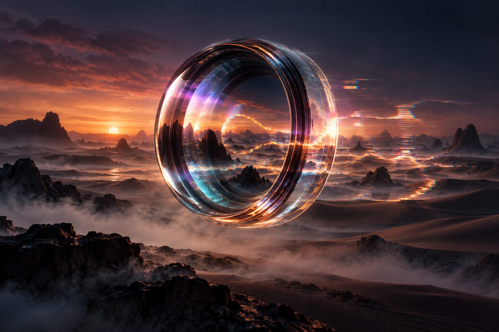

<p align="center">
  
</p>

# mirage

     

Real-time Metal shader effects for your webcam, served to Zoom, Meet, OBS — any app — as a
virtual camera. The lens experience Snap Camera left behind when it shut down, rebuilt for
macOS, with effects you can write, drop in, and share without rebuilding the app.

> **Pre-alpha.** The architecture is settled (see `docs/ARCHITECTURE.md`); the code is not here
> yet. The first milestone is a pass-through frame reaching Zoom through the Camera Extension.

## How it works

```text
webcam ──▶ mirage (host app) ──▶ Metal effect (.lens, compiled at runtime) ──▶ Camera Extension ──▶ Zoom / Meet / OBS
```

- **Effects are `.lens` packages**: a `manifest.json` (name, parameters, inputs) plus an
  `effect.metal` written in the Metal Shading Language, compiled on the fly with
  `MTLDevice.makeLibrary(source:)`. Drop a package into the effects folder and it appears in the
  menu bar; edit the shader and it hot-reloads.
- **The virtual camera is a CoreMediaIO Camera Extension** (the only mechanism macOS 14+ still
  allows), so it works in every app that lists cameras.
- **Untrusted shaders can't take the app down**: each effect runs in its own command buffer;
  a hang or fault falls back to pass-through, and an effect that keeps failing is disabled
  automatically.

## Requirements

- macOS 14 or later, Apple silicon
- The app must live in `/Applications` and the Camera Extension must be approved once in
  System Settings → Privacy & Security

## Development

```sh
make test              # deterministic suite, no GPU or camera required
make test-gpu          # Metal smoke tests (local, needs a GPU)
make lint && make check
swift run dev-harness  # camera → effects → preview window, no extension needed
```

Architecture, module map and the physical-abstraction table: [`docs/ARCHITECTURE.md`](docs/ARCHITECTURE.md).
Conventions for contributors and AI agents: [`AGENTS.md`](AGENTS.md), [`.claude/`](.claude/).

## Roadmap

| Stage | Goal |
|---|---|
| M0 | Pass-through frame visible in Zoom via the real Camera Extension |
| MVP-A | One bundled effect end to end |
| MVP-B | Runtime `.lens` loading, hot reload, menu switching |
| MVP-C | Parameter UI generated from the manifest |
| MVP-D | Pass-through on failure, auto-disable |
| Later | Face landmarks / person segmentation inputs, GLSL (Shadertoy) import, URL/Git import, gallery |

## License

[MIT](LICENSE)
