# Architecture

macOS menu-bar app: webcam → real-time Metal shader effects → virtual camera. Clean Architecture in the lyra style, with SwiftPM targets enforcing layer boundaries at compile time and every physical element behind a port so the test suite is deterministic.

> This is the canonical architecture reference. `.claude/CLAUDE.md` keeps a short summary and points here; the **enforceable** boundaries live in `.claude/rules/architecture-boundaries.md` and `.claude/rules/physical-abstraction.md`.

## Architecture Decision Record

**Context.** The product replaces the discontinued Snap Camera on macOS: webcam frames are processed by GPU shaders and served to any video-calling app as a virtual camera. Effects must be loadable at runtime from community-authored `.lens` packages (MSL source compiled with `MTLDevice.makeLibrary(source:)`), so untrusted GPU code is a first-class input. The only sanctioned virtual-camera mechanism is a CoreMediaIO Camera Extension (macOS 12.3+; DAL plug-ins were disabled in 14.1), which runs sandboxed in a second process, so a host → extension IPC is unavoidable. The author's lyra codebase proved a pattern — one SwiftPM target per layer slice, swift-dependencies DI, every OS boundary a port, a shared TestSupport with event-driven waiting — that keeps a large module graph testable without flaky tests; the sibling decoy project proved the CMIO/System Extension/Mach-port plumbing. Solo developer, rich domain (frame pipeline, effect lifecycle, GPU failure policy, IPC), AI-assisted development that relies on tests as the specification.

**Decision.** Clean Architecture with the lyra layer vocabulary (Entity → Domain → UseCase → Repository → DataSource/DataStore → Gateway, plus Interactor → Presenter → View/Router lanes for the GUI). swift-dependencies for DI with one wiring target per process. All physical elements (camera, GPU, compiler, IOSurface, Mach, System Extension, CMIO stream, files, watch, clocks, host time, randomness, defaults, logging, display link, global hotkeys, the login item, image decode and encode, the process log store, standard output and error, the host's app and macOS versions) are Domain ports with fake doubles in a shared `TestDoubles` target. No actors on the frame path; frame flow runs on an injected `FrameExecutor` and surfaces travel as pooled, generation-tagged leases. The Xcode project is a thin xcodegen shell that embeds the Camera Extension; all logic is SPM. Product name is confined to three files.

**Consequences.** Tests are fully deterministic and run in parallel without a GPU; the module count is high (`Package.swift` lists some eighty non-test targets) and every new module touches `Package.swift`, DI and docs (the checklist is mandatory). The real GPU and the real extension are exercised only in a separate local test job and a manual verification lane. Zero-copy frame transport depends on the `SurfaceToken` + Mach-port design surviving the M0 spike; the fallback is one copy per frame. Renaming the product is a three-file change plus profile re-issue.

## Module Dependency Graph

Solid edges are compile-time dependencies (`Package.swift`); dotted edges are `@Dependency` resolutions through `Domain`. Implementation targets depend on `Domain` only; the three DI targets are the only importers of implementation targets. The dotted edges below the lane edges (from `L_UC -.-> DispatchExecutorGateway` down) leave their lane; they are the per-key exceptions of the key-path lint (`.claude/rules/architecture-boundaries.md` → Key-Path Allow-List); every other resolution follows the lane edges.

```mermaid
flowchart TD
  subgraph L_Entry["Entry / Router / View"]
    DevHarness["DevHarness (executable)"]
    LensTool["LensTool (executable)"]
    ViewGallery["ViewGallery (executable)"]
    App["App"]
    AppRouter["AppRouter"]
    Views["Views"]
    ExtensionApp["ExtensionApp"]
  end
  subgraph L_DI["DependencyInjection"]
    HostDI["HostDependencyInjection"]
    ExtDI["ExtensionDependencyInjection"]
    CommonDI["CommonDependencyInjection"]
  end
  subgraph L_Pres["Presenter"]
    Presenters["Presenters"]
  end
  subgraph L_Inter["Interactor"]
    CameraInteractor
    ExtensionInteractor
    EffectInteractor
    HarnessInteractor
    ControlsInteractor
    SettingsInteractor
    OnboardingInteractor
    EffectAuthoringInteractor
  end
  subgraph L_UC["UseCase"]
    FramePipelineUseCase
    CameraControlUseCase
    ExtensionInstallUseCase
    EffectCatalogUseCase
    SettingsUseCase
    ExtensionRelayUseCase
    SupportLogUseCase
    EffectAuthoringUseCase
  end
  subgraph L_Repo["Repository"]
    CameraRepository
    VirtualCameraRepository
    EffectRuntimeRepository
    PreviewRepository
    EffectPackageRepository
    SettingsRepository
    SurfaceRepository
    FrameReceiverRepository
    StreamOutputRepository
    ExtensionInstallRepository
    SupportLogRepository
    StillImageRepository
  end
  subgraph L_DS["DataSource / DataStore"]
    CameraDataSource
    CameraPermissionDataSource
    ShaderCompilationDataSource
    GPURenderDataSource
    BundledEffectDataSource
    EffectRuntimeStateDataSource
    SurfacePoolDataSource
    FrameTransportDataSource
    FrameReceiverDataSource
    StreamOutputDataSource
    ExtensionInstallDataSource
    PreviewDataSource
    EffectPackageDataSource
    EffectWatchDataSource
    HotkeyDataSource
    LoginItemDataSource
    SupportLogDataSource
    StillImageDataSource
    PreferencesDataStore
    StoreMaintenanceDataStore
  end
  subgraph L_GW["Gateway (OS boundary)"]
    AVFoundationGateway
    MetalGateway
    MetalKitPreviewGateway
    IOSurfaceGateway
    MachGateway
    SystemExtensionGateway
    CMIOExtensionGateway
    FileSystemGateway
    FileWatchGateway
    UserDefaultsGateway
    WorkspaceGateway
    DispatchExecutorGateway
    HotkeyGateway
    LoginItemGateway
    LogStoreGateway
    ImageIOGateway
  end
  subgraph L_Sup["Provider / Support"]
    RandomSource
    UnifiedLog
    HostTime
    AppDirectories
    HostEnvironment
    StandardStreams
  end
  subgraph L_Core["Contract / Model"]
    Domain
    Entity
  end

  Domain --> Entity
  App --> AppRouter & Views & HostDI
  DevHarness --> AppRouter & Views & HostDI
  LensTool --> Presenters & HostDI
  ViewGallery --> AppRouter & Views & Presenters
  AppRouter --> Presenters & Views & Domain
  Views --> Presenters & Domain
  ExtensionApp --> ExtDI
  HostDI --> CommonDI
  ExtDI --> CommonDI
  HostDI --> L_Inter & L_UC & L_Repo & L_DS
  HostDI --> AVFoundationGateway & MetalGateway & MetalKitPreviewGateway & SystemExtensionGateway & FileSystemGateway & FileWatchGateway & UserDefaultsGateway & WorkspaceGateway & HotkeyGateway & LoginItemGateway & LogStoreGateway & ImageIOGateway
  HostDI --> RandomSource & AppDirectories & HostEnvironment & StandardStreams
  ExtDI --> ExtensionRelayUseCase & FrameReceiverRepository & StreamOutputRepository & FrameReceiverDataSource & StreamOutputDataSource & CMIOExtensionGateway
  CommonDI --> SurfaceRepository & SurfacePoolDataSource & IOSurfaceGateway & MachGateway & DispatchExecutorGateway & UnifiedLog & HostTime
  L_Pres & L_Inter & L_UC & L_Repo & L_DS & L_GW & L_Sup --> Domain

  Presenters -.-> L_Inter
  DevHarness -.-> HarnessInteractor
  LensTool -.-> EffectAuthoringInteractor & StandardStreams
  L_Inter -.-> L_UC
  L_UC -.-> L_Repo & L_Sup
  L_Repo -.-> L_DS & L_Sup
  L_DS -.-> L_GW & L_Sup
  L_UC -.-> DispatchExecutorGateway
  EffectRuntimeRepository -.-> DispatchExecutorGateway
  GPURenderDataSource & PreviewDataSource -.-> SurfacePoolDataSource
  ExtensionApp -.-> ExtensionRelayUseCase

  style L_Entry fill:#e8eaf6,stroke:#3f51b5,color:#111
  style L_DI fill:#fff3e0,stroke:#ef6c00,color:#111
  style L_Pres fill:#e0f7fa,stroke:#00838f,color:#111
  style L_Inter fill:#e8f5e9,stroke:#2e7d32,color:#111
  style L_UC fill:#f3e5f5,stroke:#7b1fa2,color:#111
  style L_Repo fill:#fce4ec,stroke:#c2185b,color:#111
  style L_DS fill:#fffde7,stroke:#f9a825,color:#111
  style L_GW fill:#eceff1,stroke:#455a64,color:#111
  style L_Sup fill:#f1f8e9,stroke:#558b2f,color:#111
  style L_Core fill:#fff,stroke:#111,stroke-width:2px,color:#111
```



## Frame Path

```text
AVCaptureSession ──(CaptureSessionGateway, serial queue)──▶ CameraDataSource ──▶ CameraRepository
   ▼ FrameRef + SurfaceToken
FramePipelineUseCase  (LatestFrameSlot → tick() on FrameExecutor → one effect pass in flight via WorkRunner; a busy tick drops its frame; any failure sends the input; while bypassed, a tick sends its frame as it is instead of starting a pass)
   ├─▶ EffectRuntimeRepository ──▶ ShaderCompilationDataSource ──▶ ShaderLibraryGateway (makeLibrary(source:))
   │   (orchestrates, no state)    ├▶ GPURenderDataSource ──▶ GPUGateway (encode / commit / completion)
   │                               ├▶ EffectRuntimeStateDataSource (in-process cache keyed by source, compile options and parameter layout, newest wins, the selected effect's parameter block, session clock and seed; hops onto FrameExecutor)
   │                               └▶ BundledEffectDataSource (the bundled effects' MSL, string constants; the first is the default)
   │   each pass's outcome (the timing or the failure, stamped with the fingerprint of the effect that ran) is reported to EffectRuntimeStateDataSource and leaves it as the outcomes() stream, which EffectCatalogUseCase feeds to EffectHealthPolicy off the frame path
   │   the frame that goes on (output, or input on failure) fans out: sent first, then presented; its lease ends with the later of the two
   ├─▶ VirtualCameraRepository ──▶ FrameTransportDataSource ──▶ MachGateway (IOSurface mach port, MOVE_SEND)
   └─▶ PreviewSink (host, same frame, completion ends the lease; in split mode also the pass's input as the original, whose lease ends with it) ──▶ PreviewRepository ──▶ PreviewDataSource ──▶ PreviewGateway (MetalKitPreviewGateway: one compute pass into the view's CAMetalLayer drawable, the frame alone or split against its original)
                                   ║ process boundary (sandboxed Camera Extension)
ExtensionRelayUseCase ◀── FrameReceiverRepository ◀── FrameReceiverDataSource ◀── MachGateway (check-in, receive: frame / hello / dead-name)
   └─▶ StreamOutputRepository ──▶ StreamOutputDataSource ──▶ CMIOExtensionGateway (CMIOExtensionStream.send)
   (host lost → SlateSchedule: black frames from a per-episode slate surface, ticked by FrameScheduler, until a newer real frame arrives)
```

The host also keeps a presence port alive toward the extension and reconnects on its own when the extension goes away (see *Host absence and slate* and *Host reconnect* below). Pixel buffers never cross a layer as `Data` or as raw `IOSurface`; the one exception is a `StillImage` (BGRA bytes, rows packed), which `SurfaceRepository.upload` / `download` copy into and out of a pooled surface for the authoring tools, so a still image can go through an effect without a camera. The host and the extension each own a `SurfaceRepository`; a surface only crosses the process boundary as a Mach port and is re-leased on the other side.

## Layer Summary

| Layer | Modules | Responsibility |
|---|---|---|
| Entry | `App`, `ExtensionApp`, `DevHarness`, `LensTool`, `ViewGallery` | `App` is the host's SwiftUI `App` (`HostApplication`: its one scene is a `MenuBarExtra(.menu)` drawing `EffectMenu` from the Presenter of an `AppRouter`, with the Camera section from that Router's `CameraMenuPresenter`, an `OnboardingMenuItem` that opens the onboarding window and a `MenuBarLabel` icon) with its `HostAppDelegate` (through `NSApplicationDelegateAdaptor`: it launches the camera, owns the `AppRouter` (made with `showsCameraMenu: true, showsPreview: true`) and starts and stops it, owns the `OnboardingRouter` and closes it at termination, and keeps the app running when the host's last window closes: the effect picker, the settings window, the parameter panel or the onboarding window); both are untested glue (see *Menu bar* below). `ExtensionApp` wires `CMIOExtensionProvider` startup. `DevHarness` is the `swift run dev-harness` executable (`Tools/DevHarness/Info.plist` linked in via `-sectcreate`, see *Dev harness* below) for camera → effects → preview without the extension. `main.swift` only launches AppKit; `HarnessAppDelegate` is the untested window glue (one window around `PreviewView`, whose close quits even while the effect picker is open, and the calls that need a running application); `HarnessMenu` holds the main menu (Quit, and an Effects menu: the host's `EffectMenu` in an `NSHostingMenu` over an `AppRouter` it owns, built by `HarnessMenu.live()`) and the Router's `start()` / `stop()`, which the delegate calls beside the session's, and `HarnessMenuTests` runs it over a Router whose Presenter talks to a fake Interactor; `HarnessSession` holds the lifecycle (it runs `HarnessInteractor.launch` in the process's one task and cancels it on termination) and, in `live()`, the harness's one substitution; it passes `PreviewView`'s target to the interactor, and is tested against a fake interactor. `HarnessSession.live()` is the harness's wiring: the host's live graph, built inside `withDependencies { $0.useDiscardingVirtualCameraSink() }`, the one substitution (see *Dev harness sink* below); `HarnessWiringTests` builds the same graph by hand over fakes (it does not call `live()`), and `HarnessLiveWiringTests` takes the `live()` route through the live registrations with only the OS boundary faked, and builds the effects menu's `HarnessMenu.live()` (its `AppRouter`) beside the session over the real catalog. What the harness does is `HarnessInteractor`'s, over `CameraControlUseCase` and `FramePipelineUseCase`. `LensTool` is the `swift run lens-tool` executable (not shipped, no camera): the offline authoring command line, `validate <package>`, `new <name> [--in <folder>]`, `render <effect> --input <png> --output <png>` and `help`, over the host's live graph. `main.swift` only runs `LensToolMain` (`import HostDependencyInjection` links the live registrations, as in the dev harness); `LensToolArguments` (pure) reads the arguments into an Entity `LensCommand` or a `LensUsageProblem`; `LensToolMain` resolves `effectAuthoringInteractor` and `consoleWriter` and nothing else, writes results to standard output and failures and usage errors to standard error in the words of `AuthoringReportText` (`Presenters`, pure), and answers the exit code: 0 for a command that succeeds and for `help`, 1 for a command that fails, 2 for a usage error (no command, an unknown command, a missing value, an unexpected argument, an unknown or repeated option; see *Offline authoring* below). `ViewGallery` is the `view-gallery` executable (not shipped, no camera; `scripts/gallery` builds it and photographs its window): `view-gallery <screen>` opens one window of the app over fixture data, `--list` prints each screen's name and summary, and a wrong command line exits 2. `GalleryCommand` (pure) turns the arguments into an `Outcome` (`launch` a `GalleryScreen`, or `exit` with a status); `galleryScreens` registers the screens, each built in `Screens/` over the fixture Interactors of `Fixtures/`; `GalleryAppDelegate` opens the chosen screen once the application has launched and quits when its window closes; `main.swift` is the only place that writes to the process's streams or ends it. It links `AppRouter`, `Views` and `Presenters`, no live graph, and resolves nothing (see *View gallery* below) |
| Router | `AppRouter` | `AppRouter` (`@MainActor`) builds the one `MenuBarPresenter`, `EffectPickerPresenter`, `SettingsPresenter` and `ParameterPanelPresenter` in `init` (through injectable factories, default the live Presenters), plus a `CameraMenuPresenter` when `showsCameraMenu` is true and a `PreviewPresenter` when `showsPreview` is true (the host sets both, the dev harness neither), exposes them as `menuBarPresenter` / `effectPickerPresenter` / `settingsPresenter` / `parameterPanelPresenter` / `cameraMenuPresenter` / `previewPresenter`, and starts and stops the menu's (and the camera menu's): `start()` / `stop()` are those Presenters', and the Router resolves nothing (see *Menu bar* below). It is the menu's `MenuBarRouting` (#12): *Browse Effects…* opens the picker's window, at most one, made by the injectable `makePickerWindow` (`PickerWindowFactory`; the default builds `EffectPickerWindow`, the module's AppKit glue that hosts `EffectPickerView` in an `NSWindow`, gives it `EffectThumbnailDecoding` (the module's call that makes a picture of a thumbnail's bytes and refuses one of more than 2048 × 2048 pixels in all; covered and tested, which `Views` is not) and reports its own close, seen by the Router only through the `PickerWindow` protocol); the picker's Presenter observes while that window is open, and both end when it closes, from its title bar or from `stop()`. The picker's window is one of the Router's own states, and the settings window and the parameter panel's are two more, opened the way the menu's `MenuBarRouting` opens the picker: *Settings…* opens the settings window (`SettingsPanelWindow` around `SettingsView`, made by `makeSettingsWindow`, over the Router's one `SettingsPresenter`; the Router is that Presenter's `SettingsRouting`, so a finished reset-all comes back through `settingsDidReset()` and restarts the menu's Presenter, then the camera menu's where there is one, whose Interactor reads the stored camera values only on start (#536)) and *Adjust Effect…* opens the parameter panel (`ParameterPanelWindow` around `ParameterPanelView`, made by `makeParameterWindow`, over the one `ParameterPanelPresenter`); each is at most one window, and its Presenter observes while the window is open. With `showsPreview` the picker's window is made by `makePreviewPickerWindow` and carries the live preview pane above its grid, and the `PreviewPresenter` starts and stops with it; `stop()` closes all three windows (see *Effect picker* below). `OnboardingRouter` is a second Router, kept apart so that the menu's stays as it is: it builds the one `OnboardingPresenter`, opens the onboarding window (made by `makeWindow`, at most one) on `openOnboarding()` and starts the Presenter with it, and closing the window, or `close()`, stops it. The UI-test bootstrap comes with the issue that needs it |
| View | `Views` | SwiftUI menu bar, effect picker, onboarding, settings, parameter panel, preview window. Declarative only; not unit-tested. `PreviewView` (MVP-A) is a bare `MTKView` that hands its `PreviewViewTarget` out once, when it is created, to the entry lane (DevHarness, which passes it down through `HarnessInteractor` and `FramePipelineUseCase.attachPreview` to the `PreviewSink`) or, in the host, through `PreviewPaneView` to a `PreviewPresenter`, which attaches it through `PreviewInteractor`, so the view never reaches a Repository. `EffectMenu` (#50) draws a `MenuBarPresenter` as menu content and decides nothing: the host's `MenuBarExtra(.menu)` and the harness's `NSHostingMenu` show the same declaration (see *Menu bar* below). `EffectPickerView` (#12) draws an `EffectPickerPresenter`: a search field over a `LazyVGrid` laid out by `EffectPickerGeometry`, one `EffectPickerCellView` per cell with its `EffectArtworkView`, which maps what `resolveArtwork` answers (the decoded thumbnail, or the effect's tile) to pixels and is given the decoder by the window; the window that hosts it is the Router's (see *Effect picker* below). `EffectMenu` also draws the Camera section (`CameraMenuSection`) from a `CameraMenuPresenter`, and `MenuBarLabel` the menu-bar icon from the `MenuBarPresenter`. `ParameterPanelView` draws a `ParameterPanelPresenter` (one `ParameterRowView` per row, and the reset), `SettingsView` a `SettingsPresenter`, `OnboardingView` an `OnboardingPresenter` (`OnboardingStatusSection`, `OnboardingDiagnosticsSection`), and `PreviewPaneView` a `PreviewPresenter`: the preview view in a rounded pane with a segmented control for the After / Split mode |
| Presenter | `Presenters` | `@Published` display state; no AppKit/SwiftUI import. `MenuBarPresenter` exists: it maps `EffectInteractor.state` to the menu's `items` (`EffectMenuItem`: title, detail = the package's author or why a broken one cannot be chosen, `isSelected`, `isEnabled`) and a one-line `status`, maps `ControlsInteractor.state` to `isBypassed`, `frameRateLine` and the icon (`iconName`), derives `canAdjustEffect` from the chosen effect's parameters, and owns both Interactors' `start()` / `stop()` for the menu, which `AppRouter` calls (see *The effects menu's Interactor and Presenter* and *Menu bar* below); it hands *Browse Effects…*, *Adjust Effect…* and *Settings…* to its `router` (`MenuBarRouting`, held weak: the Router owns the Presenter). `EffectPickerPresenter` (#12) maps the same `EffectInteractor.state` to the picker's `cells` (`EffectPickerCell`), the menu's `status` line and an `emptyMessage`, filtered by its `query`; it only observes, never starting or stopping the Interactor. `EffectPickerGeometry` (pure: the column count and cell width for a width) and `resolveArtwork` (pure, generic over the decoded image: the picture, or the tile when the decoder answers `nil`) sit beside it, as do `ParameterPanelGeometry`, `PreviewGeometry` and `OnboardingGeometry`, because `Views` is coverage-ignored (see *Effect picker* below). `CameraMenuPresenter` maps `CameraSelectionInteractor.state` to the Camera section's rows (cameras, resolutions and frame rates with the choice in effect, `isMirrored`, and a `status` line for a camera that cannot be used) and hands the choices back, owning that Interactor's start and stop for the menu as `MenuBarPresenter` does for its own. `ParameterPanelPresenter` maps `EffectInteractor.state` to the parameter panel's `rows`, `heading` and `emptyMessage`, and only observes. `PreviewPresenter` decides when the pipeline's preview is attached to the picker's pane (the picker is open, its window is visible and the pane's view exists) and holds the preview `mode` (`After` / `Split`), through `PreviewInteractor`. `SettingsPresenter` maps `SettingsInteractor.state` to the settings window's launch-at-login, hotkey and reset-all display, and `OnboardingPresenter` maps `OnboardingInteractor.install` and the catalog's status to the onboarding window's status line, approval buttons and support-log export; only the menu's Presenter starts and stops `EffectInteractor` |
| Interactor | `CameraInteractor`, `ExtensionInteractor`, `EffectInteractor`, `HarnessInteractor`, `ControlsInteractor`, `SettingsInteractor`, `OnboardingInteractor`, `EffectAuthoringInteractor` | Combine pipelines over UseCases for the GUI. `HarnessInteractor` is the dev harness's launch sequence: the camera prompt, then the pipeline only when the camera is granted (there is no extension, so none of `CameraInteractor`'s install gating); the window's view is attached to the pipeline's preview whenever it arrives, before or after the launch; every outcome is a log line. `EffectInteractor` (`EffectInteractorImpl`) is the effects menu's pipeline: it owns the one task that runs `EffectCatalogUseCase`, publishes the catalog's state through `state`, and passes `select` / `reenable` / `setParameter` / `resetParameters` / `openEffectsFolder` down (see *The effects menu's Interactor and Presenter* below). The `CameraInteractor` module also holds `CameraSelectionInteractorImpl`, the camera menu's pipeline over `CameraSelectionUseCase` (it owns the one task that watches the attached cameras, publishes the `CameraState` through `state` and passes the device, resolution, frame-rate and mirror choices down), and `PreviewInteractorImpl`, the preview pane's attach, detach and mode pass-through to `FramePipelineUseCase` (each outcome a log line, each refusal a `PreviewRefusal`). `ControlsInteractor` (`ControlsInteractorImpl`, #188, #189) is the menu bar's controls pipeline: `state` carries `ControlsState` (the bypass and the frame-rate readout) and holds `ControlsState()` from construction on, `toggleBypass()` carries the bypass to `FramePipelineUseCase`, and `start()` begins a sampler that wakes once a second on `\.continuousClock` and counts the frames the pipeline received in that second, and the global hotkeys, which it registers through `SettingsUseCase` (a press is a bypass toggle, or a next / previous switch asked of `EffectCatalogUseCase.selectAdjacent` in a task of its own); `stop()` ends both, reads 0 and keeps the bypass, and `MenuBarPresenter` starts and stops it beside `EffectInteractor`. `SettingsInteractor` (`SettingsInteractorImpl`, #191) is the settings window's: it queues the window's commands for `SettingsUseCase` and, after each, publishes what `settings()` reads back as `state`, so the state is the UseCase's and never the Interactor's guess; `resetAll()` returns once the reset is done and published. `OnboardingInteractor` (`OnboardingInteractorImpl`, #216, #217) is the onboarding window's: `start()` / `stop()` begin and end the one task that forwards `ExtensionInstallUseCase.updates()` into `install` (nothing is published before the first status), and `openApprovalSettings(_:)` and `exportSupportLog(_:)` await their UseCases (`ExtensionInstallUseCase`, `SupportLogUseCase`) and answer unchanged, without touching the observation. `EffectAuthoringInteractor` (`EffectAuthoringInteractorImpl`, #274) is, like `CameraInteractor` and `HarnessInteractor`, a stateless struct without a queue, a state or a publisher: the entry of the command-line tool (`LensTool`) into `EffectAuthoringUseCase` (`validate`, `scaffold`, `render`), which answers what the UseCase answers and leaves one developer-log line per call, none in the error log (see *The controls, settings, onboarding and authoring Interactors* below). `ExtensionInteractor` has no target yet |
| UseCase | `FramePipelineUseCase`, `CameraControlUseCase`, `ExtensionInstallUseCase`, `EffectCatalogUseCase`, `SettingsUseCase`, `SupportLogUseCase`, `EffectAuthoringUseCase`, `ExtensionRelayUseCase` (extension side) | Business logic, no cross-UseCase dependencies. `FramePipelineUseCase` also owns the effect stage (one `apply` in flight, see *Effect stage*), the fan-out of every frame it sends to the `PreviewSink` (see *Preview fan-out*), `attachPreview` / `detachPreview` (the window's view handed to the `PreviewSink` and taken back; `attachPreview` is a main-thread pass-through that touches no executor-confined state), `setBypass` (while bypassed, a tick sends its frame as it is instead of starting a pass), `setPreviewMode` (in `.split` the preview is given each pass's input beside its output as the frame's original), the host reconnect task and `PipelinePhase`; `ExtensionRelayUseCase` owns the slate (pure `SlateSchedule`). `EffectCatalogUseCase` (`EffectCatalogUseCaseImpl`) owns the effects menu's policy — which effect is chosen, hot reload, the fallback to the bundled effect, the restore at launch, the next or previous effect for the hotkeys, the effect circuit breaker and the parameter values — in an internal actor (`EffectCatalogSession`), over `effectPackageRepository`, `effectRuntimeRepository` and `settingsRepository` (see *Effect catalog* below). `EffectCatalogUseCase` also owns the pure policy types `EffectHealthPolicy` (consecutive-failure counting, GPU-time budget, the cool-down with one trial; it is fed by `EffectRuntimeRepository.outcomes()`, and the session records an effect the policy switches off through `settingsRepository`, then prepares the bundled effect in its place) and `ParameterPacker` (clamping, defaults, the `Parameters` block's byte layout from the shared `EffectParameterLayout`) as sibling files. The `CameraControlUseCase` module also holds `CameraSelectionUseCaseImpl`, the camera menu's policy over `CameraSelectionRepository`: it works the `CameraState` out from the stored choice and the attached cameras, saves one item of the choice per command and hands the capture to the camera source. `SettingsUseCase` (`SettingsUseCaseImpl`) is the settings window's policy over `SettingsRepository`: it stamps the store's schema version on the first launch (and leaves one it does not own alone), resets every stored value, stamps the current version again, turns launch at login off and applies the hotkeys from their default, requests launch at login and logs a request that did not come back as asked, and applies the global hotkeys (see *Stored schema version and reset* below). `SupportLogUseCase` (`SupportLogUseCaseImpl`, host only; port `export(_ context: SupportReportContext) async -> SupportLogExportOutcome`) builds the support report and saves it: it takes `supportLogRepository`'s snapshot, makes the text with the pure `supportReportText` (`SupportReportFormat.swift`, a sibling file: the display name, the app and macOS versions, the Camera Extension's install status, the effect's status, the compiler's output cut at 4000 characters, then the log lines oldest first as `<ISO 8601 time> [<category>] <message>`), saves it through the Repository and answers `.saved(path:lineCount:logError:)` or `.failed(description:)`, with a developer-log line for a save and an error-log line for a failure; a failure to save is a value, never a throw (see *Support log* below). `EffectAuthoringUseCase` (`EffectAuthoringUseCaseImpl`, a stateless struct; host only) is the command-line tool's policy, with no camera and no pipeline (see *Offline authoring* below): `validate(packageAt:)` answers `EffectPackageRepository.check(packageAt:)` unchanged, `scaffold(named:in:)` answers the Repository's path and wraps its problem as `AuthoringFailure.scaffold`, and `render(_:from:to:)` runs one effect once over one image through `StillImageRepository`, `EffectPackageRepository`, `SurfaceRepository` and `EffectRuntimeRepository`, with every parameter at its declared default (`DefaultParameterBlock`, a pure sibling file); it answers the closed `AuthoringFailure`, and resolves `frameExecutor`, the UseCase exception, only to run the surface pool's calls on the executor the pool lives on |
| Repository | `CameraRepository`, `VirtualCameraRepository`, `EffectRuntimeRepository`, `PreviewRepository`, `EffectPackageRepository`, `SettingsRepository`, `SurfaceRepository`, `FrameReceiverRepository`, `StreamOutputRepository`, `ExtensionInstallRepository`, `SupportLogRepository`, `StillImageRepository` | Orchestration and cache strategy. `ExtensionInstallRepository` is a pass-through that keeps the UseCase → Repository → DataSource chain intact for the installer. `CameraSelectionRepository` (live `CameraSelectionRepositoryImpl`, in the `CameraRepository` module) is the camera choice in one place: it forwards each call unchanged to `CameraDevices` (the cameras and their formats), `CameraPreferences` (the stored choice) and `CameraSource` (the capture and the mirror flag). `EffectRuntimeRepository` (port: `prepare(effect, parameters:)` / `apply(input:output:frameContext:)`, both `async -> Result<Void, EffectFailure>`, `setParameters(_:of:)`, `outcomes() -> AsyncStream<EffectPassOutcome>` and `compilerMessage(of:) async -> String?`; live `EffectRuntimeRepositoryImpl`, a stateless struct that holds neither state nor an executor) orchestrates: `prepare` is `begin` (with the effect's parameter block) → compile through `ShaderCompiler` → `settle` on the `EffectRuntimeState` port, and `apply` is `admit` → (starts the compile of the effect `admit` hands back on the `WorkRunner` and goes on to `selected` without waiting for it) → `GPURenderer.render` with the uniforms `admit` built and the parameter block the selection carries → `report` of the pass's `EffectPassOutcome` (the timing or the failure, stamped with the fingerprint of the effect that ran); `setParameters`, `outcomes` and `compilerMessage` are forwarded to the state; it maps what the state settled to the caller's result and logs the compile (a failure to find a GPU context once per streak, and the recovery). The cache, newest wins, the bundled default's trigger and the session clock live below it, in `EffectRuntimeStateDataSource` (see *Effect runtime* below). `PreviewRepository` holds the `PreviewSink` port's live value (`attach(target)` on the main thread / `detach(target)` / `present(frame, original:, completion:)`): `PreviewRepositoryImpl`, a pass-through to `PreviewDataSource` that keeps the chain adjacent. `SurfaceRepository` owns surface lifetime and hands out `SurfaceToken`s (`allocate` / `release` / `liveCount`, and `upload` / `download` of a `StillImage` through the pool). `EffectPackageRepository` (port: `catalog() -> AsyncStream<[EffectCatalogEntry]>`, `source(of:) async -> Result<EffectSource, EffectPackageProblem>`, `openEffectsFolder()`, and for the authoring tools `check(packageAt:) async -> Result<EffectSource, AuthoringFailure>` and `scaffold(named:in:) async -> Result<String, ScaffoldProblem>`; live `EffectPackageRepositoryImpl`, a stateless struct) joins `BundledEffects`, `EffectPackages` and `EffectWatch` into the effects menu's catalog: eager, listed again after every change, the bundled effects first, in the order `BundledEffects.effects` gives them, and the packages by display name; it does not know which entry is chosen (see *Effect catalog* below). `SettingsRepository` (live `SettingsRepositoryImpl`) is a pass-through to the `Preferences` DataStore (the chosen effect, the disabled-effect records, the hotkeys flag, each effect's parameter values) and to `StoreMaintenance` (the schema version, reset-all), `LoginItem` (launch at login) and `Hotkeys` (registration and presses), each call once and its answer as it came, as `ExtensionInstallRepository` is to its DataSource, so that no UseCase reaches a DataStore or a system integration directly; its clients are `EffectCatalogUseCase` and `SettingsUseCase` (#48, #183). `StillImageRepository` (port: `read(_ path:) async -> Result<StillImage, StillImageProblem>`, `write(_:to:) async -> Result<Void, StillImageProblem>`; live `StillImageRepositoryImpl`, a stateless struct, #266) is a pass-through to the `StillImages` DataSource in the same way, so that `EffectAuthoringUseCase` reaches no DataSource; conversion, caching and policy would belong here and the authoring command needs none. `SupportLogRepository` (port: `snapshot() -> SupportLogSnapshot`, which never throws, and `save(_:) throws -> String`; live `SupportLogRepositoryImpl`, host only, a stateless struct) binds `HostEnvironmentProvider.info` and the lines of the `SupportLogs` DataSource into one `SupportLogSnapshot`: a log that cannot be read does not stop the report, `entries` is then empty and `logError` holds the reason. `save` hands the report to `SupportLogs.save` and rethrows its error unchanged; it caches nothing and retries nothing (see *Support log* below) |
| DataSource | `CameraDataSource`, `CameraPermissionDataSource`, `ShaderCompilationDataSource`, `GPURenderDataSource`, `BundledEffectDataSource`, `EffectRuntimeStateDataSource`, `SurfacePoolDataSource`, `FrameTransportDataSource`, `FrameReceiverDataSource`, `StreamOutputDataSource`, `ExtensionInstallDataSource`, `PreviewDataSource`, `EffectPackageDataSource`, `EffectWatchDataSource`, `HotkeyDataSource`, `LoginItemDataSource`, `SupportLogDataSource`, `StillImageDataSource` | Real work against Gateways plus domain knowledge (prelude + `#line` source assembly, diagnostic line mapping, the effect pass — `GPURenderDataSource` behind the `GPURenderer` port (`render(library:input:output:uniforms:parameters:) async -> Result<GPUTiming, EffectFailure>`): lease resolution on the frame executor, texture binding, one command buffer per effect and the pure raw-completion → `EffectFailure` mapping (`GPUCompletionMapping`) —, manifest decoding/validation, Mach state machines, the extension's receive loop, surface pool bookkeeping with generation tags (and the copy of a `StillImage` into and out of a leased surface, row-padded to the surface's own stride), the host's presence port and the extension's dead-name handling, the preview's kernel sources (the aspect-fit blit, and `previewSplit`, which draws the original left of a two-pixel white rule at the centre and the frame right of it), attach state and latest-wins draw order). Gateways are consumed here only. `ShaderCompilationDataSource` (port `ShaderCompiler`: `compile(EffectSource) async -> Result<LibraryHandle, ShaderDiagnostics>`) assembles the prelude, the one generated `Parameters` line of the effect's `EffectParameterLayout`, `#line 1 "effect"` and the author's source (`ShaderSourceAssembly`, pure), compiles inside a `WorkRunner` item with a fresh `GPUContextHandle` per compile, rewrites `program_source:` locations to `effect:` / `prelude:`, classifies the compiler's raw error code into the diagnostics' cause with the pure `LibraryErrorMapping` (`MTLLibraryError.internal` is `.environment`, every other code `.source`; epic #42, D7) and caches nothing. `BundledEffectDataSource` (port `BundledEffects`: `defaultEffect` and `effects`) holds the bundled effects, `ChromaticGrainEffect` (the default), `VignetteEffect`, `PixelateEffect` and `DuotoneEffect`, as Swift string constants and hands each out as the `EffectSource` a `.lens` package is, with the parameters the last three declare (`EffectPackageDataSource`, below). `EffectRuntimeStateDataSource` (port `EffectRuntimeState`: `begin(_:parameters:)` / `settle` / `admit` / `selected` / `compilerMessage`, all `async`, and the synchronous `setParameters` / `report` / `outcomes`) is the effect runtime's memory, confined to the `FrameExecutor` like the surface pool: the compile cache keyed by `(source, compile options, parameter layout)`, the selection and the parameter block that goes with it, the ticket counter, the callers waiting for the selection, the session clock and seed (`EffectSession`, `EffectUniforms.pass`; the seed is drawn once from `randomSource` when a session starts) and the open `outcomes()` streams, each of which keeps the newest 64 outcomes nobody has read; every call hops onto the executor itself, so nothing above it touches the executor. `EffectPackageDataSource` (port `EffectPackages`: `packages()` / `package(_:)` / `package(atPath:)` / `scaffold(named:in:)` / `openFolder()`; live `EffectPackageDataSourceImpl`) lists the effects folder as `.lens` packages, a directory `<id>.lens/` holding `manifest.json` and `effect.metal`: the manifest is decoded by the pure `EffectManifestDecoding`, which also checks its typed `parameters` (a package that breaks a rule of them is `.broken`; `package(atPath:)` reads a package at any path, and `scaffold(named:in:)` writes a new one from `EffectScaffoldTemplate`), and each package answers `.ready` with its shader as an `EffectSource` or `.broken` with the reason (*`.lens` packages* below) `EffectWatchDataSource` (port `EffectWatch`: `changes(of: EffectWatchSet) -> AsyncStream<Void>`) arms a directory watch on each directory and a file watch on each file of the set through `FileWatchGateway` before it returns, logs and skips a path that cannot be watched, folds a burst of events into one element after a 200 ms quiet period on `\.continuousClock`, and stops every watch exactly once when its stream ends (epic #42, D4; *Hot reload, the watch half* below). `CameraDevicesDataSourceImpl` (port `CameraDevices`, in the `CameraDataSource` module) lists the cameras `CameraDeviceGateway` reports without this app's own virtual camera, sorted by name and then id, and passes their formats and the change stream through. `LoginItemDataSource` (port `LoginItem`: `status`, `setEnabled(_:) -> LaunchAtLoginStatus`, `openSystemSettings()`; live `LoginItemDataSourceImpl`, a struct, #179) maps the gateway's raw `SMAppService.Status` (0 `.off`, 1 `.on`, 2 `.needsApproval`, any other value `.unavailable`) onto `LaunchAtLoginStatus` and calls `register` only from `.off` and `unregister` only from `.on` or `.needsApproval`, so a repeated toggle never reaches the system; a throw from the gateway is logged once and never leaves it, and `setEnabled` answers the status read back (*System integrations* below). `HotkeyDataSource` (port `Hotkeys`: `presses()`, `register(_:)`, `unregisterAll()`, `registration`, all `@MainActor`; live `HotkeyDataSourceImpl`, a `@MainActor` class, #177) registers the bindings it is given through `HotkeyGateway`, releasing the previous call's first, installs the press observer once, lists each binding the OS refused in `registration.failed` and logs it to `ErrorLog`, and hands each press to the one open `presses()` stream as the `HotkeyAction` its id names (*System integrations* below). `StillImageDataSource` (port `StillImages`: `read(_ path:) async -> Result<StillImage, StillImageProblem>`, `write(_:to:) async -> Result<Void, StillImageProblem>`; live `StillImageDataSourceImpl(maxFileBytes:maxSide:)`, a struct, #265) reads a still image's bytes through `FileSystemGateway` and its size and pixels through `ImageIOGateway`, refuses a file of more than 64 MiB or a side outside 1...4096 pixels before it decodes, and answers every failure as a `StillImageProblem`, never thrown (*Still images* below). `SupportLogDataSource` (port `SupportLogs`: `entries() throws -> [SupportLogEntry]` and `save(_ report: String) throws -> String`; live `SupportLogDataSourceImpl`, host only) asks `LogStoreGateway` for the lines under `ProductIdentity.logSubsystem`, sorts them by timestamp with the read position as the second key and keeps the newest 500; `save` makes `AppDirectoriesProvider.diagnosticsDirectory`, writes the report as `support-log.txt` there through `FileSystemGateway.writeString(_:to:)` (a fixed name, so a second save replaces the first), opens the folder through `WorkspaceGateway` and logs one developer line, and a folder that cannot be made or a file that cannot be written throws and leaves Finder closed (see *Support log* below) |
| DataStore | `PreferencesDataStore`, `StoreMaintenanceDataStore` | The user's choices, kept between launches through `KeyValueStoreGateway`: `PreferencesDataStoreImpl` (port `Preferences`: `selectedEffect()` / `setSelectedEffect(_:)`, the disabled-effect records, the hotkeys flag and each effect's parameter values) stores the effect as one `<origin>:<key>` string (`StoredEffectID`, pure) under one role-named key, the disabled records as one JSON string, the hotkeys flag as `"1"` or `"0"` and each effect's parameter values as one JSON object (`StoredParameterValues`), and answers `nil` for a stored string that does not decode, with one developer-log line and without touching it. `CameraPreferencesDataStoreImpl` (port `CameraPreferences`: `selection()` / `save(_:)`) keeps the camera choice (device id and name, resolution, frame rate, mirroring) in the same defaults the same way. `StoreMaintenanceDataStore` (`StoreMaintenanceDataStoreImpl`, host only; port `StoreMaintenance`: `schemaVersion() async -> StoredSchemaVersion`, `stampSchemaVersion(_:) async`, `resetAll() async`) keeps the schema version the stored values were written with as one decimal string under the persisted key `storeSchemaVersion`, the only place that knows the key and the form: `schemaVersion()` answers `.missing` when nothing was stamped, `.version(n)` for an integer of 1 or more and `.unreadable` for any other stored string, which gets one developer-log line and is left where it is (reading never writes); `resetAll()` is one `KeyValueStoreGateway.removeAll()` and one developer-log line, `store reset` (see *Stored schema version and reset* below) |
| Gateway | `AVFoundationGateway`, `MetalGateway`, `MetalKitPreviewGateway`, `IOSurfaceGateway`, `MachGateway`, `SystemExtensionGateway`, `CMIOExtensionGateway`, `FileSystemGateway`, `FileWatchGateway`, `UserDefaultsGateway`, `WorkspaceGateway`, `DispatchExecutorGateway`, `HotkeyGateway`, `LoginItemGateway`, `LogStoreGateway`, `ImageIOGateway` | 1:1 thin pass-throughs to OS APIs. No branching, no timing, no ordering decisions (`make check` enforces the thin-live rule). `DispatchExecutorGateway` is the live `FrameExecutor` (serial queue), `FrameScheduler` (`DispatchSourceTimer` on that queue) and `WorkRunner` (one `Task` per work item). `AVFoundationGateway` is the live `CaptureSessionGateway` (the camera and format a `CameraCapture` names, and the running session's mirror flag), `CameraDeviceGateway` (the attached cameras, their formats and the changes to the list) and `CameraAuthorizationGateway`. `MetalKitPreviewGateway` is the live `PreviewGateway`: `prepare` readies the `MTKView` on the main thread and becomes its delegate, so the paused view's size still reaches its `CAMetalLayer`; `draw` runs one compute pass into the layer's next drawable, with the frame, the drawable and the original bound at texture indices 0, 1 and 2. `UserDefaultsGateway` is the live `KeyValueStoreGateway` (host only): strings by key over `UserDefaults`, `removeAll` removing every key the defaults list, `KeyValueStoreGatewayImpl(defaults:)` with `.standard` unless a smoke test passes a suite of its own. `HotkeyGateway` (`HotkeyGatewayImpl`, host only, #176) is the live `HotkeyGateway` port: `observePresses` installs one Carbon event handler on the application event target and `register` asks `RegisterEventHotKey` for one hotkey, each returning a `HotkeyHandle` that carries the OS status and that its owner `release()`s exactly once (a refused registration still returns a handle); both are `@MainActor`, where Carbon calls back, and no permission prompt is involved. `LoginItemGateway` (`LoginItemGatewayImpl`, host only, #178) is the live `LoginItemGateway` port over `SMAppService.mainApp`: `rawStatus()` is the raw `SMAppService.Status` as an `Int`, `register()` and `unregister()` throw what the system throws, unmapped, and `openSystemSettings()` opens the Login Items pane; mapping the status and deciding whether to call are `LoginItemDataSource`'s. `LogStoreGateway` (`LogStoreGatewayImpl`, host only, #211) is the live `LogStoreGateway` port: `entries(subsystem:)` opens an `OSLogStore(scope: .currentProcessIdentifier)` and maps the `OSLogEntryLog` lines of one subsystem to `SupportLogEntry` (timestamp, category, composed message) as the store holds them, with no level filter, no sort and no page; it throws when the store cannot be opened or read, and the scope is the host process, so the Camera Extension's lines are not in it. `ImageIOGateway` (`ImageIOGatewayImpl`, host only, #263) is the live `ImageIOGateway` port over ImageIO and CoreGraphics: the size from the header, the first frame as 8 bit sRGB premultiplied BGRA with the rows packed, and a PNG encode, with a `nil` from the OS turned into the closed `ImageIOError` (`notAnImage`, `encodeFailed`) and every decision left to `StillImageDataSource` (*Still images* below). `HotkeyGateway`, `LoginItemGateway` and `LogStoreGateway` are coverage-ignored and thin (`codecov.yml`; `LogStoreGateway` has no smoke suite either, because a log store cannot be read in CI); `ImageIOGateway` needs no GPU and no window, so it is covered, has a smoke suite and keeps the thin-live shape by hand |
| Provider / Support | `RandomSource`, `UnifiedLog`, `HostTime`, `AppDirectories`, `HostEnvironment`, `StandardStreams` | Cross-cutting seams: randomness (`RandomSource`; the live `RandomSourceImpl` draws from the system's generator, and a test pins the draws with `ZeroRandomSource` or `SequenceRandomSource`), `os.Logger`-backed `ErrorLog`/`DeveloperLog`, mach uptime for PTS, and `AppDirectories`, the live `AppDirectoriesProvider`: the effects and diagnostics folders under Application Support / host bundle id (no env reads, nothing created); `HostEnvironment` is the live `HostEnvironmentProvider` (`HostEnvironmentProviderImpl`, host only, #208): `info` is the app's version and build (`CFBundleShortVersionString` and `CFBundleVersion` of `Bundle.main`, `nil` when the bundle lacks them) and the macOS version (`ProcessInfo.operatingSystemVersion`), read on every access and cached nowhere; it is the one module that reads `ProcessInfo` and `Bundle`, each such line marked `// allow-physical: HostEnvironmentProvider`; `StandardStreams` (host only) is the live `ConsoleWriter` for the command-line tool: `StandardStreamsImpl` writes `line` to standard output and `errorLine` to standard error, each text as UTF-8 with one newline, through two `FileHandle`s, and drops a write that fails (a closed pipe, say), because a tool whose streams are gone has no other channel to report it on; it imports Foundation only, so it is covered and not coverage-ignored |
| DI | `CommonDependencyInjection`, `HostDependencyInjection`, `ExtensionDependencyInjection` | `liveValue` registrations only, plus `DependencyValues` extensions whose members each only assign one value (the dev-only substitutions of `DevelopmentSubstitutions.swift`: no branch, no `var`, checked by `scripts/check-live-thin.sh`); one wiring point per process |
| Domain | `Domain` | Protocols, `TestDependencyKey`, `DependencyValues` extensions, `Unimplemented*` (`@_exported import Entity`). Subdirectories by port kind: `UseCase/ Interactor/ Repository/ DataStore/ DataSource/ Gateway/ Support/`; sinks (`VirtualCameraSink`, `PreviewSink`) are Repository-layer ports and live in `Repository/` |
| Entity | `Entity` | Pure data: `FrameRef`, `FrameContext`, `SurfaceToken`, `SurfaceDescriptor`, `EffectSource`, `EffectFailure` (closed), `EffectUniforms`, `DispatchGrid`, `ShaderCompileOptions`, `ShaderDiagnostics`, `GPUCompletion`, `RawGPUError`, `GPUTiming`, `GPUError`, `PreviewError`, `InstallStatus`, `CameraAuthorizationStatus`, `LaunchReport`, `PixelFormat`, `EffectTicket`, `EffectBegin`, `EffectSettlement`, `ProductIdentity` (M0 / MVP-A); `EffectID` (`EffectOrigin` × key), `EffectManifest` (`formatVersion`, `name`, optional `author` / `description` / `thumbnail`, and `parameters`, the typed `EffectParameterSpec` list, empty by default; unknown keys ignored; decoded by `EffectManifestDecoding`), `EffectPackage` (with the `EffectThumbnail` it was read with, if any), `EffectThumbnail` (`data`, `EffectThumbnailFormat` `png` / `jpeg`; #12), `EffectPackageProblem` (closed), `EffectPackageListing` (`ready` / `broken`), `EffectWatchSet`, `EffectPackageInventory`, `EffectCatalogEntry` (`displayName`, stored `origin`, `EffectAvailability`, optional `author`, optional `thumbnail`, optional `description`), `EffectSelectionOutcome`, `EffectCatalogState`, `EffectMenuItem` (the Presenter's row) (the effects catalog's contracts, epic #42); `EffectPickerCell`, `EffectArtwork` (`placeholder`, or `image` with the thumbnail and the tile to fall back on) and `EffectPlaceholder` (the picker's cell, #12); `EffectParameterSpec` (with its `EffectParameterKind`), `EffectParameterValue`, `EffectParameterState`, `EffectParameterLayout` (the field list that drives both the generated `Parameters` struct and `ParameterPacker`) and `EffectParameterBlock` (the packed bytes bound at buffer 1) (MVP-C); `EffectFingerprint`, `EffectPassOutcome`, `EffectFailureKind`, `EffectDisableReason` and `DisabledEffectRecord` (the health policy's contracts, MVP-D); `CameraDevice`, `CameraFormat`, `CameraResolution`, `CameraCapture`, `CameraSelection`, `CameraAvailability`, `CameraState` and `CameraMenuOption` (the camera selection's contracts); `PreviewMode`, `PreviewRefusal` and `PreviewAttachResult` (the preview pane's); `HotkeyAction`, `HotkeyBinding` and `HotkeyRegistration`; `ParameterPanelRow` (with `ParameterPanelControl` and `ParameterPanelSlider`); `ControlsState`, `SettingsState` and `LaunchAtLoginStatus` (`off`, `on`, `needsApproval`, `unavailable`); `StoredSchemaVersion` (`missing`, `version(Int)`, `unreadable`); `HostEnvironmentInfo` (`appVersion` and `buildNumber`, both optional, and `systemVersion: SystemVersion`); `SupportLogEntry` (`timestamp` in seconds since 1970, `category`, `message`), `SupportLogSnapshot` (`environment`, `entries`, optional `logError`), `SupportReportContext` (`install`, optional `effectStatus`, optional `compilerMessage`) and `SupportLogExportOutcome` (`saved(path:lineCount:logError:)` / `failed(description:)`) (the support report's contracts); `StillImage` (`width`, `height`, `bgra`: 8 bit, premultiplied, rows packed), `StillImageSize` and `StillImageProblem` (`unreadable`, `tooLarge`, `notAnImage`, `dimensionsOutOfRange`, `unwritable`); `EffectReference` (`bundled(name:)` or `package(path:)`), `LensCommand` (`validate`, `scaffold`, `render`, `help`) and `LensUsageProblem` (closed), `AuthoringFailure` (closed) with `ScaffoldProblem` (closed) (the authoring command line's contracts) |
| Test | `Tests/TestSupport`, `Tests/TestDoubles` | Waiting primitives (Foundation + Combine only; `Result.failure` for results whose success is not `Equatable`) and shared fakes (`FakeCaptureSessionGateway`, `FakeGPUGateway`, `FakeShaderLibraryGateway`, `FakeTextureCacheGateway`, `FakeEffectRuntimeRepository`, `FakeGPURenderer`, `FakeShaderCompiler`, `InMemoryPreviewSink`, `FakePreviewGateway`, `ManualFrameExecutor`, `RecordingFrameExecutor` (records every enqueue, for subjects that hop from their own task: `GPURenderDataSource`, `EffectRuntimeStateDataSource`), `ManualFrameScheduler`, `FakeSurfacePool`, `FakeFrameTransport`, `FakeMachBootstrapGateway`, `FakeMachMessageGateway`, `InMemoryFrameTransport`, `FakeStreamOutput`, `InMemoryFileSystemGateway`, `FakeFileWatchGateway`, `FakeWorkspaceGateway`, `InMemoryKeyValueStore` (`values`, `writes`, and `resets`, one entry per `removeAll()`), `FakeStoreMaintenance` (`stamps`, `resets`), `FixedAppDirectories`, `FixedHostEnvironment`, `FakeHotkeyGateway`, `FakeHotkeys`, `FakeLoginItemGateway`, `FakeLoginItem`, `FakeImageIOGateway`, `FakeStillImages`, `FakeStillImageRepository`, `FakeLogStoreGateway`, `FakeSupportLogs`, `FakeSupportLogRepository`, `FakeCameraDeviceGateway`, `FakeCameraDevices`, `FakeCameraPreferences`, `FakeEffectPackages`, `FakeEffectWatch`, `FakeEffectPackageRepository`, `FakeSettingsRepository`, `FakeEffectCatalogUseCase`, `FakeEffectAuthoringUseCase`, `FakeEffectInteractor`, `FakeControlsInteractor`, `FakeSettingsInteractor`, `FakeOnboardingInteractor`, `FakeEffectAuthoringInteractor`, `FakeCameraSelectionRepository`, `FakeCameraSelectionUseCase`, `FakeCameraSelectionInteractor`, `FakePreviewInteractor`, `FakeSupportLogUseCase`, `ScriptedCameraAuthorization`, `FakeCameraControlUseCase`, `FakeSystemExtensionGateway`, `RecordingLog`, `RecordingConsole` (`lines` and `errorLines`: one `Collector` per stream), `FixedHostTime`, `GatedClock` (cancellation-aware, like `ContinuousClock`), `RecordingWorkRunner`, `FakeFramePipelineUseCase`, `ZeroRandomSource` and `SequenceRandomSource` (`draws`); `Seeds.range` for seed sets; `HashNoiseReference`, the Swift twin of the prelude's `hash` / `noise`). `InMemoryFrameTransport` is the in-process Mach kernel (bootstrap table, per-port queue cap, presence ports, dead-name delivery, `killHost()`); `Tests/FramePathIntegrationTests/LoopbackRig.swift` builds the host and extension sides on it with separate surface pools per side; its host side runs a `FakeEffectRuntimeRepository` by default and, with `effects: .real`, the real effect runtime (`EffectRuntimeRepositoryImpl` over the live DataSources) over the fake GPU layer (`RealEffectRuntimeIntegrationTests`) and, with `catalog: .real` on top of it, the effects menu's real catalog (`EffectCatalogUseCaseImpl` over the real Repository, DataSources and settings chain, on the same runtime, with only the effects folder, the file events, the defaults and Finder faked and a `GatedClock` of its own for the watch's quiet period; `EffectCatalogIntegrationTests`) |

The graph and the table show the target architecture. The one module of the graph that has no target yet is `ExtensionInteractor`; each such module arrives with the issue that needs it, and `Package.swift` is the list of what exists. Every OS-boundary port of the catalog has its live in `HostDependencyInjection`: `FileSystemGateway`, `FileWatchGateway`, `WorkspaceGateway` and `AppDirectoriesProvider` since #44 (*The file gateways* below), and `KeyValueStoreGateway` as `UserDefaultsGateway` since #51 (*The chosen effect is kept as one string in the user's defaults* below); nothing above them resolved one until the real DataSource / DataStore replaced its pass-through (*The effect catalog follows the same rule* below).

Delivery stages: **M0** spike (pass-through to Zoom via the real extension) → **MVP-A** one bundled effect end-to-end in the dev harness and the loopback (camera → GPU → preview; the extension path is M0's) → **MVP-B** runtime `.lens` loading + hot reload + menu switching (epic #42, landed; the timed run on a device is Lane 1's) → the **effect picker** (#12, landed: a thumbnail grid opened from the menu; the live preview pane in it, #68, has landed with an After / Split choice) → **MVP-C** effect parameters (typed manifest `parameters`, the generated `Parameters` struct, the parameter panel; landed) → **MVP-D** pass-through on failure + auto-disable (landed: the circuit breaker in `EffectCatalogUseCase`) → **menu bar and settings** (landed: bypass, the frame-rate readout, the Camera submenu, global hotkeys, launch at login, reset all) → **onboarding** (landed: the set-up window, the approval buttons, the support log) → **authoring** (landed: `lens-tool`, the guides and the examples). Later: Vision face landmarks / person segmentation inputs, GLSL (Shadertoy) import, URL/Git import, gallery.

## Physical Abstraction Table

Every row is a Domain port with a `TestDependencyKey` whose `testValue` is `Unimplemented*` (side-effecting ports fail via `reportIssue`; pure ones return safe values). Live implementations are registered only in the DI targets.

| Physical element | Domain port | Live module | Test double | How the test stays deterministic |
|---|---|---|---|---|
| Camera frames (AVCaptureSession) | `CaptureSessionGateway` (`start(descriptor:capture:onFrame:onEnd:)` opens the camera and format a `CameraCapture` names; the returned handle's `setMirrored(_:)` flips the running session), `CameraSource` (frames stream, monotonic PTS contract; `configure(_:)` takes the `CameraCapture` to use and `setMirrored(_:)` the mirror flag) | `AVFoundationGateway`, `CameraDataSource` | `FakeCaptureSessionGateway` (`emit` / `end(_:)`; `capture` and `mirrorCalls` record what it was started with and told), `FakeCameraSource` (`captures`, `mirrorSettings`) | The test owns arrival order and PTS; no real camera in CI |
| Device list / hot-plug | `CameraDeviceGateway` (`devices()`, `formats(ofDevice:)`, `changes() -> AsyncStream<Void>`), with `CameraDevices` above it (the same three calls over the list without this app's own virtual camera, sorted by name and then id) | `AVFoundationGateway`, `CameraDataSource` (`CameraDevicesDataSourceImpl`) | `FakeCameraDeviceGateway`, `FakeCameraDevices` (`setDevices` / `setFormats` / `emitChange`) | Test sets the list and fires the change; no camera is attached or unplugged |
| Camera permission (TCC) | `CameraAuthorizationGateway` (`CameraAuthorizationStatus`, including `.unrecognized` for a raw status this build does not know: not granted, cannot be requested) | `AVFoundationGateway` | `ScriptedCameraAuthorization` | `request()` suspends until the test resolves it; no dialog |
| GPU device / queue / command buffer | `GPUGateway` (`makeContext() → GPUContextHandle`; `encodeAndCommit(pass, on:, completion)`: one `ComputePass` per call (its textures, its `EffectUniforms` at buffer 0 and its `EffectParameterBlock` at buffer 1 by value with `setBytes`; an effect without parameters binds `EffectParameterBlock.none`, so the gateway has no case to tell apart), one command buffer with `errorOptions = .encoderExecutionStatus` and one compute encoder, `dispatchThreadgroups` only — `DispatchGrid.covering` rounds up and every kernel bounds-checks its `gid`; sequencing several passes is the DataSource's) | `MetalGateway` (`CommandQueueBox`); `GPURenderDataSource` makes the context on its first pass and commits one pass per render | `FakeGPUGateway` (records pass graph, completes manually); `FakeGPURenderer` one layer up (suspends until `complete(_:with:)`, or answers a scripted result; ignores cancellation, as the live renderer does; `complete` refuses, with `false`, a request another instance issued) | Completion timing is the test's; one submission per render is asserted on the recorded pass graph; in-flight cap and drop order are checkable |
| Command-buffer completion & errors | `GPUCompletion` + `RawGPUError` (Entity); mapping to `EffectFailure` is a pure function in `GPURenderDataSource` (`GPUCompletionMapping`: in `MTLCommandBufferErrorDomain`, 2 → `timeout`, 3 → `pageFault`, 4 → `accessRevoked`, 8 → `outOfMemory`, 9 → `invalidResource`; any other code or domain → `unknown(code:)`) | `MetalGateway` returns raw domain/code only | `FakeGPUGateway` returns any `GPUCompletion` | `timeout` / `pageFault` / `accessRevoked` are synthesized as raw codes; real hangs never run in CI. The mapping is table-tested over every SDK code, and `GPUSmokeTests` pins the domain string and the numbers to the SDK constants |
| Shader compiler (`makeLibrary(source:)`) | `ShaderLibraryGateway` (`compile(source:options:on:) → Result<LibraryHandle, ShaderDiagnostics>`; the handle is `options.entryPoint` resolved to its compute pipeline state, so nothing is built per frame; `options.precise` is `fastMathEnabled = false`; the "never on main" contract is the DataSource's — the gateway runs where it is called) | `MetalGateway` (`PipelineBox`); above it `ShaderCompilationDataSource` (port `ShaderCompiler`: prelude + `#line`, off-main through `WorkRunner`, diagnostics mapped to the author's lines and classified by cause, `LibraryErrorMapping`) | `FakeShaderLibraryGateway` (scripted per source; records calls and thread), `FakeShaderCompiler` (each compile suspends until `complete(_:with:)` / `succeed(_:)`, in any order; ignores cancellation, as the live DataSource does, so a cancelled caller still waits for its result; `complete` / `succeed` refuse, with `false` / `nil`, a request another instance issued) | Test controls completion; "newest wins during a slow compile" is proven in both completion orders by the `EffectRuntimeStateDataSource` suite (through the port) and the `EffectRuntimeRepository` suite (over the real state, with `FakeShaderCompiler`); `#line`, the prelude and the bundled effect are proven on the real compiler by `MetalGateway smoke`, and `LibraryErrorCodeTests` pins `LibraryErrorMapping`'s `internal` code to `MTLLibraryError.Code.internal` |
| Texture binding | `TextureCacheGateway` (`bind(surface, on:) → TextureHandle`, `unbind`): `makeTexture(descriptor:iosurface:plane:)` over plane 0, `bgra8Unorm`, `.shared`, shaderRead + shaderWrite — no `CVMetalTextureCache`, no copy; the DataSource resolves `SurfaceToken → SurfaceHandle` through the pool first | `MetalGateway` (`TextureBox`) | `FakeTextureCacheGateway` | Bind/unbind counts are a pool invariant; the live gateway holds no state, so a stale handle is caught at the `SurfaceToken` generation, not here |
| IOSurface | `IOSurfaceGateway` (`create`, `makeSendRight`, `resolve(sendRight)`, `identifier`, `descriptor`, `fill`, `readBytes`, `writeBytes`; `SurfaceRepository.allocate(_:filledWith:)` backs the black slate surface, and `SurfaceRepository.upload` / `download` move a `StillImage` into and out of a pooled surface through `readBytes` / `writeBytes`, so a still image can go through an effect without a camera; `create` aligns the requested `bytesPerRow` up with `IOSurfaceAlignProperty`, because IOSurface keeps an explicit stride as given and Metal binds only 16-byte-aligned rows) — thin; pool logic is `SurfacePoolDataSource`, which stores the stride read back from the surface | `IOSurfaceGateway` | `FakeSurfacePool` (tokens + generations + lifetimes; `uploads`, `setPixels`, `failUploads` / `failDownloads`), `FakeIOSurfaceGateway` (a surface keeps its bytes, read back as zeros until something is written or filled) | `liveCount == 0` after stop is a property test; real IOSurface only in Gateway smoke |
| Frame execution context | `FrameExecutor` (serial `run { }`) | `DispatchExecutorGateway` | `ManualFrameExecutor` (`drain()`) | The test enumerates interleavings; UseCase state is single-threaded |
| Frame-path async work (reconnect, effect `apply`) | `WorkRunner` (`run { async }` → `WorkHandle.cancel()`) | `DispatchExecutorGateway` (`WorkRunnerImpl`: one `Task` per item; tested for completion and for `cancel()` reaching the work as a cancellation) | `RecordingWorkRunner` (starts a real `Task` at once; `started` / `finished` / `cancelled` collectors) | The test awaits `finished` instead of polling; with `GatedClock` it proves `stop()` ends a reconnect parked in its back-off. For frame-path work only: the install flow (`ExtensionInstallDataSourceImpl`) is off the frame path and keeps its own `Task` |
| Frame pacing | `FrameScheduler` (`start(frameRate:onTick:)`) | `DispatchExecutorGateway` | `ManualFrameScheduler` (`tick()`) | Driven by `tickUntil`, never by time |
| Clock (debounce, timeouts, cool-down, receiver watchdog, reconnect backoff, frame-rate readout) | `\.continuousClock` (swift-dependencies) | swift-dependencies | `TestClock` / `ImmediateClock` / `GatedClock` | No fixed sleeps; `clock.timer` advanced by `advance`; the receiver watchdog wakes every `frameGap / 4`, reconnect delays come from `RetryPolicy.serviceLookup`; the watch's 200 ms quiet period is stepped on a `GatedClock`, once the subject's sleep is parked; the controls' one-second frame-rate sampler is stepped the same way, `ControlsInteractorTests` advancing a `GatedClock` once the sampler's sleep is parked |
| PTS / uniform `time` / frame index | `FrameRef.presentationTime`, `HostTimeProvider` (mach uptime ns) | `HostTime` | `FixedHostTime` (advanceable) | Uniform `time` = PTS − session-start PTS in seconds (pure, `EffectSession` in `EffectRuntimeStateDataSource`; a session starts at frame index 0, which the pipeline counts from at every `start`); slate PTS = `base + n × (1/fps)` with `base = max(hostTime.now(), lastEmitted + frameDuration)` (pure, `SlateSchedule`); the first real frame after a slate is re-timed (`SlateSchedule.shift`) to land just above the last slate PTS, and every later real frame carries that shift; a real frame whose shifted PTS is ≤ the last emitted PTS is dropped `.nonMonotonic` |
| GPU execution time | `GPUCompletion.gpuStart/gpuEnd`, handed up unchanged as `GPUTiming` by `GPURenderer.render` on success | `MetalGateway` | `FakeGPUGateway` returns any values; `FakeGPURenderer` answers any `GPUTiming` | No clock is read: the time is the GPU's own. Budget judgement is a pure function in `EffectHealthPolicy` (`EffectCatalogUseCase`), fed each pass's `GPUTiming` through `EffectRuntimeRepository.outcomes()`; a zero or reversed timing means the device reported nothing, not that the pass was fast |
| Randomness | `RandomSource` (`next(below:)`) | `RandomSource` (`RandomSourceImpl`: `UInt64.random(in:)`, no state) | `ZeroRandomSource`, `SequenceRandomSource` (`draws`) | Seed injected: `EffectRuntimeStateDataSource` draws it from the port once, when an effect session starts (`EffectSession`), and every pass of the session carries it, so a frame that continues a session draws nothing (epic #14 D3); GPU hash-noise is a pure function of (coordinate, time, seed) with a Swift twin, `HashNoiseReference`, compared pixel for pixel by the `hash-noise parity` GPU suite |
| File system (effect folders, manifests, thumbnails) | `FileSystemGateway` (`contentsOfDirectory`, `isDirectory`, `readString`, `readData(_:upTo:)`, `createDirectory`, `writeString(_:to:)`, `writeData(_:to:)`) + `AppDirectoriesProvider` (`effectsDirectory`, `diagnosticsDirectory`), with `EffectPackages` (`packages()` → `EffectPackageInventory`, `package(_:)`, `package(atPath:)`, `scaffold(named:in:)`, `openFolder()`) above them | `FileSystemGateway` (`FileSystemGatewayImpl`: `FileManager`, a UTF-8 read and a bounded `FileHandle` read, a string write and a data write; `isDirectory` follows symlinks), `AppDirectories` (`AppDirectoriesProviderImpl`), `EffectPackageDataSource` (`EffectPackageDataSourceImpl`) | `InMemoryFileSystemGateway` (sorted listings, files as bytes (`write(_:bytes:)`; bytes that are not UTF-8 throw `fileReadCorruptFile` from `readString`, as live), `CocoaError` for a missing path (`fileNoSuchFile` from `readData`, as `FileHandle` raises), `write` / `remove` between two reads, `failRead(of:with:)` / `failCreateDirectory(of:with:)` / `failWriteString(of:with:)` / `failWriteData(of:with:)` for permission errors; `writeString` and `writeData` refuse what the live gateway refuses, with the same codes, and record their calls in `writtenPaths` and `dataWrites`), `FixedAppDirectories`, `FakeEffectPackages` (`script(_:)`) | Hot-reload races are reproducible; real FS only in Gateway smoke under a UUID temp dir, and one read-only exception: `ExamplePackagesTests` reads the repository's own `Examples/` from disk and copies the files into the in-memory tree, so the packages the README points to are held to the format while the subject still sees no disk |
| File watch | `FileWatchGateway` (`watch(directory:onChange:)`, `watch(file:onChange:)` → `FileWatchHandle.stop()`), with `EffectWatch` (`changes(of: EffectWatchSet) -> AsyncStream<Void>`) above it | `FileWatchGateway` (`FileWatchGatewayImpl`: a `DispatchSource` file-system object source over `FileDescriptor.open(…, .eventOnly)`, which throws for a path that cannot be watched; shaped after lyra's), `EffectWatchDataSource` (`EffectWatchDataSourceImpl`: arms the set, one element per burst after a 200 ms quiet period on `\.continuousClock`; consumed by `EffectPackageRepositoryImpl`) | `FakeFileWatchGateway` (`fire(path)`; `watches`, `activeWatches`, `stopCount`, `doubleStopCount`, `isBalanced`), `FakeEffectWatch` (`fire(request:)`, `requests`, `terminations`) | Debounce under `GatedClock`: the test fires a path and advances the clock once the subject's sleep is registered, and a seeded property test keeps its own 200 ms, so a changed `quietPeriod` turns it red; live smoke uses `Collector.waitForCount(≥1)` (an atomic write into a directory, an in-place overwrite and a shrinking truncate of a file; `stop()` proven with a sentinel watch) |
| System Extension install | `SystemExtensionGateway` (submit activation, delegate events as `AsyncStream`) + `CameraExtensionInstaller` (`notInstalled → installing → needsApproval → installed`, `rebootRequired` when the activation only takes effect after a restart, or `failed(InstallFailure)`; replacing an existing build re-yields `installing` and is logged; `updates()` streams the current status first and then every later transition and never finishes on its own, and `openApprovalSettings(_:)` opens the System Settings pane a `SystemSettingsPane` names and answers whether the system accepted the request) | `SystemExtensionGateway`, `ExtensionInstallDataSource` | `FakeSystemExtensionGateway` (scripted events, including `.failed(code:description:)` and `.willReplaceExisting`), `FakeCameraExtensionInstaller` (`openedPanes`; `updates()` yields the current status, then every status `install()` yields, until `finishUpdates()`) | No approval dialog; transitions driven by test events. The gateway yields raw `OSSystemExtensionError` codes; `ExtensionInstallDataSource` maps them to a typed `InstallFailure` (`denied` / `canceled` / `invalidBuild(code:)` / `other(code:description:)`) in a pure function and ignores events of a superseded request (generation guard) |
| Mach port IPC | `MachBootstrapGateway` (`lookUp` / `checkIn` / `register` → `MachPortToken`; `makePresencePort` → `PresencePort`; `requestDeadNameNotification`, `releaseDeadName`), `MachMessageGateway` (`send` of a frame, `announce` of the presence right, async cancellable `receive(on:)` of one `IncomingMessage` = `frame` / `hello` / `deadName` / `notice`), `MachError.queueFull` (`MACH_SEND_TIMED_OUT`), `FrameTransport` (`connect` / `send` / `events`) | `MachGateway`, `FrameTransportDataSource` (host: look-up, presence port, generation), `FrameReceiverDataSource` (extension: owns the loop, the watchdog and the presence right) | `FakeMachBootstrapGateway` (scripted per call; `presencePorts` / `deadNameRequests` / `deadNamesReleased` collectors), `FakeMachMessageGateway` (scripted per call; `announced` collector), `InMemoryFrameTransport` (in-process kernel: bootstrap table whose look-up fails until check-in and after the service port is destroyed; per-port queue cap of 5 → `.queueFull`; destroyed receive right → `.destinationLost` on send and `.portDied` on a pending receive; presence ports whose destruction delivers `.deadName` to the registered notify port; `killHost()` for the kill -9 model) | State machines covered by fakes; the in-process host → kernel → extension integration tests check order, PTS, reconnect and slate. Real Mach ports run only in the in-process smokes of `Tests/MachGatewayTests`; cross-process names and the real kernel's dead-name timing are pending the device profiles of issue #3 |
| CMIO extension stream | `StreamOutput` (`send(frame)`, `clientCount` events, format) | `CMIOExtensionGateway` via `StreamOutputDataSource` | `FakeStreamOutput` (`connectClient` / `disconnectClient` drive the client count and the `.streamStarted` / `.streamStopped` events; `setStreaming` is kept) | Client arrival and departure are driven by the test; the relay's slate does not depend on them (it runs whenever the host is lost) |
| Virtual camera output | `VirtualCameraSink` | `VirtualCameraRepository`; for the dev harness only, `DiscardingVirtualCameraSink` (same module, swapped in by `HarnessSession.live()`: `connect` succeeds, `send` is always `.sent`, no events) | `FakeVirtualCameraSink` (`emit(event)`) | A frame can only go once the transport has looked the extension up, which happens after the install step — until then every send is `.dropped(.notConnected)`. On `destinationLost` the pipeline reconnects on the injected clock (`PipelinePhase`: `idle → connecting → connected → disconnected → reconnecting → stopped`); `HostReconnectClockTests` proves it with `GatedClock`. The dev harness has no extension to send to: its sink accepts and drops every frame (`DiscardingVirtualCameraSinkTests`), so `dropped` in its summary counts only the pipeline's own drops |
| Preview window | `PreviewSink` (`attach(PreviewTargetHandle)` on the main thread / `detach(_:)` / `present(frame, original:, completion:)`, completion exactly once, ending the frame's lease and the original's; `original` is the pass's input in split mode, `nil` otherwise) → `PreviewRenderer` (DataSource) → `PreviewGateway` (`prepare(target, on:)` → `PreviewLayerHandle`, main thread; `draw(texture, original:, with:, into:, on:, completion:)`: one compute pass into the layer's next drawable, the frame at texture index 0, the drawable at 1 and the original at 2, the raw `GPUCompletion` exactly once) | `PreviewRepository` → `PreviewDataSource` → `MetalKitPreviewGateway`; the `MTKView` is `Views.PreviewView`'s | `InMemoryPreviewSink` (records each attach, detach and presentation, with its `original`; completions held until `complete(_:)`, any order; with `holding: .onceAttached`, completed inside `present` until a target is attached, which is stricter than the live sink: `PreviewDataSource` completes them in a later executor job) for the pipeline; `FakePreviewGateway` (draws pending until `complete(_:with:)`, any order) for `PreviewDataSource` | Attach state, latest-wins, exactly-once completion and bind/unbind balance are proven against `FakePreviewGateway` with `ManualFrameExecutor.drain()` (seeded property test); the kernel's pixels and a real draw run only in `PreviewSmokeTests` (`make test-gpu`); the window itself is checked by eye with `swift run dev-harness` (`.claude/rules/dev-verification.md` Lane 1) |
| Menu bar / windows | not abstracted (Presenter holds state; View declarative) | `Views`, `AppRouter` | `AppRouterTests` and `AppRouterPickerTests` build the Router inside `withDependencies { $0.effectInteractor = … }` over `FakeEffectInteractor`, the picker's windows through `makePickerWindow` as a fake `PickerWindow` (one test makes the live `EffectPickerWindow` and closes it without showing it), and `EffectThumbnailDecodingTests` run the live decoder over real PNG and JPEG bytes; view bodies and the delegates are not unit-tested; later UI tests swap a fixture graph at bootstrap (`#if DEBUG`) | lyra pattern |
| Command line (arguments, exit code) | not abstracted: `main.swift` passes `CommandLine.arguments` without the program name to `LensToolMain.run(_:) async -> Int32` and exits with the answer; what the user reads goes through `ConsoleWriter` (a row above) | `LensTool` (`main.swift`, the shell) | `FakeEffectAuthoringInteractor` and `RecordingConsole` under `LensToolMainTests` (`run` takes an array and returns the exit code, so no process starts); `LensToolRenderSmokeTests` (`make test-gpu`) run the command over the live registrations, substituting the console and the random seed | the arguments are read by the pure `LensToolArguments`; `exit` is called by `main.swift` only |
| Gallery windows (`view-gallery`) | not abstracted: a screen builds an `AppRouter` (for the camera and controls menus, which have no window of their own in the app, a `GalleryCameraMenuWindow` or `GalleryControlsMenuWindow`) and the window comes from the Router's own window factory | `ViewGallery` (`GalleryAppDelegate`, `main.swift`); the capture is `scripts/gallery` over `scripts/shot` | the fixture Interactors of `Fixtures/` (each publishes the one state it was made with and its commands do nothing; not test doubles, since `Sources` may not use `TestDoubles`); the screen tests pass the factory a fake window (the seam each `open…` function takes), so no window opens; `GalleryCommandTests` and `GalleryScreensTests` are pure | the pixels are checked by eye: `scripts/gallery <screen> <out.png>` builds `view-gallery`, opens the screen, captures that process's window and quits it, one capture at a time (a `flock(2)` slot) |
| UserDefaults | `KeyValueStoreGateway` (`string(forKey:)`, `set(_:forKey:)`, `removeValue(forKey:)`, `removeAll()`), with `Preferences` (`selectedEffect()` / `setSelectedEffect(_:)`, the disabled-effect records, the hotkeys flag and each effect's parameter values), `CameraPreferences` (`selection()` / `save(_:)`), `StoreMaintenance` (`schemaVersion()` / `stampSchemaVersion(_:)` / `resetAll()`) and `SettingsRepository` above it | `UserDefaultsGateway` (`KeyValueStoreGatewayImpl(defaults:)`), `PreferencesDataStore` (`PreferencesDataStoreImpl`, `CameraPreferencesDataStoreImpl`), `StoreMaintenanceDataStore` (`StoreMaintenanceDataStoreImpl`), `SettingsRepository` (`SettingsRepositoryImpl`) | `InMemoryKeyValueStore` (`values`, `writes`, `resets`: one entry per `removeAll`), `FakeStoreMaintenance` (`stamps`, `resets`), `FakeCameraPreferences` (`saves`) | The stored form is pure (`StoredEffectID`) and round-trips under seeded property tests; a stored string that does not decode is `nil` plus a developer-log line, never a write. Live smoke uses `UserDefaults(suiteName: UUID)` (one name per run, serialized) and removes its persistent domain after every test; the empty `<uuid>.plist` the OS writes at exit stays, one file per run. The schema version is one decimal string under the persisted key `storeSchemaVersion`, and the suite pins the key and the form literally: a stored string that is not a version of 1 or more (`abc`, `0`, `-2`, empty) reads `.unreadable` with one developer-log line and is left in place, and `resetAll()` removes every key, the chosen effect included, so the version reads `.missing` again |
| Logging | `ErrorLog`, `DeveloperLog` | `UnifiedLog` (`os.Logger`) | `RecordingLog` | `print` / `os.Logger` elsewhere is a lint failure |
| Process log store (support log) | `LogStoreGateway` (`entries(subsystem:) throws -> [SupportLogEntry]`: the lines this process wrote under one subsystem, as the store holds them; no level filter, no sort, no page; throws when the store cannot be opened or read), with `SupportLogs` (`entries()`: time-ordered, the newest 500; `save(_:)`: `support-log.txt` in `AppDirectoriesProvider.diagnosticsDirectory`, then the folder is opened through `WorkspaceGateway`), `SupportLogRepository` (`snapshot()`, never throws) and `SupportLogUseCase` (`export(_:)`) above it | `LogStoreGateway` (`LogStoreGatewayImpl`: `OSLogStore(scope: .currentProcessIdentifier)`; the host process only, so the extension's lines are not in it; coverage-ignored, thin, no smoke), `SupportLogDataSource` (`SupportLogDataSourceImpl`), `SupportLogRepository` (`SupportLogRepositoryImpl`), `SupportLogUseCase` (`SupportLogUseCaseImpl`) | `FakeLogStoreGateway` (a fixed list in the order given, or a `failure` thrown), `FakeSupportLogs`, `FakeSupportLogRepository`, `FakeSupportLogUseCase`; under the DataSource also `InMemoryFileSystemGateway`, `FakeWorkspaceGateway` and `FixedAppDirectories` | The test owns the lines and the failure: the order (scrambled input), the cap (500 and 501 lines), the tie-break of equal timestamps, the file name, and "folder made once, Finder opened once, nothing opened after a failed make or write" are asserted on fakes; an unreadable log is a snapshot with `logError`, not a throw; the report text is a pure function (`supportReportText`) over a fixed snapshot and context. The real log store is never read in CI, so only a person on a device sees real lines |
| Standard output / standard error (the command-line tool) | `ConsoleWriter` (`line(_:)` writes to standard output and `errorLine(_:)` to standard error, each text as UTF-8 with one newline; `\.consoleWriter`, a Support port; the results and failures the user reads, never the logs) | `StandardStreams` (`StandardStreamsImpl(standardOutput:standardError:)` over two `FileHandle`s, `.standardOutput` and `.standardError` by default; a write that fails is dropped without a report; Foundation only, so it is covered, has no `LIVE_MODULES` entry and `print` stays a lint failure) | `RecordingConsole` (`lines` and `errorLines`: one `Collector` per stream, in call order) | `StandardStreamsTests` hand the Impl two `Pipe`s, close the write ends and `readToEnd()`, so each read ends at EOF without a sleep; the tool's suites read `RecordingConsole` and assert that a result reached `lines`, a failure reached `errorLines`, and the two never mix |
| Workspace | `WorkspaceGateway` (`open(_ path: String)`: a file or folder path; `openURL(_ url: String) -> Bool`: a URL, answering whether it was opened) | `WorkspaceGateway` (`WorkspaceGatewayImpl`: `NSWorkspace.shared.open` of a file URL or of the parsed URL; coverage-ignored, thin, no smoke) | `FakeWorkspaceGateway` | Settings-app deep links are recorded, not opened |
| Global hotkeys | `HotkeyGateway` (`@MainActor`: `observePresses(_:)` installs the one press observer and `register(id:keyCode:modifiers:)` asks the OS for one hotkey, each returning a `HotkeyHandle` that carries the OS `status` and that its owner `release()`s exactly once; a refused registration still returns a handle, with a non-zero status), with `Hotkeys` (`presses()`, `register(_:) → HotkeyRegistration`, `unregisterAll()`, `registration`) above it | `HotkeyGateway` (`HotkeyGatewayImpl`: Carbon `InstallEventHandler` and `RegisterEventHotKey` on the application event target, no permission prompt; coverage-ignored, thin), `HotkeyDataSource` (`HotkeyDataSourceImpl`: the registry, the id → `HotkeyAction` mapping and the release of the previous registration) | `FakeHotkeyGateway` (`press(id:)`, `script(status:forID:)`, `failObserve(with:)`; `liveHandleCount`, `doubleReleaseCount`), `FakeHotkeys` (`script(_:)`, `press(_:)`) | The test delivers every press: `press(id:)` reaches the unreleased observers only for an id whose registration is unreleased and has status 0, as the OS does for a hotkey it still holds, and answers whether anyone heard it. `liveHandleCount` and `doubleReleaseCount` count the handles still held and the handles released twice, so the exactly-once release is checkable. The live smoke arms and releases handles on the main actor and does not assert the status, because a session without a window server may refuse a hotkey |
| Login item (launch at login) | `LoginItemGateway` (`rawStatus() -> Int`: the raw `SMAppService.Status`, 0 notRegistered, 1 enabled, 2 requiresApproval, 3 notFound; `register()` / `unregister()` throw what the system throws, unmapped; `openSystemSettings()`), with `LoginItem` (`status`, `setEnabled(_:) -> LaunchAtLoginStatus`, `openSystemSettings()`) above it and `SettingsRepository` above that | `LoginItemGateway` (`LoginItemGatewayImpl`: `SMAppService.mainApp` and `SMAppService.openSystemSettingsLoginItems()`; coverage-ignored, thin), `LoginItemDataSource` (`LoginItemDataSourceImpl`: the status mapping, and `register` only from `.off`, `unregister` only from `.on` / `.needsApproval`) | `FakeLoginItemGateway` (a raw status that `register` / `unregister` move the way the system does: a second `register` throws `alreadyRegistered`, a second `unregister` `notRegistered`; `failNext(_:)`, `set(status:)`), `FakeLoginItem` (the status moved as `LoginItemDataSourceImpl` moves it; `set(status:)`) | No login item is ever registered by a test: the DataSource's decision to call or not is asserted on the recorded calls, and a throw is one `launch at login:` log line with the status read back. The live smoke only reads `rawStatus()` (0...3), because `register`, `unregister` and `openSystemSettings` would change the real login items and System Settings |
| Host environment (app version, build, macOS version) | `HostEnvironmentProvider` (`info: HostEnvironmentInfo`: `appVersion` and `buildNumber`, `nil` when the bundle lacks them, and `systemVersion: SystemVersion`) | `HostEnvironment` (`HostEnvironmentProviderImpl`: `ProcessInfo.operatingSystemVersion` and the `CFBundleShortVersionString` / `CFBundleVersion` of `Bundle.main`, read on every access; the one module that may spell `ProcessInfo.processInfo` and `Bundle.main`, each marked `// allow-physical: HostEnvironmentProvider`) | `FixedHostEnvironment` (`init(info:)`, and `init(systemMajor:)`: that major version, minor and patch 0, app version `1.0.0`, build `1`) | The test hands its subject a fixed value, so the approval panes the onboarding Presenter offers for a macOS major version and the support report's header do not depend on the machine. The live smoke compares `info` with `ProcessInfo` and `Bundle.main` |
| Still image files (ImageIO) | `ImageIOGateway` (`dimensions(of:)`: the size from the header, no pixel decoded; `decode(_:)`: the first frame as 8 bit sRGB premultiplied BGRA, rows packed; `encodePNG(_:)`; the failures are the closed `ImageIOError`, `notAnImage` and `encodeFailed`), with `StillImages` (`read(_ path:)`, `write(_:to:)`, both answering `Result<…, StillImageProblem>`) and `StillImageRepository` above it, and `FileSystemGateway` beside it for the bytes | `ImageIOGateway` (`ImageIOGatewayImpl`: `CGImageSource…`, one `CGContext` for the pixels, `CGImageDestination…` over `public.png`), `StillImageDataSource` (`StillImageDataSourceImpl`), `StillImageRepository` (`StillImageRepositoryImpl`, a pass-through) | `FakeImageIOGateway` (the test says which bytes are an image: `script(_ image:for:)`, `script(_ size:for:)`, `failEncode(_:)`), `FakeStillImages` (`script(_:for:)`, `failWrites(with:)`), `FakeStillImageRepository` (the same shape), with `InMemoryFileSystemGateway` for the DataSource | The limits (64 MiB of bytes, 4096 pixels a side) and the mapping of every failure onto a `StillImageProblem` are proven against the fakes, and the order of the calls (size before pixels, no `decode` for a refused size) is read off the recorded requests. Real ImageIO needs no GPU and no window, so `ImageIOGatewayTests` runs on any runner and is the one suite that proves the header read, the BGRA layout, the PNG signature and the round trip; `LensToolRenderSmokeTests` runs the whole chain over the live stack in `make test-gpu` |
| Process / network (later) | `ProcessGateway`, `ProcessExecutor`, `ScopedAPISession` (lyra) | copied from lyra | lyra fakes | URL/Git import, post-MVP |

## Target Layout

- **SPM (`Package.swift`, tools 6.0, macOS 14)** — every module above as `.target` + `.testTarget`; external dependencies: swift-dependencies, swift-clocks (tests). The executables are `DevHarness` (product `dev-harness`), `ViewGallery` (product `view-gallery`) and `LensTool` (product `lens-tool`, the offline authoring command line over `EffectAuthoringInteractor`: validate, scaffold and render a still, no camera); none is a shipped product, since no xcodegen shell links them. `make build-dev-harness` builds the first and the CI release-build job runs that after `make build`; `scripts/gallery` builds `view-gallery` with `swift build --product view-gallery`, and `swift run lens-tool` runs the third. `make build` compiles all three too: SwiftPM ignores `--product` for the automatic `App` / `ExtensionApp` library products and builds every non-test target. `make build` always passes `--product`.
- **Xcode shell (`project.yml` → xcodegen; `*.xcodeproj`, `Info.plist` and `*.entitlements` are generated and gitignored)** — target `Host` (application; sources `Apps/Host/`, embeds the extension with `codeSign: true`) and target `CameraExtension` (`system-extension`; sources `Apps/CameraExtension/`). Product names, bundle IDs, plist properties and entitlements are declared in `project.yml`; target names are role names.
- **Signing** — Debug ad-hoc; Release Developer ID + two provisioning profiles (app, extension), notarized DMG via the release workflow copied from decoy (never exercised there — M0 includes its first real run).

## Key Design Decisions

**Rename-safe naming.** The product name appears in exactly three files: `README.md`, `project.yml` (`name`, `PRODUCT_NAME`, bundle IDs) and `Sources/Entity/ProductIdentity.swift` (display name, host and extension bundle IDs, Mach service name, log subsystem, virtual device UUID — plain literals, because `project.yml` and the provisioning profiles need the same literal strings and `scripts/check-service-names.sh` compares them textually). Module, target, type, file and directory names are role names. The shells' `Info.plist` and entitlements necessarily carry bundle IDs, so they are **generated** by xcodegen from `project.yml` (`info:` / `entitlements:` properties) and gitignored — never hand-written. The one hand-written plist, the dev harness's (*Dev harness* below), carries a role-named bundle ID and no product name. Renaming = editing those three files + re-issuing the two provisioning profiles (bundle IDs and the Mach service name are baked into them — an Apple constraint, not a code one) + `gh repo rename`. `make check` fails if the product name string appears anywhere else under `Sources/`, `Tests/`, `Apps/`, `Tools/` or `Examples/` (the sample `.lens` packages): Swift and Metal sources under the first three, every file under `Tools/` and `Examples/`, file and directory names throughout.

**Gateway modules for every OS boundary (lyra, not decoy).** decoy hid OS types behind inner ports inside adapters; here each boundary is its own `*Gateway` module consumed at the DataSource layer (the execution-context ports — `frameExecutor`, `frameScheduler`, `workRunner`, live in `DispatchExecutorGateway` — are the exception: the UseCases run the frame path on them, and the key-path lint names them), so the import lint can draw a hard line: AVFoundation, Metal, MetalKit, IOSurface, CoreMediaIO, CoreMedia, CoreVideo, SystemExtensions, Carbon, ServiceManagement, ImageIO, CoreGraphics, OSLog, AppKit and `os` are importable only in Gateway modules and the View/Router/App lane.

**No actors on the frame path; tokens instead of surfaces.** decoy hit a Swift 6.3 crash passing `IOSurface` across an actor boundary and fell back to `Data` frames (up to four full copies per frame). Here frame callbacks run synchronously on the `FrameExecutor` port (live: one serial queue), UseCase frame state is a single-threaded state machine (no locks in UseCases), and pixel storage is referenced through `SurfaceToken` — an `(index, generation)` value issued by `SurfaceRepository` / `SurfacePoolDataSource`. The generation is what makes the token safe without a scoped wrapper: a token whose generation no longer matches the slot resolves to nothing, so a double `release` or a use after release is detected (`release` returns `false`) rather than touching the slot's next tenant. Tokens are process-local and never serialized; a surface crosses the process boundary only as a Mach port. Property test: after stop, `liveCount == 0`; any allocate/release sequence never double-frees. To be validated in the M0 spike; fallback is a single copy at the transport.

**Latest-frame slot + tick, not per-frame fan-out.** Capture callbacks only overwrite a `LatestFrameSlot`; the pipeline consumes it on `FrameScheduler.tick()` with an in-flight cap of one effect pass (see *Effect stage* below). Heavy encoding never runs on the capture callback, and interleavings are enumerable in tests (`ManualFrameExecutor.drain()` + seeded `forAll`). A TSan job (`swift test --sanitize=thread`) runs nightly.

**Effect stage: one pass in flight, two leases, pass-through without memory.** Owner: `FramePipelineUseCase`. A tick takes the slot's frame, leases an output surface of the same descriptor from `SurfaceRepository` and starts `EffectRuntimeRepository.apply(input:output:frameContext:)` through the `WorkRunner` port; the answer hops back onto the `FrameExecutor`, where the pass (`EffectPass`: input, output, and the stop count its run started under) lives. *In-flight cap = 1:* frames that arrive while a pass runs wait in the slot (newest wins, as always), and a tick that finds a pass still running drops the frame it took as `.inFlightCapReached` instead of holding it across the tick — so every frame a tick takes ends as exactly one send or one counted drop (or is abandoned by `stop`), which the seed property checks as a conservation law. *Leases, each released exactly once, and only the answer ends a pass:* on success the input is released at the answer and the output goes on (in the preview's split mode the input goes to the preview as the frame's original and is released with it, *Preview fan-out* below); on any failure the unused output is released at the answer and the input goes on unchanged. The frame that goes on is released once the sink and the preview are both done with it (*Preview fan-out* below). An output that cannot be leased (pool exhausted, or an allocation error) drops the frame as `.poolExhausted`. *No failure memory:* every frame is judged on its own answer; consecutive-failure counting and auto-disable belong to `EffectHealthPolicy` in `EffectCatalogUseCase`, which the runtime's outcome stream feeds (*Effect health* below). *Stop abandons the pass; it cannot cancel it:* cancelling cuts no GPU work short, so the live runtime may still read the input and write the output after `stop()`. `stop()` first bumps a stop count (a `CurrentValueSubject`, so the bump is visible at once from any context), and an answer from a pass started under an older count only ends the pass — even one already queued on the executor ahead of `stop()`'s cleanup — so nothing is sent after `stop()`. A pass carries the count its run's `start()` read, which every tick of that run is handed, never a count the tick reads itself: the live ticks fire on the executor's queue while `stop()` runs on the caller's thread and bumps the count before it waits for the tick under way, so a tick reading the count would adopt the new one and send after `stop()` (or into the next run). The abandoned pass keeps both leases and the in-flight cap until its answer, which releases both with nothing sent, shown or counted; the cleanup's `releaseAll()` waits for that answer and for every frame still on the preview (and is left out once a restart owns the pool), and a restarted pipeline's ticks drop as `.inFlightCapReached` while the abandoned pass is still out. `PipelineStats` counts every drop by reason (the extension's slate drops included, so the reasons add up to `framesDropped`) and effect outcomes by failure kind. The effect half of that bookkeeping (`noteEffect`, `effectsFailed`, `effectSummary`) is host-only policy and lives in `FramePipelineUseCase`; `note`, `noteReceived` and `summary` stay in `Entity` because both UseCases use them and neither may depend on the other. The developer log carries a per-second `effect` line (`applied=… failed=… <kind>=… capDropped=…`) next to the `pipeline` summary. Drop lines are deduplicated per source — the effect stage and the transport each log a reason only when it changes, and `start` and `.connected` make every reason news again — and the operational failure behind a drop (an exhausted pool) reaches the error log by the same rule, once rather than once per frame. The pipeline never calls `prepare(effect)` either: `EffectCatalogUseCase` does (*Effect catalog* below), and until it has prepared anything the runtime prepares the bundled effect on the first `apply` (*Effect runtime* below).

**Preview fan-out: the frame that goes on is sent, then shown; its lease ends with the later of the two (epic #14, D9).** Owner: `FramePipelineUseCase`, through the `PreviewSink` port (`\.previewSink`, the Repository-layer port next to `VirtualCameraSink`). The pipeline owns both leases of a pass, and the frame that goes on — the output on success, the input on any failure — is handed to `VirtualCameraSink.send` and then to `PreviewSink.present`, and released once both are done with it, exactly once. The send returns synchronously, so presenting after it reduces "both" to the preview's completion: that completion may run on any thread and at any point, so it hops onto the `FrameExecutor` and the lease ends there. With no view attached the live `PreviewDataSource` queues the frame on the executor and completes it in that job, after `present` has returned; `InMemoryPreviewSink(holding: .onceAttached)` completes inside `present` itself, the stricter case, and the pipeline's tests run on it (`LoopbackRig(preview: .rendered)` runs the live timing). A frame the sink refuses (not connected, queue full) is still shown and its drop counted as before: the preview is the host's own view of the camera, not a mirror of the link. The preview holds that lease and, in the split mode, the pass's input as the frame's original (`PreviewSink.present(_:original:completion:)` borrows both until its one `completion`, which ends both leases; the virtual camera never sees the original), and nothing else — the in-flight cap ends at the answer — so a preview slower than the camera delays no pass and no send; what it costs is pool surfaces, which `PreviewDataSource`'s latest-wins bounds at two presented frames (one drawn, one waiting, each with its original in the split mode) within the live pool of eight, and which in the pipeline's pool of four tests runs the pool out: the camera is refused or the output lease drops as `.poolExhausted`, and nothing leaks. `stop()` does not abandon a frame already on the preview (it was sent before the stop); its pool reset waits for every such frame as it waits for an abandoned pass — an executor-confined count of frames on the preview — and the last completion or answer to arrive after the cleanup runs it, unless a restart owns the pool by then. The conservation law is untouched: the preview neither sends nor drops, so every frame a tick takes is still one send, one counted drop or one abandoned pass. Alternatives not taken: presenting before sending and joining two completions with a per-frame count, which only an asynchronous `send` would need; and skipping a presentation while an earlier one is outstanding, as the harness's retired solid-frame UseCase did — the DataSource's latest-wins already bounds what the preview holds, and the pipeline would duplicate that policy. Proven by `FramePipelinePreviewTests` (late completion, sink first, no view attached, stop and restart with a frame on the preview), a 50-seed property over emit / tick / effect answer / send / preview completion / attach / stop / restart, and `FramePathIntegrationTests` running the real `PreviewRepository` / `PreviewDataSource` over `FakeGPUGateway` + `FakeShaderLibraryGateway` + `FakeTextureCacheGateway` + `FakePreviewGateway` on the loopback's host side.

**Two time sources, one rule.** Sleeping, debouncing and timers use `\.continuousClock` (lyra); PTS uses `HostTimeProvider` (mach uptime, required by `CMIOExtensionStream` `.hostTime` clocks — decoy observed Zoom freezing when PTS was `0` or "now"). To keep `TestClock` and `FixedHostTime` from disagreeing, slate frames derive PTS as `base + n × (1/fps)` from one captured base, and uniform `time` is `PTS − sessionStartPTS` in seconds (`EffectSession`). No wall clock anywhere.

**Runtime MSL compilation through our own pipeline, not Core Image.** `CIKernel(source:)` is deprecated and Metal `CIKernel`s need pre-built metallibs; `MTLDevice.makeLibrary(source:options:)` is the only runtime path. `ShaderCompilationDataSource` (port `ShaderCompiler`) prepends the prelude (`Uniforms`, hash/noise helpers) and one generated `Parameters` line (*Effect parameters* below), with `#line` so diagnostics map back to the author's lines, and runs the compile off-main inside a `WorkRunner` item (the fake gateway records the thread and fails the test otherwise). It caches nothing — the cache and "newest wins" are `EffectRuntimeStateDataSource`'s — and cancellation does not shorten a compile: the caller stays suspended until the compiler finishes and receives the real result (pinned by `ShaderCompilationDataSourceTests`, mirrored by `FakeShaderCompiler`), so dropping a stale handle is the state's decision (`EffectRuntimeStateDataSource` compares tickets), never a side effect of cancelling its task. It asks `GPUGateway` for a fresh context per compile: compiles are rare, the compile needs only the device, and the handle it returns (the pipeline state) dispatches on any context of that device, so no context is shared across concurrent compiles and no lock is needed. **`#line` diagnostic mapping:** the assembled source is the prelude, `#line 1 "effect"`, then the author's source verbatim (`ShaderSourceAssembly`, pure), so the compiler numbers the author's lines from 1 under the file name `effect`; `MetalGateway smoke` proves it on the real compiler on every `test-gpu` run (a syntax error on the author's third line comes back as `effect:3:`, not as its line in the assembled source). On top of that the DataSource rewrites any location still given against the assembled source: `program_source:<n>:` inside the author's part becomes `effect:<n − offset>:` — the safety net should a compiler ignore the directive, property-tested over 50 seeds of source length and error position — and inside the prelude becomes `prelude:<n>:`, so the note under an author's redefinition of `hash` says where the original lives. Only a location that opens a diagnostic line is rewritten: the compiler echoes the failing source line verbatim, so `program_source:<n>:` inside that excerpt or inside a message is the author's text and is kept. **The prelude** declares `Uniforms` (mirrors `EffectUniforms`; `static_assert(sizeof(Uniforms) == 24)` turns a drift into a compile error of every effect), `hash(cell, timeStep, seed)` (white noise in [0, 1) at 24-bit resolution from integer avalanche rounds, so bit-exact against the Swift twin) and `noise(p, time, seed)` (value noise, trilinear over the hash lattice in space and time with smoothstep weights; IEEE adds and multiplies, so within one 8-bit step once the GPU fuses a multiply-add); internal helpers live in `namespace prelude`, and the prelude never defines the entry point. `HashNoiseReference` (`Tests/TestSupport`) is the Swift twin, operation for operation; the `hash-noise parity` GPU suite compares every pixel of a 256 × 256 image for seed 0 and another seed under the GPU suites' single tolerance, and the hash's 24 bits bit for bit.

**Effect runtime: a Repository that orchestrates, over a state confined to the executor (epic #14, D1 / D14).** Owner: `EffectRuntimeRepository` (`EffectRuntimeRepositoryImpl`, a stateless struct); memory: `EffectRuntimeStateDataSource`. *Where the state lives.* The compile cache, the selection, the ticket counter, the callers waiting for the selection and the session clock must change together, in one step, so they are confined to the `FrameExecutor` (thread confinement on a serial executor): there is no lock, which the lint forbids above the Gateway, and no actor, which the frame path avoids and which would take `ManualFrameExecutor.drain()` away from the tests. A Repository does not reach for the executor, so the state is a DataSource — the precedent is `SurfacePoolDataSource`'s slot bookkeeping and `GPURenderDataSource`'s hop onto the executor — behind the `EffectRuntimeState` port, whose every call hops there itself, decides in one step and hops back. A UseCase was ruled out because it sits above the Repository (the Repository would have to call upward, or the pipeline would hold a second UseCase for one runtime: UseCase → UseCase); a `DataStore` is, in this repo, persistence over a Gateway (`PreferencesDataStore`), and these transitions are not storage. The price is one more module, and an `EffectTicket` crossing the port so that "newest wins" is decided in the state while the slow compile runs in the Repository. The Repository resolves `effectRuntimeState`, `shaderCompiler`, `gpuRenderer`, `bundledEffects`, `workRunner` (the lifetime of the compile an `apply` starts) and the two logs; its suite is wired without any executor, so one that reached for it would meet the unimplemented default. *The cache* is keyed by `(source, compile options, parameter layout)` — a `Hashable` key of the three, so a hash collision still compares the sources — and never by the effect's name, so a label or a default that changes recompiles nothing; only successful compiles are kept, so a broken source compiles again when it is prepared again. It lives in process only: a cache on disk, which would need a device id, an OS version and a `RuntimeEnvironment` port to supply them, is deferred to Later (epic #42, D12, which supersedes the plan of epic #14, D14), so no implicit port exists here. *Newest wins:* every `begin` takes the next ticket, and `apply` runs the effect of the newest one, whether it compiled or failed. A compile that finishes after a newer `prepare` still answers its own caller with its real outcome (the port's contract) and a success still fills the cache, but it never becomes the effect `apply` runs and never releases a caller waiting for the newer one; a cache hit settles at once, overtakes a compile still running and releases the callers that waited on it. The state suite proves these rules through the port with the completions written down in either order, and mutations of the ticket check, the cache write and the waiter release (by a compile and by a cache hit) turn it red. The Repository suite proves what the Repository decides over the real state: which port each call goes through, what it maps and logs, that a `prepare` which overtakes an `apply`'s own compile answers that `apply` without waiting for the compile, and that it resolves no executor (a mutation that does turns it red). *The bundled default:* while nothing has been prepared (the effects menu prepares the chosen effect as soon as its run has listed the catalog) the first `admit` hands back `BundledEffects.defaultEffect` (asked of the Repository through a closure, only then) to be compiled; the pipeline never learns the effect exists. An `apply` that meets the newest compile still running waits for it (one slow pass, during which the pipeline's in-flight cap drops ticks as `.inFlightCapReached`) rather than answering a failure the stats would count. An `apply` that compiles an effect itself starts that compile on the `WorkRunner` and waits for the *selection*, not for its own compile: when a newer `prepare` settles first, the frame goes on with the newer effect instead of waiting out a stale compile (and holding the in-flight cap for it), and the late compile still fills the cache and the log. The compile holds no lease, so the leases stay the caller's until `apply` returns. *Two kinds of failed compile.* A source that does not compile is the effect's fault: `.compileFailed`, final for the frames after it, which answer at once without compiling again, so a broken effect costs one compile and the pipeline passes every frame through. A compile that found no GPU context, or whose compiler service failed (`ShaderDiagnostics.cause == .environment`), is the runtime's: `.internalError`, as the renderer answers for the same cause, which keeps a good effect from being counted as a broken one, and not final — the selection remembers the effect and the next `apply` compiles it again, as the next pass asks for the render context again. Those retries run at the camera's pace, so the state counts a streak of them and the Repository logs only its first failure and the recovery ("compiled after N failed attempts"), the pipeline's rule for drop reasons: a change is news, a repeat is counted. `ShaderCompilationDataSource` marks the missing context as `.environment` itself and classifies the compiler's own errors by their raw code, with the pure `LibraryErrorMapping` (epic #42, D7): `MTLLibraryError.internal`, a transient fault of the Metal compiler service, is `.environment` too, and every other code, the `0` of a missing entry point included, is `.source`. A thin Gateway does not classify, so `ShaderLibraryGateway` returns the raw code and nothing else; the number is spelled out because nothing above the Gateway imports Metal, and `LibraryErrorCodeTests` pins it to the SDK the way `GPUCompletionMapping`'s codes are pinned. Classifying only the compiler's answer keeps a missing context `.environment` whatever its own code would read as. It matters once `prepare` is called by the effects menu's hot reload: a compiler service fault in the middle of an edit is retried by the next `apply` instead of being final, while a source that does not compile stays final. *The bundled effect is a string constant (D1):* `BundledEffectDataSource` holds `ChromaticGrainEffect`'s MSL in Swift and returns it as an `EffectSource`, so there is no `Bundle.main`, no bundle port and no resource bundle in the Xcode shell; `.lens` packages come from `EffectPackageDataSource` (#45) behind the same `EffectSource`, so the runtime's contract does not change. The effect drifts red and blue sideways by 1 to 4 pixels (the prelude's `noise` over 64-pixel bands and over `time` at half speed, sampled with a linear blend so the drift has no steps) and adds a per-frame grain (`hash` of the pixel and `frameIndex`); `MetalGateway smoke` compares one pass with its Swift twin (`ChromaticGrainReference`) under the GPU suites' one tolerance, directly and through the runtime over the live DataSources. *Uniforms* (`EffectUniforms.pass`, pure, built by the state when it admits the frame): `time` is seconds since the session's first frame as a `Float` (`EffectSession`: a session starts at frame index 0, which the pipeline counts from again at every `start`, or at the first frame the runtime is handed; a frame stamped before its session's start is at 0), `frameIndex` is the caller's, `resolution` is the output surface's size in pixels, and `seed` is the session's, drawn once from `RandomSource` when a frame starts the session and kept until the next one (D3; `EffectSession`). The pass's grid is the output size rounded up to whole 16 × 16 threadgroups (`DispatchGrid.covering`), so it can overshoot `resolution` and a kernel bounds-checks its `gid` against the texture, as the bundled kernel does.

**Every host port above the OS boundary has a live value from the day its contract exists.** `EffectRuntimeRepository` and `PreviewSink` were registered the moment their protocols landed, as `PassthroughEffectRuntimeRepository` (`prepare` and `apply` answer `.failure(.internalError)`: the runtime, not the effect, is what is missing, and the pipeline passes the frame through) and a discarding sink (`present` completed at once). Each lived in the module the real implementation would occupy, so #19 / #20 replaced the `liveValue` in place and a PR merged ahead of them never left the host without a runtime or a sink. Both have: the sink is `PreviewRepositoryImpl` over `PreviewDataSource` (which itself completes every frame, undrawn, in an executor job until a view is attached), and the runtime is `EffectRuntimeRepositoryImpl` over `EffectRuntimeStateDataSourceImpl` (*Effect runtime* above), which took `PassthroughEffectRuntimeRepository`'s place and its module. The fakes that the DataSource and UseCase suites drive (`FakeGPUGateway`, `FakeShaderLibraryGateway`, `FakeTextureCacheGateway`, `FakeEffectRuntimeRepository`, `InMemoryPreviewSink`, `FakePreviewGateway`) complete manually and in any order, refuse foreign handles with the live gateways' errors and in the live gateways' order, and are themselves under contract test (`Tests/TestDoublesTests`), so a lenient fake cannot hide a bug the live gateway would raise. Every manual-completion fake (`FakeGPUGateway`, `FakeEffectRuntimeRepository`, `FakeGPURenderer`, `FakeShaderCompiler`, `InMemoryPreviewSink`, `FakePreviewGateway`) tags what it issues with its own `ObjectIdentifier`: ids restart at 1 per instance, so a completion handed to another instance returns `false` (`nil` from `FakeShaderCompiler.succeed`; a reported issue from the two gateways) and resumes nothing. Two things are deliberately *stricter* than live. The live `TextureCacheGateway` holds no state and cannot see a double unbind, while `FakeTextureCacheGateway` throws on it and counts it (`doubleUnbindCount`), so the DataSource's exactly-once unbind is proven against the fake rather than trusted to the device. And `InMemoryPreviewSink(holding: .onceAttached)` completes a frame inside `present` where the live `PreviewDataSource` completes it in a later executor job, so the pipeline's hop onto its executor is proven against the caller-still-inside-its-own-call case, while `LoopbackRig(preview: .rendered)` keeps the live timing covered.

**The effect catalog follows the same rule (epic #42, D10).** Seven modules exist from the day their contracts do, each with a small pass-through that the later issues replace in place: `NoPackages` (`EffectPackageDataSource`: an empty inventory, no package, `openFolder` does nothing; #45 replaced it in place with `EffectPackageDataSourceImpl`, *`.lens` packages* below), `NeverChangingWatch` (`EffectWatchDataSource`: a stream that yields nothing; #46 replaced it in place with `EffectWatchDataSourceImpl`, *Hot reload, the watch half* below), `EmptyPreferences` (`PreferencesDataStore`) and `EmptySettings` (`SettingsRepository`), which kept nothing and reported no stored selection until #51 replaced them in place (*The chosen effect is kept as one string in the user's defaults* below) and `StaticEffectInteractor` (`EffectInteractor`: publishes a fixed state, or none, and its commands do nothing; #49 replaced it in place with `EffectInteractorImpl`, *The effects menu's Interactor and Presenter* below). `EffectPackageRepository` had one too, `BundledOnlyCatalog`, and #47 replaced it in place with `EffectPackageRepositoryImpl` (*Effect catalog* below). The seventh, `BundledOnlyEffectCatalog` (`EffectCatalogUseCase`: the bundled catalog with its first entry selected, `select` `.prepared` for a listed id, `run()` parked), has been replaced in place by `EffectCatalogUseCaseImpl` (#48, *Effect catalog: the UseCase selects and reloads* below). `HostDependencyInjection` registers them and `HostEffectRegistrationsTests` pins what each stateless key resolves to, the real implementation of its module (`EffectPackageDataSourceImpl` for `effectPackages`, #45; `EffectWatchDataSourceImpl` for `effectWatch`, #46; `EffectPackageRepositoryImpl` for `effectPackageRepository`, #47; `SettingsRepositoryImpl` and `PreferencesDataStoreImpl` for `settingsRepository` and `preferences`, #51; `EffectInteractorImpl` for `effectInteractor`, #49; `EffectCatalogUseCaseImpl` for `effectCatalogUseCase`, #48; the last two are pinned by `HarnessLiveWiringTests`, below). The OS-boundary lives are pinned by `HostFileGatewayRegistrationsTests`, which resolves each one inside `context = .live` with nothing overridden and never calls it (a call would read the user's defaults): `FileSystemGatewayImpl`, `FileWatchGatewayImpl`, `WorkspaceGatewayImpl`, `AppDirectoriesProviderImpl` and `KeyValueStoreGatewayImpl` (#51) for `fileSystemGateway`, `fileWatchGateway`, `workspaceGateway`, `appDirectories` and `keyValueStoreGateway`. The default graph shows the bundled effect and whatever packages the effects folder holds, and watches that folder; since #45 the first catalog it asks for lists the effects folder (and makes it), and since #46 the run arms a watch on it through `FileWatchGateway`, which is why `HostEffectRegistrationsTests` resolves every stateless live value inside a `live(_:)` scope over an in-memory file system, a fixed folder, a `FakeFileWatchGateway`, an in-memory key-value store, a `FakeWorkspaceGateway` and fresh logs, and no suite ever touches the user's own folder, defaults or Finder, or opens a real descriptor; the suite asserts it for the folder, the descriptor and the defaults by reading the fakes back (the default-graph test: the effects folder made once, then listed, its directory watch armed on the `FakeFileWatchGateway` with no "could not watch" line, and no error logged; the restore test: a package choice seeded in the in-memory store comes back as the selection), while Finder is only overridden, since nothing here calls `openFolder` (`HarnessLiveWiringTests` drives it to the fake workspace). *Who resolves which live value.* A live value is a process-wide `static let`, built on its first resolution, and the test bundle is one process whose suites run concurrently. The Repositories, DataSources and DataStore are structs that hold nothing between calls, but a call made outside a scope of its own reaches the Gateways the first builder's scope held, and which suite built first is a race; so every suite that resolves them does so, and calls them, inside a `withDependencies` scope that overrides each Gateway they reach, and a `Task` made inside inherits it. `EffectInteractorImpl` (it resolves the catalog and the logs once and starts a supervising `Task`) and `EffectCatalogUseCaseImpl` (it owns the catalog's session) freeze the scope that built them for the process, so exactly one suite in the whole test bundle resolves them live: `HarnessLiveWiringTests`, which also checks their types there. `scripts/check-live-owner.sh` (in `make check`) fails when any other test file names either key as a key path (`\.effectInteractor`, `\.effectCatalogUseCase`; an override assigns and resolves nothing) or calls `HarnessMenu.live()` (the harness's route to a live `AppRouter()`, whose Presenter resolves `effectInteractor`; the grep reads comments too, so no other file spells the call); a live `AppRouter()` or `EffectInteractorImpl()` made directly, which resolves the key through its own `@Dependency`, is not seen, and stays with review. `HostEffectRegistrationsTests` pins the stateless values and builds its own `EffectCatalogUseCaseImpl` for the default-graph test, and resolves neither of the two keys. It reads the stored choice only when a run starts (`EffectCatalogUseCaseImpl` is the first client of `settingsRepository`) and writes it only when `select` is called. They respect the key-path lanes: the UseCase reads the catalog through `effectPackageRepository`. No pass-through of the catalog remains, and the real DataSources resolve only OS-boundary ports that already have a live value (`FileSystemGateway`, `AppDirectoriesProvider`, `WorkspaceGateway`, `FileWatchGateway`), so an OS-boundary port that has no live value yet is never reached: the rule above is about the ports above that boundary, and a Gateway or Support live arrives with the issue that wraps its OS API. `FileSystemGateway`, `FileWatchGateway`, `WorkspaceGateway` and `AppDirectoriesProvider` (module `AppDirectories`) landed in #44, so `EffectPackageDataSource` found them registered when it replaced its pass-through (#45) and `EffectWatchDataSource` found `FileWatchGateway` registered when it replaced its own (#46); `KeyValueStoreGateway` landed in #51 as `UserDefaultsGateway`, which `PreferencesDataStoreImpl`, the replacement of `EmptyPreferences`, resolves. `NeverChangingWatch.changes`, the one stream-returning pass-through, left its stream open until the consumer let go, and `EffectWatchDataSourceImpl` keeps that contract, because the end of a stream is the cleanup signal and would read as "the source died". The fakes that stand in for these ports under the later suites are themselves under contract test (`Tests/TestDoublesTests`): a stream they hand out is registered before the call returns, `terminations` counts the consumer letting go, and `FakeFileWatchGateway` counts a double stop.

**The file gateways throw instead of branching, and are proven by smoke (epic #42, D2 / D4, #44).** The thin-live rule forbids `if` / `guard` / `var`, so each place an OS call can fail or answer an optional is settled by the call's own shape. `FileWatchGatewayImpl` opens its descriptor with `FileDescriptor.open(…, .eventOnly)` from the System module, which throws for a path that cannot be watched; lyra's gateway tests the raw `open` result and returns `nil`, a branch this live does not have, and the port promises the throw. `FileSystemGatewayImpl.isDirectory` reads `URL.resourceValues(forKeys: [.isDirectoryKey])` (the `FileManager` form needs an inout `var`) after `resolvingSymlinksInPath()`: the plain resource value is `false` for a symlink to a directory while `contentsOfDirectory` lists it, so a package linked into the effects folder would be listed but skipped. `FileSystemGatewayImpl.readData` reads with `FileHandle.read(upToCount:)`, which stops at the bound, so a file larger than its caller keeps is never read whole; it answers `nil` for a file with nothing to read, which `?? Data()` settles in the expression as `isDirectory` settles its optional with `== true`. `AppDirectoriesProviderImpl` takes `URL.applicationSupportDirectory`, the location `FileManager.urls(for:in:)` returns first, because it is not optional: there is no force unwrap and no fallback for an empty result that cannot happen. Watching has two descriptors because neither sees every save (a directory descriptor misses an in-place write to a file inside it, a file descriptor dies on a rename), and the smoke suite pins both halves, plus the shrinking truncate that posts only an attribute event (`.attrib` is in the mask for it). The suites assert "at least one" event, never a count, because the OS coalesces; a negative ("a stopped watch stays silent", "a directory watch does not hear an in-place write") waits on a sentinel watch that does hear the same write before it asserts. Every smoke suite of these two gateways runs in a UUID-named temporary directory that it removes; the one other suite that reads the disk, `ExamplePackagesTests`, only reads the repository's own `Examples/` (*Physical Abstraction Table*, the File system row).

**`.lens` packages: a folder, a manifest and one kernel (epic #42, D1 / D3).** A package is a directory `<id>.lens/` in the effects folder holding `manifest.json` and `effect.metal`; the id is the directory name without the suffix, so editing either file never changes who the effect is, and the menu shows the manifest's `name` (trimmed). *Alternatives not taken:* a single `.metal` file has nowhere to put a name or an author; a zip has to be unpacked, which defeats editing the shader in place and having it reload; a manifest that names its own shader file would make the watch set and the entry point open-ended for nothing, so the two file names are fixed, the entry point is `effect` and the compile options are the defaults (the thumbnail is the one file a manifest names, and what it adds to the watch set stays on its own path: *Thumbnails* below). *The manifest* (`EffectManifestDecoding`, pure) requires `formatVersion` (the integer 1, probed on its own first, so a newer package is reported as `unsupportedFormatVersion` even when its other keys have a shape this build would reject; a `formatVersion` that is a number but not an integer is `manifestInvalid` naming the key, `1.5` as not an integer and a whole number beyond `Int` as out of range, where the JSON decoder alone reports both as text that is not JSON, without a key) and a `name` that is not empty after the trim, takes `author`, `description` and `thumbnail` (a path inside the package, *Thumbnails* below) as optional, validates `parameters` (*Effect parameters* below) and ignores every other key: forward compatibility is the reason `formatVersion` exists, not strictness. Its `manifestInvalid` messages are built from the decoder's coding path rather than its wording, so they do not change with the OS or the locale. *A package that cannot be used is listed, not dropped (D3):* `EffectPackageDataSourceImpl` answers `.broken(id, problem)` so the menu can list a disabled item and say why in its second line (which macOS 14 may not draw, *Menu bar* below; the catalog's log carries the reason too, once per change, *Broken packages are logged on a change* below). It always reads both files and reports the first problem in a fixed order (manifest missing, unreadable, invalid; then shader missing, unreadable), so one broken file neither hides the other from the watch set nor makes the answer depend on read order. A file is *missing* or *unreadable* by its `CocoaError` code, never by a message. `fileReadNoSuchFile` is what `readString` raises, live (pinned by `FileSystemGatewayImplTests`) and in `InMemoryFileSystemGateway`; `fileNoSuchFile` is what `readData` raises for a missing thumbnail, live (`FileHandle`, pinned by the same suite) and in the fake, and for the two text files only a scripted `failRead` in `EffectPackageDataSourceTests` raises it. Every other failure, a non-Cocoa error included, is unreadable. *What to watch:* the folder and every package directory (as directories: an editor's atomic save only shows there) and every file that exists, the shader of a package whose manifest is broken included (as files: an in-place overwrite shows nowhere else); a missing file is not named because it cannot be watched, but its directory is, so creating it is noticed and the next listing watches it; a thumbnail adds its file and the directories on its way (*Thumbnails* below). *Folder, order and ids:* the first listing and `openFolder()` make the folder, `package(_:)` never does; the gateway promises no order, so the DataSource sorts by id in plain string order (the Repository orders for display); and since the id of a package comes back from a persisted selection (#51) and is joined into a path, `package(_:)` answers `nil` without touching the file system for an id that is not a `.package` id or not a single path component. *Where the checks end:* the DataSource proves that a package's files are readable and well formed; whether the kernel compiles is the runtime's (`prepare` answers `.compileFailed`, which the menu shows), and `Examples/Ripple.lens` is held to the format by `ExamplePackagesTests` (read through this DataSource it is ready, with a kernel named `effect` and no `Uniforms` of its own), while that its kernel compiles is not asserted by any test: it is checked on a device, in the Lane 1 run of #52 (`.claude/rules/dev-verification.md`, the timed table's steps 2 to 4).

**Thumbnails: a picture that can only be missing (#12).** Owner: `EffectPackageDataSourceImpl`, with the pure rules beside it in `EffectThumbnailReading`; the picker draws what it reads (*Effect picker* below). The value travels as `EffectManifest.thumbnail` (the path as written) → `EffectPackage.thumbnail` → `EffectCatalogEntry.thumbnail` → `EffectCatalogState`, which the effect picker reads; it is an `EffectThumbnail`, the file's bytes and an `EffectThumbnailFormat` (`png` / `jpeg`). The bundled effect has none, and neither has a broken package, whose manifest is not trusted for its name either. *Why bytes, not a path or a URL.* The picker lives in the View lane, which touches no file (`.claude/rules/physical-abstraction.md`), so the DataSource reads the file through `FileSystemGateway` and the bytes ride the catalog; turning them into pixels is the view lane's (`EffectThumbnailDecoding` in `AppRouter`, handed to the picker's view), and nothing below it imports an image framework. The bytes are checked only as far as their size and signature, so the picker must still expect a decode to fail, and it draws the effect's tile then (*Effect picker* below). *What is refused, and where.* The path is judged from its text before anything is read: an empty path, an absolute one, one that holds a NUL, or one with a `..` component (even one that would come back inside: nothing is resolved) is refused, and `.` and empty components are dropped. The text is split at the byte `/`, never by `Character`: a `/` followed by a combining mark is one `Character`, so a `Character` split would hide the `..` before it, while the kernel still splits there. The name must end in `.png`, `.jpg` or `.jpeg`, in any case. Then the file system is asked, still before anything is read: a directory on the way that is not there, or is a file, makes the file missing, and a directory where the file should be is refused (`is a directory, not a file`). Asking is not a nicety: below a file `FileHandle` fails with `fileWriteUnknown`, which would read as a file that cannot be read, and on a directory it has been seen to fail with `fileNoSuchFile`, `fileWriteUnknown` and `fileWriteNoPermission`, so its code is not one to sort by (`FileSystemGatewayImplTests` pins only that a directory throws, and that a path below a file does not throw a missing code). The file is read with `readData(_:upTo:)` and a bound of 1 MiB and one byte (`EffectThumbnailReading.readLength`), so a larger file is told from one at the limit without being read whole, and the bytes must begin with the PNG or the JPEG signature, which decides the format: a JPEG under a `.png` name is a JPEG, a text file under one is refused. *Why 1 MiB.* A picker cell is a few hundred points wide, which a 512 × 512 PNG fills well under the limit, while every listing reads every package's thumbnail again and every published state holds them all: the limit bounds what each package adds to the I/O of a listing and to the memory of a state, which grow with the number of packages and no faster. It does not bound what a picture decodes to, which the picker's decoder does itself (*Effect picker* below). *Symbolic links are followed*, as for `manifest.json` and `effect.metal` (and a package directory may itself be a link): the check keeps the path among the package's own names, the bytes never leave the process, and they must still carry an image signature. Refusing a link that leaves the package would take a gateway method that resolves one, and would refuse a link an author made on purpose. *A thumbnail that cannot be used costs the package its picture and nothing else.* The package is `.ready` with no thumbnail, and the reason is logged with the path quoted as Swift writes a string (`String(reflecting:)`, so a newline or a NUL reads as an escape): a file that is there and cannot be read is an error-log line, every other reason (a refused path, a file that is missing, a directory where the file should be, a file too large or not an image) a developer-log line, the same split as for a broken package. It is not a `.broken` reason because the effect itself works, and a picker that hid a working effect over its picture would cost more than the missing picture. A `thumbnail` that is neither a JSON string nor `null` is another matter: that is a manifest of the wrong shape, `manifestInvalid` naming the key as for `author`, and the package is broken with the reason in the menu. What the DataSource cannot know is whether the bytes decode: a thumbnail that was read but does not decode, or has more than 2048 × 2048 pixels in all, is the picker's to draw as the tile, and nothing is logged for it (*Effect picker* below). *What is watched.* A thumbnail that was read, or would have been had it been there, adds its file when it is there (an in-place save) and every directory on its way below the package directory that is there, whether the file is or not (an atomic save in a subdirectory, and the file or a directory on its way being made); a path refused by its text adds nothing, since only an edit of the manifest can change it, and neither does a directory where the file should be, whose replacement the directory it is in hears. *Read on every listing, cached nowhere*, like the shader, and a listing that changes only a thumbnail is a new catalog (`EffectPackageRepositoryThumbnailTests`) and a new state that prepares nothing (`EffectCatalogThumbnailTests`; on the loopback, `EffectCatalogIntegrationTests` fires the thumbnail file's own watch). *`package(_:)` leaves it out.* That read is the one a source is prepared from (`source(of:)`), for the chosen package on every listing and every choice; reading the picture there as well would read it a second time and log a second time why it cannot be used, for a value nobody takes, so `package(_:)` answers a ready package with `thumbnail` `nil` and the picture travels with `packages()` alone. *Missing by either code.* `FileHandle` reports a missing file as `fileNoSuchFile`, where `String(contentsOfFile:)` says `fileReadNoSuchFile`: the DataSource takes both as missing, `FileSystemGatewayImplTests` pins the live code (and `fileWriteNoPermission` for a file that may not be read, which the DataSource words as permission denied, as it does `readString`'s `fileReadNoPermission`), and `InMemoryFileSystemGateway.readData` raises it. `Examples/Ripple.lens` names a `thumbnail.png`, which `ExamplePackagesTests` copies byte for byte and requires to be read.

**Effect catalog: one listing per change, assembled in the Repository (epic #42, D3).** Owner: `EffectPackageRepository` (`EffectPackageRepositoryImpl`, a stateless struct); it resolves `effectPackages`, `effectWatch`, `bundledEffects` (DataSource ports) and the two logs, so it respects the Repository lane of the key-path table. *One round per change.* `catalog()` is eager: making the stream starts a task of its own, off the frame path (an unstructured `Task`, not the `WorkRunner`, whose business is the frame path's work), that runs a round and then another whenever the watch speaks. A round lists the folder (`packages()`), arms `effectWatch.changes(of: inventory.watchSet)`, shows the catalog and waits for the watch's first element. The watch is let go before the next listing and the next round arms the *new* inventory's set, never the old one, since a package that arrived or went away changes what there is to watch (D4: each package directory as a directory for an editor's atomic rename, its manifest, shader and thumbnail as files for an in-place overwrite, and the directories on a thumbnail's way as directories). The watch is armed before the catalog is shown, so the first change after any catalog a consumer has seen is heard. A re-listing is not covered: the old watch is let go before the folder is read again and the new one is armed only after that read, so an edit that lands after its file was read and before the new watch is armed is heard only with the change after it (the contract of `EffectWatch` arms everything before `changes(of:)` returns, but the set to arm comes from the listing, so listing and arming cannot be one step; the burst fold keeps the window to the few milliseconds of one listing, and the next save repairs it). The order of arming and showing is two adjacent statements, which a consumer on another thread cannot observe, so the suite pins it by sequence instead: thin wrappers around the two fakes write each call the Repository makes (listing the folder, arming a watch, and how many watches are still armed at that moment) to the developer log, between the "catalog listed" lines the Repository writes right before it shows a catalog, and the test reads back list, arm, shown, and after a change list, arm, shown again with no watch armed at either call. Ending the stream cancels the task, which lets go of the watch it armed (the end of a stream is the cleanup signal); a watch that ends *on its own*, which its contract never does, ends the catalog and logs an error instead of being listened to in a loop, so a catalog that has stopped being kept current is not mistaken for one that is. Whichever side ended it, the task records a developer-log line saying the catalog ended: the one signal that its work is done, which the ending tests wait for before they read the logs. *Every element is a listing, and every listing is shown.* The Repository does not compare a catalog with the one before (the one comparison it makes is of the broken packages, for the log alone, *Broken packages are logged on a change* below): folding a burst into one element is `EffectWatchDataSource`'s (a 200 ms quiet period on `\.continuousClock`), and a listing that looks the same can be a package whose `effect.metal` changed, which `EffectCatalogUseCase` finds out by reading `source(of:)` again. That is why `source(of:)` reads afresh on every call and caches nothing (D5: the comparison for a hot reload is between two reads). *Why the Repository decides the order and the bundled entry.* A DataSource knows one kind of source (the folder, the bundled effect) and promises no order; the catalog is the join of two of them plus a presentation rule, which is orchestration, and the UseCase above must see `[EffectCatalogEntry]` without knowing that there are two sources, a folder or a watch. The bundled effect is always first (D3: the fallback must exist and be findable); the packages follow by display name, compared case-insensitively with numeric runs as numbers (`Effect 2` before `Effect 10`), the folder name as the tie-break, and no locale, so the menu reads the same on every machine; a broken package is listed under its folder name, since its manifest cannot be trusted for one, as `.broken(problem)` among the others. *`source(of:)`* answers `BundledEffects.defaultEffect` for the bundled effect's id and `.sourceMissing` for any other bundled id; a package is read once with `EffectPackages.package(_:)`: `.ready` is `.success(source)`, `.broken` is `.failure(problem)`, and nothing at all (the folder is gone) is `.failure(.manifestMissing)`, the first thing a package lacks. `openEffectsFolder()` is `EffectPackages.openFolder()`. The suite is `Tests/EffectPackageRepositoryTests` over `FakeEffectPackages` and `FakeEffectWatch`: the first catalog needs no `fire()`, a re-listing is a `fire()` after `packages.script(_:)`, the old watch's end is `terminations`, and every wait is `Collector.waitForCount`.

**Broken packages are logged on a change, not on each listing (#71).** Owner: `EffectPackageRepositoryImpl`, in the task of each catalog stream: before it shows a listing, the Repository logs what changed about the broken packages since its last listing, and the DataSource logs nothing for a broken package, so `package(_:)` cannot repeat a line either. A package that was not broken, or whose problem is not equal to the one it had (its kind, or the reason it carries), is logged once: as an error when a file exists and cannot be read, as a developer line `package <id> is broken: …` otherwise; one that was broken and is ready is logged once as `package <id> is readable again`; a package that stays as it was is not logged again, however many changes list it, and one that left the folder is forgotten without a line. A listing with no packages in it forgets them all the same way, a folder that cannot be listed included: it gives an empty listing (the DataSource logs why), which the Repository cannot tell from an empty folder, so a broken package it hid is logged again when the folder lists. *Which layer remembers.* The memory is the sequence of listings, and the Repository is the layer that makes that sequence (`architecture-boundaries.md`). Three places were weighed. A DataSource: a live value is one process-wide `static let` that every suite and consumer shares (*Who resolves which live value*, in the D10 paragraph of the effect catalog), so a DataSource that remembered would let one catalog's listing silence another's, and its suites would have to reset it between cases. A UseCase: the frame path keeps the same kind of memory in its UseCase, the last drop reason per source, reset by `start` and `.connected` (*Effect stage* above), and the catalog's UseCase could read the problems from the entries it is handed (`availability`); but `EffectCatalogUseCaseImpl` is one process-wide value too, so its memory would outlive the run that made it, and every run would have to reset it, a second lifecycle to keep right. A memory on the Repository instance would be shared the same way, so it is a value in the stream's task instead, which lives exactly as long as the stream and needs no reset. The consequence is that a new stream, which a new run of the menu opens, logs what it finds once more. *Why full equality.* The comparison is `==` on the whole problem, so an author who edits a manifest from one invalid reason to another sees the new reason logged, and identical lines are the only thing suppressed. *Frame path.* The memory is a local value of the catalog's task, off the frame path, so no actor is added. *Not covered.* A thumbnail that cannot be used is still logged on every listing that reads it: the DataSource logs it inside the read and the package stays ready. Moving that to the Repository would need the reason carried in the listing (an Entity change), so it is the next candidate for the same rule. The folder's own errors are not deduplicated either: a folder that cannot be listed is still watched, so each change to it logs the listing error again, and one that cannot be made is logged once per catalog stream, since nothing is watched then. The suites are `EffectPackageRepositoryTests` (each transition, and ten changes to one broken package, eleven listings in all, giving one line) and `EffectPackageDataSourceTests` (a listing and repeated reads log nothing).

**Hot reload, the watch half: a directory watch on the folder and on each package, a file watch on each file, one element per burst (epic #42, D4, #46).** Owner: `EffectWatchDataSourceImpl` (a struct; port `EffectWatch`), which resolves `fileWatchGateway`, `continuousClock` and `developerLog` and nothing else, the DataSource lane of the key-path table. It decides nothing about *what* to watch: the set comes from the listing (`EffectPackageDataSource`, #45) and arming again after every listing is the Repository's (#47). *Two kinds of watch, one descriptor each.* An editor's atomic save replaces a directory entry, which a file descriptor never sees (it dies on the rename), and an in-place overwrite changes no entry, which a directory descriptor never sees. So the set carries the effects folder, each package folder and every directory that is there on the way to a package's thumbnail as directories (`watch(directory:)`), and each package's manifest, shader and thumbnail as files (`watch(file:)`): what the DataSource arms is the folder's directory watch and, per package, its directory watch, a directory watch for each directory on its thumbnail's way, and a file watch for each of its files. A path that is both is armed twice and heard twice, and still makes one burst. *Armed before the call returns.* `changes(of:)` arms every directory and then every file before it hands the stream back, so the watches are live when the call is over: the first change after a catalog the Repository has shown is buffered until someone iterates instead of lost. *An un-armable path is logged and skipped.* A path that was in the listing and is gone by the time it is armed makes the gateway throw; the DataSource records it in the developer log (`.effect`) and goes on with the rest, because a throw would cost every other watch of the set. The skip costs only that path's watch: nothing arms it again and nothing asks for a listing because of it, so the listing stays as it was until some other armed watch hears an event. *One element per burst.* Whichever watch fires restarts the same quiet period, 200 ms (`quietPeriod`) on `\.continuousClock`. Each event gets a number and a `clock.sleep` of its own, a child of a `withDiscardingTaskGroup`; when a sleep ends it reports its number, and only the report of the newest event yields an element, so a period that a later event replaced yields nothing. The watches' callbacks run on any thread and only post `.changed` to a stream of signals; one task reads that stream, together with the sleeps' reports, in order, so the counter is touched by that task alone and needs no lock. The task is the DataSource's own unstructured `Task`, as in `ExtensionInstallDataSource`: this is off the frame path, which is the `WorkRunner`'s business. *The stream never ends on its own, and its end stops every watch exactly once.* Not for an empty set and not when nothing could be armed, because `EffectPackageRepository` reads an end it did not cause as the watch being gone and ends the catalog. Only the consumer ends it (its task is cancelled, it leaves the loop, or it drops the stream), and `onTermination` then stops every armed handle once, finishes the signals and cancels the task, which cancels the sleeps still parked: the period in progress is dropped, and an event after that reaches nobody. The live handle cannot see a double stop (cancelling a cancelled `DispatchSource` does nothing), so `FakeFileWatchGateway` counts it (`isBalanced`). *Why a DataSource and not a Gateway.* `FileWatchGateway` is a thin pass-through (no branch, no timing, no loop: `scripts/check-live-thin.sh`), whereas a quiet period is time plus a decision (restart or yield) that needs a test; one layer up the clock is injected and the kernel is `FakeFileWatchGateway`. *Testing.* The suite is `Tests/EffectWatchDataSourceTests` over `FakeFileWatchGateway` and a `GatedClock`: `gateway.fire(path)` is the file system and `clock.advance(by:)` is time. A `TestClock` would not do, because an event travels from the callback through the signals stream to a sleep and nothing observable says the sleep is parked, so an `advance` made too early is lost; `GatedClock.sleepers` fires once a sleep is registered, so a test advances only when the subject is waiting on it, and `parkedCount` shows a period running out (or not) without a window of ticks. The property test replays seeded gaps drawn around the boundary (0 to 600 ms, with 199, 200 and 201 among them) against a model that writes 200 ms out itself instead of reading `quietPeriod`, so changing the constant turns it red. *Alternative not taken: FSEvents.* It is recursive (one registration for the whole folder instead of a directory watch on the folder and on each package and a file watch on each file), but it is a C API with a run loop that does not fit the thin-live rule, and its coalescing latency is the OS's, not ours to step in a test; the two-watch `DispatchSource` shape is the one lyra already proves.

**The chosen effect is kept as one string in the user's defaults (epic #42, D6).** Chain: `SettingsRepositoryImpl` → `PreferencesDataStoreImpl` → `KeyValueStoreGatewayImpl`. *Why a DataStore.* The key and the string form are persistence-shaped knowledge, neither a Gateway's thin pass-through nor a DataSource's work against a changing world, so `Preferences` is the first port under `Domain/DataStore/`; the implementation resolves `keyValueStoreGateway` and `developerLog` and nothing else (the key-path lane of a `*DataStore`). *The form.* An `EffectID` is stored as `<origin>:<key>` (`package:glitch`, `bundled:Chromatic Grain`) under the role-named key `selectedEffect`. Both are persisted, so neither is renamed, and the suite pins them literally, because a symmetric rename of encoder and decoder would still round-trip. `StoredEffectID` is the pure conversion. It cuts at the first colon (an origin never contains one, a key may) and by Unicode scalar: cut by `Character`, a key that starts with a combining mark fuses with the colon before it and no longer decodes, which the seeded round-trip property test catches. Every `EffectID` round-trips, and a string that decodes encodes back to itself. An empty key is well-formed (it cannot name a catalog entry, so the fallback of D6 covers it). *A stored string that does not decode* (no colon, an unknown or differently cased origin, a value another build wrote) is not an error: `Preferences.selectedEffect()` answers `nil`, the DataStore writes one developer-log line under `.effect` and leaves the value where it is, since a newer build may read it again, and the next choice overwrites it. Reading never writes. A relaunch then starts from the bundled default, the fallback D6 specifies for a selection the catalog does not list (`EffectCatalogUseCase`, #48). *Layers.* `SettingsRepositoryImpl` is a pass-through to `Preferences` and to the ports that joined it for the settings window (`StoreMaintenance`, `LoginItem`, `Hotkeys`), kept for the chain (`ExtensionInstallRepository`'s reason); `SettingsUseCase` exists since that window, for `SettingsInteractor`: it stamps the store's schema version (and leaves a version it does not own alone), resets every stored value, and drives launch at login and the hotkeys. *The live gateway.* `UserDefaultsGateway` is registered in `HostDependencyInjection` only. `KeyValueStoreGatewayImpl(defaults:)` takes `.standard` in the app and a UUID-named suite in the smoke, which removes the suite's persistent domain after every test. The empty `<uuid>.plist` that emptying a domain makes the OS write at process exit is out of the test's reach (a delete from the test comes back), so the smoke shares one name per run, serialized, and leaves one such file per run instead of one per test. Its smoke runs anywhere, so the module is covered and absent from `codecov.yml`'s ignore list, and the thin-live lint, which reads that list, does not look at it; it is thin all the same. The port says `removeValue(forKey:)`, which `UserDefaults` calls `removeObject`. `scripts/check-physical-symbols.sh` rejects the name `UserDefaults` in every module but `UserDefaultsGateway`, in any spelling (`UserDefaults.standard`, a call or `.init`, a type annotation, a qualified `Foundation.UserDefaults`); a comment or a string literal is not code and does not count.

**Camera choice: one pure policy resolves the state and the capture, and a remembered camera that is unplugged is not forgotten (#153, #155, #156).** Owner: `CameraSelectionPolicy` and `CameraSelectionUseCaseImpl` (`CameraControlUseCase`), `CameraSelectionRepositoryImpl`, `CameraDevices` (`CameraDataSource`), `CameraPreferences` (a DataStore) and `CameraMenuPresenter`. *One policy.* The state the menu shows and the capture the session starts are read from one `resolved` step, so the two cannot disagree: a remembered camera wins while it is connected, else the OS default camera, else the first one; a remembered resolution or frame rate the camera cannot give falls back to the M0 preset (1280×720 at 30 fps) and then to the smallest resolution or the highest rate on offer. The app's own virtual camera is left out of `CameraDevices`, since it cannot be the input of the camera it produces. *Remembering.* `refresh()` reads the stored choice and never saves it; each command saves one item of it when the state offers the new value, so unplugging the remembered camera falls back for now and its choice, format included, is back when it returns. *Keeping a chosen format.* `CaptureRig` holds the device lock from setting `activeFormat` through `startRunning()` until `stop()` (`configure` returns the release, which `stop()` calls after `stopRunning()`), because `AVCaptureSessionPresetInputPriority` is unavailable on macOS and `lockForConfiguration` is the documented way to keep a settable property from changing on its own; the preset path takes no lock, since an unneeded one degrades other apps on the same camera (#357, #539; `docs/hackathon/mvp-cd/DECISIONS.md`). Whether macOS keeps the format is checked on the device by a person.

**Stored schema version and reset: a DataStore of its own (#173, #174, #184).** Chain: `SettingsRepositoryImpl` → `StoreMaintenanceDataStoreImpl` → `KeyValueStoreGatewayImpl`. *Why a second DataStore.* The stored values carry a schema version and can all be wiped by the settings reset. The key and the form of the version are persistence-shaped knowledge like `Preferences`' keys, but they belong to no one setting, so `StoreMaintenance` is its own port under `Domain/DataStore/` and `Preferences` does not grow a second reason to change; `SettingsRepository` passes the three calls through unchanged. *The form.* The version is a decimal string under the persisted key `storeSchemaVersion`, never renamed, and the suite pins key and form literally. `schemaVersion()` answers `.missing` when nothing was stamped, `.version(n)` for an integer of 1 or more and `.unreadable` for anything else (`abc`, `0`, `-2`, empty): one developer-log line, the value left where it is, since another build may have written it and may read it again; reading never writes, the same rule as the chosen effect's. *Reset.* `resetAll()` is one `KeyValueStoreGateway.removeAll()` and one developer-log line, `store reset`: it removes every value the app stored, the chosen effect and the version included, and does not stamp again. *Where the policy lives.* What to do with a version is the UseCase's: `SettingsUseCase.prepareStore` stamps a missing or older version and leaves a newer or unreadable one alone, and `resetAll` clears the store and stamps the current version again (#184), so the DataStore holds no migration logic. `StoreMaintenanceDataStore` is registered in `HostDependencyInjection` only.

**Effect catalog: the UseCase selects and reloads; the pipeline never learns (epic #42, D5 / D6 / D11).** Owner: `EffectCatalogUseCase` (`EffectCatalogUseCaseImpl`), the only caller of `EffectRuntimeRepository.prepare`. *Hot reload is `prepare` again.* The Repository lists the catalog again after every change (a new package, a gone one, an edited file), so an edit arrives as a listing: for the chosen effect the UseCase reads `source(of:)` and, when the `EffectSource` differs from the last one it handed the runtime, prepares it (the first listing of a run always differs). A source that does not compile is `.compileFailed` and the pipeline passes frames through, MVP-A's rule unchanged; fixing the file prepares it again and brings the effect back. *There is no last-good library to keep:* it would collide with the runtime's selection rule (the newest `prepare` decides, success or failure) and hide the failure, while the pass-through is the shortest signal to an author that the edit broke the effect. *Fallback and restore (D6).* A run starts by reading the persisted choice, and each listing settles it: kept when the listing has it ready, otherwise the first bundled entry — a first start, a package that went away, or one whose files are broken. The bundled effect is taken from the listing because `bundledEffects` is a DataSource port, which a UseCase does not resolve. A fallback is logged and is not written back: only `select` writes the settings, so the persisted choice stays the user's last explicit one and comes back at the next launch if its package has. A listing without a bundled entry has nothing to fall back on and publishes nothing. *One state, published whenever it changes.* A listing that needs a `prepare` publishes after the runtime has answered, with the outcome; one that needs none publishes at once, carrying what the last attempt has answered so far (the outcome is `nil` while that attempt is still out, or has not begun because a choice is made before its `prepare` is issued and an answer for the effect chosen before can arrive in between, so the menu can show the chosen row before its outcome); a state equal to the last one is not published, so a hot reload that works, which changes nothing the menu shows, publishes nothing (the next listing is what proves it landed). `select` of a broken or unknown id answers `.unavailable` and changes and calls nothing; choosing the chosen effect again prepares it again, which is the retry after a runtime `.internalError`. A chosen package that is listed ready but whose source cannot be read just then is chosen and remembered all the same, is logged, and shows `.unavailable(problem)` as the outcome (the `select` that met it answers the same); the runtime keeps what it has, and a `prepare` still out goes on, its answer kept behind the problem rather than dropped. The next listing that reads the source again brings the answer back: the runtime's own when it already has that very source (nothing is prepared again), a fresh `prepare` for a new one. A `select` overtaken while it was remembered or while it read its source (by another choice, the catalog losing the package, a newer read of the same effect's source, or a new run) answers `.unavailable(nil)` and prepares nothing; the same two guards, a run number and a read number, keep a listing's stale read from preparing over a newer one. *Newest wins is mirrored, not re-implemented.* The runtime keeps the effect of its newest `prepare`, so the menu must show the newest request's outcome. The decisions are in one actor, `EffectCatalogSession` — low-rate and off the frame path, so an actor is allowed, and nothing in it touches a surface. Its `generation` is bumped in the same actor turn that calls `prepare`, with no suspension between, so its order is the runtime's; an answer that comes back after a newer `prepare` still reaches its own caller but publishes nothing, which the suites prove by completing the runtime fake's prepares in both orders. Before issuing anything, each flow re-checks that the effect it read the source of is still the chosen one, so a `select` that arrives while a listing waits for a source (or the reverse) leaves the effect to the newest choice. *Observers.* `observe()` is synchronous in the port, which an actor cannot be, so the states go through a `CurrentValueSubject` (`EffectCatalogBroadcast`): a stream is subscribed while it is built, before `observe()` returns, so a state published right after is never missed, the current state arrives at once and any number of observers see the same sequence. The lock the UseCases are denied is the subject's own, and every `send` comes from the one actor. The subjects are never completed: a run that ends (its task cancelled) ends the streams opened so far, lets go of the catalog and forgets the state and the last-prepared source, so a later run restores the choice and prepares again. A stream opened in the very instant a run ends may be handed that run's last state or miss the end, because its two subscriptions and the run's two steps of ending are not one step and a lock is not available here; the port asks callers not to open one then, and the Interactor opens its stream as its run begins, after the run before has returned. *What it relies on:* `EffectPackageRepository.catalog()` listing again after every change, an identical entries array included, since a shader edit changes no row.

**The effects menu's Interactor and Presenter (epic #42, D9).** Owner: `EffectInteractorImpl` (`EffectInteractor`) and `MenuBarPresenter` (`Presenters`). The Interactor owns the one task that runs the catalog: `start()` runs `EffectCatalogUseCase.run()` and the forwarding of `observe()` into a `CurrentValueSubject` as the two children of one task, so cancelling the task reaches both, and `state` is that subject without its `nil` — empty before the first `start()`, the latest state for every later subscriber. `start()` and `stop()` are synchronous on the port, so each only queues a command on an `AsyncStream`; one supervising task, started when the Interactor is made, carries the commands out one at a time, in call order: it cancels the run that is alive, waits for it, and begins the next on `start`. That is how the task handle needs neither a lock (the physical-symbol lint bans `NSLock` and `OSAllocatedUnfairLock` above the Gateway) nor an actor hop that could reorder `start(); stop()` (an unstructured `Task { await actor.start() }` per call could); waiting for the old run before the new one begins is what keeps a stale state from landing after a fresh one. A second `start()` therefore restarts the catalog, as the port says, and a released Interactor ends the run it owned. `select(_:)` returns nothing on the port, so it spawns a task for the UseCase's answer and writes one log line (`DeveloperLog` for `.prepared`, `ErrorLog` for a failed or unavailable effect); the outcome reaches the menu through `state`. It is deliberately not one of the queued commands, and it does not wait for an earlier `select` either: the runtime's newest-wins (*Effect runtime* above) is built so that a newer `prepare` overtakes a slow compile, and a queue here would hold the newer choice back behind the older one's compile. The price is that two `select`s made in the same instant may reach the UseCase in either order, which a person choosing from a menu does not produce; the port documents it, and a caller that needs an order waits for the first outcome in `state`. `MenuBarPresenter` is `@MainActor`; a `sink` hands every state to an `AsyncStream` that keeps the newest (`bufferingNewest(1)`), and a main-actor task applies them. It is neither `receive(on: DispatchQueue.main)` (the physical-symbol lint bans the queue, and a test would have to poll for the hop) nor a task over `interactor.state.values`: an `AsyncPublisher` asks for one value at a time, and a state sent while the task is still applying the previous one is dropped (a producer on another thread sending 100,000 states at a main-actor consumer that did a little work for each saw fewer than 2,000 of them arrive), which could leave the menu on a state that is no longer the catalog's. The `sink` takes unlimited demand, and the stream keeps the last state until the task has applied it. `stop()` ends the observation by cancelling the subscription and the task and finishing the stream, and the loop checks the cancellation before it applies a state: an `AsyncStream` still delivers a value it had already handed to its consumer, so without the check a state sent just before `stop()` would change the rows after it. Its suite waits with `settle` on `$items` / `$status` alone. It owns the Interactor's lifecycle for the menu (and, since the bypass and the frame-rate readout joined the menu, `ControlsInteractor`'s too: *The controls, settings, onboarding and authoring Interactors* below) — `start()` observes and then starts the Interactor, `stop()` ends both, and a started Presenter that is let go does what `stop()` does (its observation task and the Interactor's run would otherwise outlive it) — because the Router above it resolves no Interactor and may not skip a layer; the Router decides when to call them, and nothing starts in `init`. The Presenter's `start()` / `stop()` are therefore the only calls that begin and end the menu: whoever wires it (the Router, which the host's and the dev harness's delegates start) calls them and never `effectInteractor.start()` itself, because a second `start()` is a restart, so the catalog's `run()` would run twice at launch and the first state would be sent twice. `scripts/check-dependency-keypaths.sh` keeps the entry points to it: `App` and `DevHarness` are denied `\.effectInteractor` (*Menu bar* below). Display data follows the layer rules: `EffectMenuItem` is pure data in `Entity`, the wording of a package problem or a failure (`"<name>: compile failed"`) is a pure function inside `Presenters`, and `EffectCatalogEntry` carries the manifest's `author` so that the Presenter can show it (the Repository that assembles the catalog fills it, #47). Alternatives not taken: an `actor` holding the task (reorders unless every call goes through a mailbox anyway, which is this design with an extra type), a lock-protected task slot (banned above the Gateway), and a Presenter that subscribes in `init` (a constructor with a side effect, and the Router could not choose when the catalog starts).

**Menu bar: one SwiftUI menu, shared with the harness (epic #42, D8).** Owner: `EffectMenu` (`Views`), `AppRouter`, and what starts the Router: `HostAppDelegate`, and `HarnessMenu` for the harness's delegate. *One declaration, two hosts.* `EffectMenu` is a SwiftUI `View` over a `MenuBarPresenter` whose content is only what a menu can show: a `Toggle` per `EffectMenuItem` (with a `Button` under a switched-off row that offers to choose it again), a `Toggle` for *Bypass Effects*, `Divider`s, a `Text` for the frame-rate line and one for the status line, `Button`s for *Browse Effects…*, *Adjust Effect…*, *Open Effects Folder…*, *Settings…* and *Quit*, and, in the host only, the Camera submenu (`CameraMenuSection`, over its own `CameraMenuPresenter`). The same declaration is the content of the host's `MenuBarExtra(.menu)` and, in the dev harness, of an `NSHostingMenu` in the main menu. The View maps values and decides nothing: the rows and their order, the checked row (`isSelected`), the disabled row (`isEnabled`), the second line (`detail`: the author, or why a package cannot be chosen) and the status line all come from the Presenter (`MenuBarText`), so no wording is repeated in the View. A row is a `Toggle`, not a `Button` with a checkmark image, because SwiftUI turns a toggle into a menu item whose `state` is `.on`: the mark sits in the state column and every title lines up. The toggle ignores the value it is flipped to: whatever it flips to, the user asked for this effect, and the Presenter's `isSelected` stays the only truth about what is checked (choosing the checked row asks for the effect that is already chosen). *Why not a hand-built `NSMenu`:* it would be a second description of the same rows in AppKit, with `NSMenuItem` targets and a diff on every state, in a file nothing tests, and the harness could not share it with a `MenuBarExtra`. `NSHostingMenu` is macOS 14.4+ while the package's floor is 14.0, so the harness adds its Effects item under `#available(macOS 14.4, *)`; the host's `MenuBarExtra` needs no guard. *Known limit on macOS 14: the second line.* A row's second `Text` becomes the `NSMenuItem`'s `subtitle`, which the SDK declares `API_AVAILABLE(macos(14.4))` and which, by the note in `NSMenuItem.h` (the same text in the macOS 26.4 and 26.5 SDKs), is not shown on macOS 14 for an item with an attributed title and is shown on macOS 15 and later. With the floor at 14.0, the rows of the host's `MenuBarExtra` may lack the second line there: the author of a package, and for one that cannot be chosen the reason it cannot (the row is still listed, disabled, and the logs carry the reason). The header does not say whether SwiftUI gives these rows an attributed title, and nothing here has run on macOS 14, so *may* is the claim; Lane 1 step 8 records what is drawn, with the OS version. Alternative not taken: folding the detail into the title (`Ripple — Example Author`), which would draw everywhere but give up the second line on the systems that do draw it, and put the author into the title the manifest's `name` owns. *The Router starts the Presenter, and nobody else does.* `AppRouter` (`@MainActor`) builds the one `MenuBarPresenter` in `init` through an injectable factory (the default builds the live one) and calls its `start()` / `stop()`. The Presenter owns the `EffectInteractor`'s lifecycle (*The effects menu's Interactor and Presenter* above) and the Interactor's live value is a process-wide `static let`, so exactly one owner may start it: the entry lane (`HostAppDelegate`; in the harness `HarnessMenu`, which the delegate calls) starts and stops the Router and never calls `effectInteractor`, because a second `start()` is a restart. That is checked, not left to review: the Entry lane may resolve Interactors (`cameraInteractor`, `harnessInteractor`), so the kind rule of `scripts/check-dependency-keypaths.sh` cannot say it, and the script holds a per-key denial instead: `App` and `DevHarness` may not resolve `\.effectInteractor`, and a denial fails when its key is no longer a port, no module matches its glob, or the lane of every module matching it already keeps it from the key (`.claude/rules/architecture-boundaries.md` → *Per-key denials*). Alternative not taken: a placement check in the style of `scripts/check-live-owner.sh` (a grep for the key path in two files), which matches comments and strings as well as resolutions (a doc comment that names the key path trips it) and would sit apart from the lane table it amends. The Router resolves nothing (the key-path lint gives the View lane the Presenter and Support only), keeps no state beyond the Presenters and the open windows (*Effect picker* below), and adds nothing to the menu's Presenter's own guarantees (a second `start()` while started does nothing; a started Presenter that is let go stops). The Presenter is built in `init`, not in `start()`: it captures the dependencies of the scope it is made in, so a test that builds the Router inside `withDependencies` decides what it talks to, and the scene can read it from the delegate before `applicationDidFinishLaunching` starts anything. *The host.* `HostApplication` is a SwiftUI `App` whose one scene is the `MenuBarExtra`, and `Apps/Host/main.swift` stays the one statement `HostApplication.main()`. `HostAppDelegate`, attached with `NSApplicationDelegateAdaptor`, keeps what is not a scene (the camera launch and its handle) and owns the two Routers the scene reads, the menu's and the onboarding window's (*Onboarding window* below); the menu's content starts with the onboarding item, *Set Up Virtual Camera…*, and the host builds its `AppRouter` with the camera menu and the picker's preview pane (`showsCameraMenu`, `showsPreview`). The hand-made `NSStatusItem` is gone; *Quit* is the menu's last item. The app stays out of the Dock through `LSUIElement` in the host's Info.plist (`project.yml`), not through `setActivationPolicy(.accessory)` at launch: the plist key holds from the first moment of the process, and the activation-policy call went with `HostApplication.run()`. The harness is a regular app with a window, so it shows the same menu under *Effects*; its Router is built inside the same discarding-sink substitution as the session (`HarnessMenu.live()`), on purpose: the menu's controls resolve the frame pipeline, which keeps the sink of the scope that builds it, so a Router built outside would get the real virtual camera sink; and `HarnessLiveWiringTests` is where that Router meets the real catalog: it builds the `HarnessMenu` (and with it the `AppRouter`) beside `HarnessSession.live()` in the same fakes (camera, IOSurface, Mach, GPU, file system, file events, key-value store, Finder), and checks that the Presenter lists the bundled effect chosen and enabled, that the effects folder is made and watched, and that *Open Effects Folder…* reaches Finder and a choice reaches the store. It is the one suite that resolves `effectInteractor` and `effectCatalogUseCase` live, because those live values are process-wide `static let`s that capture the first scope that builds them (*The effect catalog follows the same rule* above has the ownership rule). *Tested, and not.* `AppRouterTests` run the Router over a `FakeEffectInteractor`, built inside `withDependencies`: the Presenter is built once, in `init`, and is one instance across reads; `start()` reaches the Interactor once however often it is called, `stop()` stops it, a stopped Router starts again, and a started Router that is let go stops the Interactor. `HarnessMenuTests` run the harness's main menu over a Router built the same way (Quit and the Effects item, no Effects item where the system cannot host one, the default menu an `NSHostingMenu` of `EffectMenu`, and the Router started and stopped through it, building the menu starting nothing), so the `#available` branch and the Router's calls leave the delegate with the window calls only. View bodies (`EffectMenu`) and the delegates are not unit-tested, as the project's rule for SwiftUI says; `Views` is coverage-ignored and holds declarations only. What a person sees is checked by eye: the harness's Effects menu in `.claude/rules/dev-verification.md` Lane 1 (its timed table is written and not yet run). The host's own menu bar (the status item, no Dock icon) needs the signed build of Lane 2, which has no check for it yet. Alternatives not taken: a Router that holds the `EffectInteractor` itself (it skips the Presenter layer, which the key-path lint forbids, and splits the lifecycle between two owners), and a `.window`-style `MenuBarExtra` (a camera switcher is a menu, and window content could not be shared with `NSHostingMenu`).

**Effect picker: a second view of the menu's state, opened by the Router (#12).** Owner: `EffectPickerPresenter` and `resolveArtwork` (`Presenters`), `EffectPickerView` (`Views`), and `AppRouter` with its `EffectPickerWindow` and `EffectThumbnailDecoding`. *One state, two views.* The picker is a window with one cell per catalog entry, over the same `EffectInteractor.state` the menu draws: the chosen cell is the menu's checked row because both come from the one state's `selection`, not because one view tells the other, and a cell is enabled exactly when its row is. Choosing a cell is `EffectInteractor.select`, as choosing a row is. The wording is shared, not repeated: a cell's second line is the row's (`MenuBarText.detail(of:)`), the status line above the grid is the menu's (`MenuBarText.status(of:)`), and the hover help says what the cell abbreviates: the name with its author and, on a line after them, the manifest's `description` (without the whitespace around it, cut at 280 Unicode scalars with an ellipsis when something other than whitespace follows the cut within the next 280 scalars, and left out when blank; the cap bounds the description alone, in scalars and not in `Character`s, so a thousand combining marks on one letter do not slip through, and the Presenter reads, on each keystroke, the whitespace before the text, the text up to the cut and 280 scalars past it, not a long description through (a gap of more than 280 whitespace scalars after the cut hides what follows it without an ellipsis); the name and the author are not cut, the cell shows them in full too), or for a broken package `<name> cannot be chosen: <reason>`. *The description rides on the catalog entry.* `EffectCatalogEntry.description` is the manifest's, as written, for a ready package (`nil` for the bundled effect and a broken package), filled by `EffectPackageRepositoryImpl` where the manifest is in hand, so no DataSource or UseCase changes; a listing that changes only a description is a new catalog and a new state, like one that changes only a picture. *It only observes.* The menu's Presenter owns the Interactor's run (*The effects menu's Interactor and Presenter* above), and a second `start()` is a restart, so `EffectPickerPresenter.start()` subscribes to `state` and does nothing else, and `stop()` lets go of it and clears the search; `state` replays the latest value, so a picker opened late shows the catalog at once. The observation is the menu's own code, shared rather than copied (`CatalogStateObservation`: a `sink` into a newest-wins `AsyncStream` that a main-actor task applies, the cancellation checked before each apply). *Search is the Presenter's.* The query, without the whitespace around it, is matched against the name or the author, ignoring case, diacritics and full- or half-width forms, under no locale, so it finds the same cells on every machine; a search that hides every effect shows `No effects match “<search>”`. *Layout is logic, so it is not in `Views`.* `EffectPickerGeometry(width:)` gives the column count (as many cells of the minimum width as fit between the insets, from 1 to 32) and the cell width that fills the row; a width that is negative or not finite is one column with no room. `Views` is coverage-ignored and holds declarations only, so the geometry is a pure type in `Presenters`, tested by examples and a seeded property test, and the View hands it the width a `GeometryReader` reports. *Thumbnails: the picture when there is one, the tile when there is none or when the picture does not decode.* A cell's `artwork` is `EffectArtwork`: either `.placeholder(EffectPlaceholder)`, a monogram (the first letter or digit of each of the first two words of the name, upper-cased) on a gradient whose hue comes from a 64-bit FNV-1a hash of `<origin>:<key>`, so an effect keeps its colour across launches and processes, which `hashValue` would not; or `.image(EffectThumbnail, fallback: EffectPlaceholder)`, which the Presenter chooses exactly when the entry is a package that can be chosen and carries a thumbnail (the bundled effect, a package whose manifest names none or names one that cannot be used, and a broken package carry none, and a broken one gets the tile whatever its entry carries, as it gets no description in its hover). The image case holds the effect's own tile as well, because its bytes passed only the package DataSource's checks (size and signature) and a decode can still fail. *The decision that a failed decode is the tile lives in `Presenters`.* `resolveArtwork(_:decode:)` is a pure function, generic over the decoded image: it hands a thumbnail to the `decode` closure it is given and answers the image, or the artwork's fallback tile when the closure answers `nil`, and it never decodes a placeholder. `Views` is coverage-ignored and holds declarations only, so the decision cannot sit in `EffectArtworkView`, which only maps the answer to pixels (a filled, clipped image or the gradient tile); `EffectArtworkResolutionTests` pin it over stub decoders that succeed and fail. *The live decoder is the Router's.* `EffectThumbnailDecoding` (`AppRouter`, AppKit; `EffectPickerWindow` hands it to the view, which passes it down as a closure to `EffectArtworkView`) makes a `CGImage` of the bytes with `NSBitmapImageRep(data:)` and not `NSImage(data:)`, which answers an image of no size for bytes that carry only a signature and would draw an empty cell; the call is `nil` for those, for a header cut off before the pixel data begins, for a PNG that says it has no pixels and for no bytes at all, and `EffectThumbnailDecodingTests` run it over real PNG and JPEG bytes, over a solid colour (which must come back as that colour), over `Examples/Ripple.lens/thumbnail.png` (256 × 256, RGB: the picture the README ships) and over a hand-made zero-size PNG. *It does not check that a picture is complete.* A PNG or a JPEG cut off inside its pixel data decodes to an image of the header's size, the rows it never got drawn black (PNG) or grey (JPEG), and ImageIO still calls the source complete; that was observed on the machine this was written on, it is the OS's, and no test holds a build to it. So a file that is half written draws half a picture until the watch reads the finished one, and a file left cut off draws that way. Telling it by its end would be sound for a PNG (`IEND` is the last chunk) and not for a JPEG (a file may carry bytes after its end marker, and one without its last bytes still decodes), so it is not done. The call also refuses a picture of more than 2048 × 2048 pixels in all (pixels, not points and not a side: 4096 × 1024 is within it, and 2049 × 2049 pixels is over it however many points it says it is), which the DataSource's byte limit does not prevent: a PNG within 1 MiB can claim tens of thousands of pixels on a side (a 15 000 × 15 000 grey PNG of 982 742 bytes opened in about a millisecond with no measurable memory, and drawing it added about 226 MB and took 0.34 s, measured on the machine this was written on), so a larger picture is the tile. Refusing it after `NSBitmapImageRep(data:)` has read the header costs nothing because the OS decodes lazily, which is its behaviour and not a documented promise; the limit is what bounds what is drawn if that ever changes. A picture that does not decode, or is over the limit, is not logged: nothing below the view lane knows it, and the tile is the only sign. *Known limits.* The decode runs where the view's body runs, on the main actor, and is not cached. How often that is was counted, with a counter in place of the decoder and the picker's view in an offscreen `NSHostingView` over nine picture cells and two tile cells: the first render decoded nine times (once per picture cell, none for a tile), a second identical pass none, a search that changed which cells are shown three times, the next, narrower search none, and a wider window none. That fits SwiftUI skipping the body of an `EffectArtworkView` whose `artwork` and `decode` are unchanged, the one `decode` closure being the same on every pass: a keystroke or a resize does not decode the cells that stay. A picture is decoded again when its cell is built again, when it scrolls out of the `LazyVGrid` and back or when its bytes change. A picture within the limit is not downsampled to the cell, so while it is drawn it costs up to 16 MB (2048 × 2048 at 4 bytes a pixel) per visible cell, where the README asks for 512 × 512 (1 MiB): the worst case is every cell the window shows at the limit, each time its cell is built. *Alternatives not taken:* the resolver in `Views` (an untested branch in a coverage-ignored module, which `.claude/rules/coverage-ignored-modules.md` forbids), a decoder port with its own Gateway (a module, a fake, a DI entry and a lint row for one expression), `NSImage(data:)` (above), and ImageIO's thumbnail call, which would read the size from the header and bound the memory by downsampling. That one is a choice and not a rule: the lane's import list could take ImageIO (a word in `scripts/check-imports.sh` and a row of `.claude/rules/architecture-boundaries.md`). It is not taken because the count above shows the decode is not repeated per pass, `NSBitmapImageRep` is what was checked by eye on a render, and a downsample or a cache is a second code path or state to keep right for a cost that has not been seen; it is the next step if a catalog of large pictures makes the picker slow. *The Router opens and closes it.* `AppRouter` is the menu's `MenuBarRouting`: *Browse Effects…* goes from the View to `MenuBarPresenter.browseEffects()` and on to the Router, which the Presenter holds weak because the Router owns it. The Router makes the window through `makePickerWindow` (`PickerWindowFactory`; the default builds `EffectPickerWindow`, which hosts `EffectPickerView` in an `NSWindow`), keeps at most one (asking again brings it to the front), starts the picker's Presenter while it is open, and lets go of both when it closes. The window reports its own close, with itself, whether its title bar or the Router closed it; the Router compares it with the window it holds, so a report from a window it has already let go changes nothing. `stop()` closes the picker before it stops the menu. The window's AppKit glue, `EffectPickerWindow`, lives in `AppRouter` beside the Router rather than in `Views`, which is coverage-ignored and holds declarations only; the Router itself sees it only through the `PickerWindow` protocol, and `AppRouter` imports `Views` for the `EffectPickerView` the window hosts (`scripts/check-imports.sh`). The host's `HostAppDelegate` keeps the app running when the host's last window (the picker, the settings window, the parameter panel or the onboarding window) closes; the dev harness quits when its preview window closes, the picker open or not, and it shows the item too, since its Effects menu is the host's `EffectMenu`. *Tested, and not.* `EffectPickerPresenterTests` drive the Presenter over a fake Interactor: the cells, their flags and words (the hover with and without a description, a blank one, a long one and a broken package's), their artwork (a picture in either format with its own tile to fall back on, none, a broken package, a picture replaced or removed), the search, the chosen cell following the menu's checked row through every change of choice with both Presenters over one Interactor, and an Interactor the picker never starts or stops. `AppRouterPickerTests` drive the Router over fake windows: one window, the same one brought forward, a title-bar close, a stale close, `stop()`, and a Router let go with the picker open; one test makes the live `EffectPickerWindow` to check that its close reports itself, without showing it. `EffectArtworkResolutionTests` and `EffectThumbnailDecodingTests` are above. View bodies are not unit-tested, and what a person sees is checked by eye on a device (the *Effect picker* row of Lane 1 in `.claude/rules/dev-verification.md` lists what to look at; it has not been run on a device, and the appearance of a picture has no automated coverage). *The live preview (#68).* A pane above the grid shows the camera through the chosen effect, with a control that splits it against the unprocessed frame: `PreviewPaneView` over a `PreviewPresenter` that `AppRouter` builds for the host only (`showsPreview`) and starts and stops with the picker window, attaching the pane's view to the pipeline only while the picker is open and visible (*Preview pane in the picker* below). Alternatives not taken: a picker Presenter that starts the Interactor (the catalog would restart each time the window opens), a picker that reads the menu's Presenter (a Presenter depending on a Presenter, and no picker without the menu), and the geometry in `Views` (untested logic in a coverage-ignored module).

**The controls, settings, onboarding and authoring Interactors: commands queue, one task carries them out, the state is what the UseCase reads back (#188, #189, #191, #216, #217, #274).** Owner: `ControlsInteractorImpl`, `SettingsInteractorImpl`, `OnboardingInteractorImpl` and `EffectAuthoringInteractorImpl`, one target each, registered in `HostDependencyInjection` only, since the extension process has no GUI and so no Interactor lane. *The shape is `EffectInteractorImpl`'s* (*The effects menu's Interactor and Presenter* above): the three that hold state make an `AsyncStream` of commands and one supervising task when they are made, their synchronous port methods only `yield` a command, the task carries the commands out one at a time in call order, and `deinit` finishes the stream so that the task, which holds the UseCases and never the Interactor, ends with it; the state is a `CurrentValueSubject` behind a private relay. So there is no lock (the lint bans it above the Gateway) and no actor hop that could reorder two commands. *Where they differ.* `SettingsInteractorImpl` publishes after every command what `SettingsUseCase.settings()` reads back, so the published state is the UseCase's and never the Interactor's guess; `resetAll()` is its one async command, which parks the caller on a continuation that the supervisor resumes after the reset's publish (at once when the command could not be queued), so a command queued during a reset waits for it. `OnboardingInteractorImpl` ends the observation that is alive on every command and waits for it before the next begins, as the effects menu's Interactor does, so a status of the old observation never lands after the new one began; `openApprovalSettings` and `exportSupportLog` are not queued, because neither begins nor ends the observation, and each awaits its UseCase and returns the answer as it is. `ControlsInteractorImpl` has two feeders into its queue besides the port's commands, a one-second sampler on `\.continuousClock` and the hotkey listener, and both only `yield` into that queue, so a sample, a press and a toggle reach `state` and the pipeline in one order; a sample or a press that reaches the queue after a `stop()` was carried out is dropped, so nothing is published after it. A next / previous press is not a queued command: it asks `EffectCatalogUseCase.selectAdjacent` in a task of its own, so the queue never waits for a compile (as `EffectInteractor.select` does not), and logs the outcome in one line (developer log for `.prepared` and for `nil`, the normal end of the list; error log for a failure or an unavailable effect). The switch goes through the UseCase because an Interactor may not resolve another (the Interactor lane of the key-path table is UseCases and Support), and the hotkeys are registered through `SettingsUseCase` (`prepareStore()`, then `hotkeyPresses()`, then `applyHotkeys()`, with the presses stream opened before the registration so no press is lost): `stop()` ends the listener and leaves the registration, and the next `start()` opens the presses again. `EffectAuthoringInteractorImpl` is the exception: no queue, no task, no state and no publisher, because the command-line tool makes one call and shows the answer; it is a stateless struct that answers what `EffectAuthoringUseCase` answers, unchanged, and leaves one developer-log line (`.effect`) per call and none in the error log, because the tool prints the failure itself. The entry lane may resolve Interactors, so `LensTool` resolves `\.effectAuthoringInteractor` as `DevHarness` resolves `\.harnessInteractor`, and never the UseCase beneath it. None of the four needs a per-key exception in the key-path lint: each resolves UseCase and Support ports only. *Who starts them.* `MenuBarPresenter.start()` / `stop()` begin and end the controls beside the effects Interactor and forward the bypass toggle, `OnboardingPresenter` begins and ends the install observation, and `SettingsPresenter` calls `refresh()` when it starts; no entry point starts one. *Live resolution.* `HarnessLiveWiringTests` resolves the controls and settings Interactors live, inside the harness's discarding-sink substitution (the controls Interactor resolves the frame pipeline, which keeps the sink of the scope that builds it); `scripts/check-live-owner.sh` still names only `\.effectInteractor` and `\.effectCatalogUseCase`. Alternatives not taken: calling `EffectInteractor` from the hotkey listener (Interactor → Interactor, #189), and a Combine publisher on the authoring Interactor (its call is one-shot and keeps no state to publish, #274).

**Onboarding window: a status the window only observes, and two actions (#215, #217, #225–#227, #230, #232).** Owner: `OnboardingPresenter` and `OnboardingText` (`Presenters`), `OnboardingRouter` and `OnboardingWindow` (`AppRouter`), `OnboardingInteractor`, `ExtensionInstallUseCase` and `SupportLogUseCase`. *Observe, never drive.* The window shows the virtual camera's install status (`ExtensionInstallUseCase.updates()`, forwarded by one supervised task in `OnboardingInteractor` into an `install` publisher that keeps the latest status for a late subscriber) and has two actions, opening System Settings for the approval and exporting the support log. The Presenter owns the observation of the install status, but only observes `EffectInteractor.state` for the chosen effect's status line and the compiler's message, because the menu's Presenter owns that Interactor's lifecycle (*Menu bar* above). The words and the buttons are `OnboardingText`'s, so the Presenter imports neither AppKit nor SwiftUI. *Deep links.* Approval is a System Settings pane (`SystemSettingsPane`: Login Items & Extensions, Privacy & Security), opened by an `x-apple.systempreferences:` URL through `WorkspaceGateway.openURL` from `ExtensionInstallDataSource`; a URL that does not open is a notice in the window, not a silent failure. The host opens the window from the menu's first item, *Set Up Virtual Camera…*, through the `OnboardingRouter` that `HostAppDelegate` owns beside the menu's Router. The support log the second action writes is the next entry's.

**Support log: this process's lines, bound with the environment, saved as one file (#211, #212, #213, #214, #215, #217).** Chain: `OnboardingInteractorImpl.exportSupportLog` → `SupportLogUseCaseImpl` → `SupportLogRepositoryImpl` → `SupportLogDataSourceImpl` → `LogStoreGatewayImpl`, all registered in `HostDependencyInjection` only (the extension links none of them). *Scope of the read.* `LogStoreGatewayImpl` opens `OSLogStore(scope: .currentProcessIdentifier)`, which holds the host process's lines and not the Camera Extension's, so a report says nothing about the extension's own log. `UnifiedLogImpl` writes `ErrorLog` at `.error` and `DeveloperLog` at `.debug`, which the OS discards unless a debugger or `log config` asks for it, so the store holds mostly error lines. The Gateway filters nothing (no level, no sort, no page: each would be a branch in a coverage-ignored module) and takes the subsystem as an argument instead of reading `ProductIdentity.logSubsystem`. *Which layer decides what.* The order, the cap and the file are persistence-shaped knowledge, so they are `SupportLogDataSourceImpl`'s: the lines sorted by timestamp with the read position as the second key (equal timestamps keep the order they were read in without relying on `sorted` being stable), the newest 500, and `save`, which makes the `Diagnostics` folder (`AppDirectoriesProvider.diagnosticsDirectory`, a sibling of the effects folder), writes `support-log.txt` there, opens the folder through `WorkspaceGateway` and logs one developer line; a folder that cannot be made or a file that cannot be written throws and Finder stays closed. The name is fixed and no clock is read, so a second save replaces the first. The report's wording is the UseCase's, as a pure function (`supportReportText`: the display name, the app and macOS versions, the Camera Extension's install status, the effect's status, the compiler's output cut at 4000 characters, then the lines as `<ISO 8601 time> [<category>] <message>`). *An unreadable log does not stop the report.* `SupportLogRepository.snapshot()` never throws: when the store cannot be read, `entries` is empty and `logError` carries the reason, and the report says so beside the versions and the install status. *A failure is a value.* `SupportLogUseCase.export` never throws: it answers `.saved(path:lineCount:logError:)` or `.failed(description:)`, with an error-log line for a failed save and a developer line for a saved one, and `OnboardingPresenter` shows the outcome; the call does synchronous I/O under an `async` signature, so a caller runs it from a `Task`. *Tests.* `LogStoreGateway` is the only module `scripts/check-imports.sh` lets import `OSLog`; it is coverage-ignored, thin and has no smoke suite, because a log store cannot be read in CI, so only a person on a device sees real lines. The layers above run on `FakeLogStoreGateway`, `FakeSupportLogs` and `FakeSupportLogRepository`.

**IOSurface → `MTLTexture` by `makeTexture(descriptor:iosurface:plane:)`, not `CVMetalTextureCache`.** Frames are already IOSurfaces — there is no `CVPixelBuffer` to feed a texture cache — so `TextureCacheGateway.bind` wraps plane 0 directly: `bgra8Unorm`, `.shared` storage (the product targets Apple silicon only), `shaderRead | shaderWrite`. A thin live cannot branch on the device, so the storage mode is hardcoded; the #15 spike ran the same compute fill through `.shared` and `.managed` textures on Apple silicon, and the `test-gpu` job re-proves `.shared` on the runner's paravirtual device on every PR. The surface's rows must be 16-byte aligned or Metal aborts the process inside `makeTexture` (validation layer or not), and IOSurface keeps an explicit `bytesPerRow` exactly as given — `width * 4` for a 6-pixel-wide surface stays 24 — so the alignment belongs to allocation, not to binding: `IOSurfaceGateway.create` passes the request through `IOSurfaceAlignProperty` (one OS call, no branch, so the gateway stays thin) and every surface it makes is bindable, slate included. Aligning in `SurfacePoolDataSource` instead would need the alignment hardcoded above the OS boundary or a second port call every allocation path must remember (#32). Dispatch is `dispatchThreadgroups` only: whole threadgroups work on every family, `DispatchGrid.covering` rounds the grid up and every kernel bounds-checks its `gid`. The compile handle (`LibraryHandle`) is the entry kernel's `MTLComputePipelineState`, built once in `compile` and cached by `EffectRuntimeStateDataSource`, never per frame; the pass (`ComputePass`) carries handles, so it is declared in `Domain` next to them rather than in `Entity`.

**`fastMathEnabled`, not `mathMode`.** `ShaderCompileOptions.precise` is the port's vocabulary; the live sets `MTLCompileOptions.fastMathEnabled = !precise` and nothing else. `mathMode` needs macOS 15, and `languageVersion` / `#available` would be a branch in a thin live. The deployment target is 14, where `fastMathEnabled` is not yet deprecated, so the build stays warning-free.

**No Metal in the extension process.** `MetalGateway` and `MetalKitPreviewGateway` are linked by `HostDependencyInjection` only. `scripts/check-extension-no-metal.sh` (in `make check`) walks `swift package dump-package` from `ExtensionApp` and `ExtensionDependencyInjection` and fails when either reaches a Metal module, `PreviewDataSource` (it carries the preview kernel's MSL) or `Views` (it imports MetalKit).

**Preview: one compute blit into the view's layer.** The preview reuses the effect path's own vocabulary instead of adding a render pipeline: `PreviewDataSource` compiles one kernel (`previewBlit`: aspect-fit, bilinear, black bars, bounds-checked `gid`) through `ShaderLibraryGateway` into the same `LibraryHandle` (a compute pipeline state), and `PreviewGateway.draw` dispatches it with the frame's texture at index 0 and the drawable's texture at index 1; the before/after split is a second kernel (`previewSplit`: the original left of a two-pixel white rule, the frame right, the original's texture at index 2) of its own source and options, so the blit's text and compile key do not change. That needs `framebufferOnly = false` on the view, which `prepare` sets with the device, `bgra8Unorm`, and a paused draw loop (`isPaused`, no `setNeedsDisplay`): frames, not the display link, drive the preview. A paused `MTKView` stops sizing its layer — it updates its own `drawableSize` on a resize or a scale change, but the layer keeps the size of its first drawable — so `prepare` also sets the view's delegate to a forwarder that copies every `drawableSizeWillChange` onto the layer; the layer handle holds the forwarder (the view holds its delegate weakly), and `PreviewSmokeTests` resizes a view between two draws to pin it. The drawable comes from `CAMetalLayer.nextDrawable()`, not `MTKView.currentDrawable` — the latter is cached until the view's own `draw` and is a main-thread API, while `nextDrawable` may be called from the frame executor. Readying the view is main-thread work, so `attach` is `@MainActor` all the way down (`PreviewSink`, `PreviewRenderer`, `PreviewGateway.prepare`); `attach` makes a GPU context, readies the view and then hands the layer to the frame executor, where it compiles the kernel once per attach — never per frame — and the split kernel right after it on the same context. A failed blit compile detaches (frames complete at once) and is logged; a failed split compile keeps the attach, is logged, and every frame is drawn as the blit; a refused attach leaves the previous view attached. One draw is in flight at a time and the latest frame wins: a frame that arrives while a draw is pending replaces the waiting one, and the replaced frame completes at once, so every presented frame completes exactly once and the pipeline's in-flight cap is never held by the preview. GPU errors are logged under `LogSubsystem.preview` and the frame still completes. Trade-off: `nextDrawable` can block up to one second on the frame executor when the compositor holds every drawable (e.g. an occluded window); measuring that on a device is Lane 1's job, and moving the wait off the executor is the fallback. The harness makes it observable: the pipeline's ticks share the executor, so its once-a-second `pipeline` summary line drifts apart in `log stream` timestamps while a draw blocks (`.claude/rules/dev-verification.md` Lane 1).

**Preview pane in the picker, and a before/after split that lends the pass's input (#242, #245, #250, #255).** Owner: `PreviewPresenter` (`Presenters`), `PreviewPaneView` and `PreviewView` (`Views`) and `AppRouter`, over `PreviewInteractor` and the pipeline's `PreviewSink`. *Where it lives.* The pane sits above the picker's grid. `AppRouter` builds its one `PreviewPresenter` only for the host (`showsPreview`; the dev harness keeps attaching its own `PreviewView` through `HarnessInteractor`) and starts and stops it with the picker window. The Presenter attaches the pane's view to the pipeline only while three facts hold, the picker is open, its window is visible and the pane's view exists, and detaches at once when any of them ends, so a closed or hidden picker costs the pipeline nothing; a refused attach (`PreviewRefusal`: no device, a foreign target, or another failure) becomes the words the pane shows in place of the picture. *The split.* A segmented control chooses `After` (the default) or `Split`, and closing the picker puts it back to `After`. In `Split` the pipeline hands a successful pass's input to `PreviewSink.present(_:original:completion:)` as the frame's original, and `PreviewDataSource` draws both with the second kernel, `previewSplit`, compiled after the blit on the same context; a split kernel that does not compile keeps the attach, is logged, and every frame is drawn as the blit. *Leases.* The original is the pass's own input, lent and not copied: `completion` ends both leases, exactly once, drawn or not, and the pipeline releases the input then instead of at the runtime's answer; the virtual camera never sees the original. The in-flight cap still ends at the answer (*Preview fan-out* above), so a slow preview costs pool surfaces and never a frame.

**Dev harness: a SwiftPM executable with a linked-in `Info.plist`.** `swift run dev-harness` needs a camera usage string and a stable bundle identifier for TCC, but an SPM executable has no bundle, so `Tools/DevHarness/Info.plist` is linked into the binary as its `__TEXT,__info_plist` section (`linkerSettings: .unsafeFlags(["-Xlinker", "-sectcreate", …])`, with an absolute path from `Context.packageDirectory` so the link does not depend on the working directory). It is the one hand-written plist: the "never hand-written" rule is about the xcodegen shells, whose plists carry the product's bundle IDs and come from `project.yml`; xcodegen never builds this executable, and the plist is role-named (`com.generald.dev-harness`) and scanned by the product-name lint like `Sources/`. `unsafeFlags` is accepted only in a root package, which this always is when built (the Xcode shell links only the `App` and `ExtensionApp` products, neither of which contains `DevHarness`). Linker settings follow the target into every product that links it, so the section also lands in the `swift test` bundle (which `DevHarnessTests` links), where no main bundle reads it. SwiftPM does not track the plist as a link input (only a linker flag names it), so an edit to it alone does not relink: `make build-dev-harness` deletes the binary before building, and a plain `swift build` / `swift run` after a plist-only edit keeps the old section. Whether TCC keys the prompt to the harness's bundle ID or to the terminal that started it (the "responsible process") is a device question; the fallback — granting the terminal app — is in Lane 1. Alternative not taken: an xcodegen `Harness` app target, which would add a dev-only target to `project.yml` and leave `swift run` without a camera prompt. The usage string says what the harness does: it shows the camera video with an effect in its own window, and the frames stay there. The harness keeps the layer chain like the host app: `HarnessSession` resolves only `HarnessInteractor`, which drives `CameraControlUseCase` and `FramePipelineUseCase`; the session has no Presenter, because the harness has no display state beyond the preview itself (the host app's entry lane resolves `CameraInteractor` the same way). The Effects menu in the harness's main menu is the exception that does not touch the session: the host's `EffectMenu` in an `NSHostingMenu`, over the `MenuBarPresenter` of an `AppRouter` that `HarnessMenu` owns (*Menu bar* below), so the effect switch and the hot reload can be tried here without the extension. It runs the host's real graph (the camera, the pipeline, the real effect runtime over the live GPU gateways, the real preview) with one substitution, the virtual camera sink, which is the next decision.

**Dev harness sink: discard, substituted at construction (epic #14, D13).** The harness has no extension to send to, so the real sink would answer `.dropped(.notConnected)` for every frame and the summary's `dropped` would say nothing. `DiscardingVirtualCameraSink` (in `VirtualCameraRepository`, a covered module; a dependency-free `Sendable` struct) accepts every frame: `connect` succeeds, `send` is `.sent`, `observe` never reports. It exists for the harness only, and the host app keeps `VirtualCameraRepositoryImpl`. It is the production-side twin of `FakeVirtualCameraSink`: `Sources` may not use `TestDoubles`, and the fake's scripted outcomes are not wanted at runtime. The substitution is `HostDependencyInjection`'s `DependencyValues.useDiscardingVirtualCameraSink()` (the DI targets are the only importers of implementation modules, so `DevHarness` cannot name the type), applied by `HarnessSession.live()` around the *construction* of the session: `@Dependency` captures the current `DependencyValues` when the property wrapper is initialised, and swift-dependencies caches a live value globally on its first resolution, so the interactor and the pipeline under it must be built inside the scope; a `withDependencies` around `start()` later cannot be relied on, because whichever of `attach` and `start` resolves them first fixes the sink for good. `HarnessWiringTests` builds the real interactor and pipeline by hand in that scope with the sink left unimplemented behind it (it does not call `live()`). `HarnessLiveWiringTests` is the one test that does: `HarnessSession.live()` under `context = .live`, fakes only at the OS boundary, and a Mach look-up count of 0, so a `live()` that stopped applying the substitution, or applied it outside the construction, leaves the real sink waiting for an extension and the test red. It is exactly one test because the live registrations are process-wide `static let`s that keep the first builder's scope (its header says so), and it is also the one suite that resolves `effectInteractor` and `effectCatalogUseCase` live (*The effect catalog follows the same rule* above). `scripts/check-dev-substitutions.sh` (in `make check`) keeps the pieces in place: the sink and its helper are named only by `HarnessSession.swift`, `DevelopmentSubstitutions.swift` and `VirtualCameraRepository`, and the app delegate builds its session with `live()`; `scripts/check-live-thin.sh` holds the helper to one assignment per member. The device shows the same thing in Lane 1 (`frames` rising with `received` rather than `dropped`). Alternatives not taken: a flag or a no-op mode in `VirtualCameraRepositoryImpl` (a development case branching inside production code); `prepareDependencies` at process start (a global mutation that also reaches the test bundle that links `DevHarness`); a fourth DI target for one line.

**Offline authoring: a command-line tool over the host graph, one still image through the existing runtime (#264, #273, #277).** Owner: `LensToolMain` (`LensTool`), `EffectAuthoringInteractorImpl`, `EffectAuthoringUseCaseImpl` and `StandardStreamsImpl`. *The entry only reads arguments.* `main.swift` runs `exit(await LensToolMain().run(arguments))` with the arguments after the program name, and `import HostDependencyInjection` is what links the live registrations, as in the dev harness. `LensToolArguments` (pure) reads the arguments into an Entity `LensCommand` (`validate`, `scaffold`, `render`, `help`) or a `LensUsageProblem`; every word printed is `AuthoringReportText` (`Presenters`, pure); `LensToolMain` only chooses the stream and the exit code: 0 for a command that succeeds and for `help`, 1 for a command that fails (a bad package or image is a failure, not a usage error), 2 for a usage error (no command, an unknown command, a missing value, an unexpected argument, an unknown or repeated option: every `LensUsageProblem`). It resolves `effectAuthoringInteractor` and `consoleWriter` and nothing else: the Entry lane takes Interactors and Support, and the lint cannot say which Interactors, so that is held by review. *One exit for what the user reads (#264).* Standard output and standard error are the `ConsoleWriter` port, not `print` (a lint failure), so a test can tell a result (`RecordingConsole.lines`) from a failure (`errorLines`); the logs stay on `DeveloperLog` / `ErrorLog`, and the Interactor writes no error-log line because the tool shows the answer itself. A write that fails is dropped: a tool whose streams are gone has no other channel to report it on. *A still image is a path of its own, not the pipeline's (#273).* `EffectAuthoringUseCaseImpl.render` touches neither `FramePipelineUseCase` nor `EffectCatalogUseCase`: it reads the image (`StillImageRepository`), takes the effect's source (`EffectPackageRepository.check(packageAt:)` for a package, `source(of:)` for a bundled effect, where an unknown name is `bundledEffectNotFound`), leases an input and an output surface at the image's size from `SurfaceRepository` and uploads the image into the input, runs `EffectRuntimeRepository.prepare` and `apply` once (time 0, frame 0, every parameter at its declared default: `DefaultParameterBlock`, pure, the bytes `EffectParameterLayout` places), reads the output back, gives both surfaces back whatever the outcome and writes a PNG. The surface pool lives on the `FrameExecutor`, so the UseCase resolves `frameExecutor` (the key-path lint's UseCase exception) for two hops of its own per render: the lease, and the read-back with the release. A failure is the closed `AuthoringFailure`, which `AuthoringReportText.failure` turns into words case by case; the output's folder is not made and an existing file is replaced without asking, so a path that cannot be written is `.image(.unwritable)`. `LensToolRenderSmokeTests` (`make test-gpu`) run `render` over the live stack and compare every pixel with the Swift reference.

**Still images: refused before they are decoded, every failure a value (#263, #265, #266).** Owner: `StillImageDataSourceImpl` (a struct; `maxFileBytes`, 64 MiB, and `maxSide`, 4096, are `init` parameters, so a test passes small ones). Chain: `EffectAuthoringUseCaseImpl` → `StillImageRepositoryImpl` (a pass-through) → `StillImageDataSourceImpl` → `FileSystemGatewayImpl` for the bytes and `ImageIOGatewayImpl` for the picture. *Why before decoding.* A decoded image of 4096 × 4096 is 64 MiB of BGRA, so `read` asks `readData(_:upTo:)` for `maxFileBytes + 1` bytes and decides `.tooLarge(limit:)` on the count (a larger file is never held whole; one of exactly `maxFileBytes` is read on), then reads the size from the header with `dimensions(of:)` and answers `.dimensionsOutOfRange` for a side outside `1...maxSide` before any pixel is decoded. *Why values.* Every failure is a case of the closed `StillImageProblem` (`unreadable`, `tooLarge`, `notAnImage`, `dimensionsOutOfRange`, `unwritable`) and is never thrown, because the authoring command reports the reason and every consumer enumerates it; the gateway says only which of its two failures it met (`ImageIOError.notAnImage` or `.encodeFailed`) and the DataSource gives it the path. `write` encodes to PNG and writes it, and does not make the parent directory: a missing one is `.unwritable`. *One pixel layout.* `StillImage` is the form the frame path takes (8 bit sRGB, premultiplied BGRA, rows packed) and `ImageIOGatewayImpl.bitmapInfo` is the one place that says so; `decode` draws into an sRGB `CGContext`, so a PNG in another color space is converted, and copies the pixels inside `withExtendedLifetime(context)`, because Swift may release the context after its last use and the copied pointer would then dangle. *Coverage.* `ImageIOGateway` needs no GPU and no window, so it is not coverage-ignored: `ImageIOGatewayTests` runs the real calls (the header read, the layout, the PNG signature, the round trip) and `LensToolRenderSmokeTests` runs the whole chain in `make test-gpu`.

**View gallery: a window is checked by pixels over fixture Interactors, not through the camera (#86, #87, #97).** Owner: `ViewGallery` (`GalleryCommand`, `GalleryScreen`, `galleryScreens`, `GalleryAppDelegate`) and `scripts/gallery`. *Why it exists.* `Views` is not unit-tested and the dev harness raises a modal camera prompt, so a worker could not look at the window it built; the gallery opens one window over fixture data and `scripts/gallery <screen> <out.png>` photographs it. *No live graph, nothing resolved.* The module links `AppRouter`, `Views` and `Presenters`, neither `HostDependencyInjection` nor `TestDoubles`, and has no `@Dependency` (its lane in the key-path lint is the default, none): each screen builds its `AppRouter` inside `withDependencies`, because the Presenters capture the dependencies of the scope they are built in, and assigns fixture Interactors (`Fixtures/`: each publishes the one state it was made with and its commands do nothing, since a screen shows a state and does not move it). They are not test doubles, because `Sources` may not use `TestDoubles`, and no shipped product links the module. *A pure command, a thin entry.* `GalleryCommand.run(arguments:output:errorOutput:)` prints through two closures and answers an `Outcome` (`launch(screen)` or `exit(status)`: 0 for `--list` and `--help`, 2 for a wrong command line), so `main.swift` is the only place that writes to the process's streams, ends it, or starts AppKit (`setActivationPolicy(.regular)`, as the dev harness does); the gallery quits when its window closes, which the harness cannot do because it has a second window. *Screens are appended, never edited.* A screen is a `GalleryScreen` (`name`, `summary`, `open`) in its own file under `Screens/`, registered by one line in `galleryScreens` (`GalleryScreens.swift`); `.gitattributes` merges that file with `merge=union`, so two changes that append at once both keep their line, and `GalleryScreensTests` is where a duplicate or malformed name turns red, since a union merge raises no textual conflict. *The capture takes one slot (PR #416).* `scripts/gallery` finds the window by the pid of the binary it started and holds one screenshot slot at a time: `flock(2)` on a file in the common git directory, taken through `/usr/bin/python3` because macOS ships no `flock(1)`, so the kernel drops it with its last holder and a gallery killed by SIGKILL strands nothing; a `mkdir` slot with a pid file was rejected, since a kill between the two steps leaves it ownerless forever.

**Untrusted shaders: contain, detect, disable.** A community shader cannot run CPU code but can hang the GPU (`timeout`), fault (`pageFault`) and, repeated, get the process's Metal access revoked (`accessRevoked`); Metal offers no execution-time limit or abort. Policy: one command buffer per effect, `errorOptions = .encoderExecutionStatus` to attribute faults, pass-through on failure, and, pure in `EffectHealthPolicy` (`EffectCatalogUseCase`), a `gpuStart/gpuEnd` budget and auto-disable after k consecutive failures with a cool-down and one trial pass, the disabled set persisted (*Effect health* below). Tests synthesize raw error codes; real hangs are a manual VM lane only.

**One effect, one command buffer; the outcome is interpreted once (epic #14, D4).** `GPURenderDataSource` is where a GPU outcome gets its meaning. Each `render` hops onto the `FrameExecutor` first, because the surface pool it resolves the two leases through is confined there; a lease that no longer resolves is `.invalidResource` before any gateway is asked for anything (no context, no binding, no command buffer). It then binds input (texture 0) and output (texture 1), commits exactly one `ComputePass` over a grid covering the output surface, and maps the completion with the pure `GPUCompletionMapping`. Failures before the commit split by cause: a surface that cannot be bound is `.invalidResource`, a GPU runtime that cannot take the pass (no context, no encoder, a foreign library handle) is `.internalError`, and both are logged because the mapping drops the gateway's error. A raw code counts only in `MTLCommandBufferErrorDomain` — the same number from another domain is `unknown(code:)`, never misread as a timeout. Every texture bound for a pass is unbound exactly once on every path: at once when a later bind or the encode fails, otherwise from the command buffer's completion, so the bindings live exactly as long as the GPU reads the surfaces; `FakeTextureCacheGateway.isBalanced` proves it under any completion order (a 50-seed property test). The GPU context is made on the first pass and kept; a failed `makeContext` is not remembered, so a later pass asks again. A caller's cancellation does not cut a pass short — a committed command buffer cannot be withdrawn, so the caller waits for its completion, keeps both leases until `render` returns (the renderer never releases one), and the textures still go back; the `GPURenderer` port states this, and `FakeGPURenderer` behaves the same so a Repository suite cannot be written against a cancelled render that returns early. The DataSource keeps no failure history: per-frame pass-through is the pipeline's (#22), and counting, budget and auto-disable are `EffectHealthPolicy`'s (*Effect health* below). **No uniform byte packer:** `MetalGateway` hands `EffectUniforms` itself to `setBytes` at index 0 with its stride (the effect's own parameter block, at index 1, is the other case: its layout comes from the manifest, so `ParameterPacker` packs it, *Effect parameters* below), so the packing is the struct's memory; a seeded property test reads the bytes a pass carries at the MSL offsets (0 / 4 / 8 / 12 / 16, stride 24) for arbitrary bit patterns instead of maintaining a second, parallel encoding.

**Effect parameters: a generated `Parameters` struct at buffer 1, one layout for both sides, and a value that reaches the next frame without a compile (#75–#78, #107).** Owner: `EffectCatalogUseCase` (the session's `setParameter`, the pure `ParameterPacker` and `ParameterReconciliation`) over `EffectRuntimeRepository`; the contract is `docs/hackathon/mvp-cd/specs/parameters.md`. *The ABI.* A manifest's `parameters` (at most 32, each a `float`, `int`, `bool`, `color`, `vec2` or `choice`; `EffectParameterValidation` rejects the package as `manifestInvalid` naming `parameters[i].<key>`) become a `Parameters` struct that `ShaderSourceAssembly` writes as **one** generated line between the prelude and the `#line` directive (`// no parameters` when there are none), so the author's first line stays at the same assembled line for every effect; the author writes `constant Parameters& params [[buffer(1)]]` and reads `params.strength`, and the uniforms stay at buffer 0. Alternative not taken: an engine-owned fixed slot array, whose indices an author would have to remember and whose reorder would change meaning silently. *One layout, two readers.* The field list is an Entity value, `EffectParameterLayout`, because the packer (a UseCase) and the source assembly (a DataSource) may not import each other, and a table per side is the drift this design exists to prevent; the generated line ends in a `static_assert` of `sizeof(Parameters)` against the layout's stride, so a drift is a compile error of the effect. *The block.* `EffectParameterBlock` is at least 16 bytes: an effect without parameters binds a zero block, so `MetalGateway` keeps one `setBytes(…, index: 1)` with no branch (`setBytes` of length 0 is invalid, and a coverage-ignored Gateway may not branch); 32 parameters are 512 bytes at the most, which `setBytes` copies at encode time, so no buffer lifetime exists to manage. *The value's way.* `setParameter` clamps and snaps in pure Swift (the control is never trusted), packs, publishes the state and hands the block to the runtime in one turn with no suspension; it never calls `prepare`, because the compile cache is keyed by `(source, options, layout)`, so a label or a default changing recompiles nothing and a slider moves the very next admitted frame. The state reads the block by value when it admits a frame, so a pass never sees half an update, and a write for an effect other than the newest one begun is dropped. The seed is drawn once per session there too (*Effect runtime* above). *Persistence.* One key per effect, `effect.parameters.v1.<origin>:<key>`, written 500 ms after the last change on `\.continuousClock` (latest wins, `PendingParameterWrites`) and reconciled with the manifest on read: ids the manifest dropped are gone, new ones and ones whose type changed take their default, the rest are clamped to the new range. *UI.* A window of its own, `ParameterPanelWindow` behind `ParameterWindow` (the picker's precedent), over `ParameterPanelPresenter` and opened by the menu's *Adjust Effect…*, which is disabled unless the chosen effect has parameters; a slider cannot live in the `.menu`-style `MenuBarExtra`, and the `.window` style would redo the whole menu.

**Effect health: the runtime reports every pass, the catalog UseCase judges, and a switched-off effect is remembered by what it compiled to (#75, #79, #122, #123, #130, #137).** Owner: `EffectCatalogUseCase` (the pure `EffectHealthPolicy` and the health half of `EffectCatalogSession`), fed by `EffectRuntimeRepository.outcomes()`; the contract is `docs/hackathon/mvp-cd/specs/health.md`. *Who judges.* Not the pipeline, which keeps no failure memory by design and must not learn that effects exist, and not the state DataSource, since policy does not belong below the Repository. `EffectRuntimeRepositoryImpl.apply` still answers the pipeline `Result<Void, EffectFailure>` and, before narrowing the result, reports an `EffectPassOutcome(fingerprint:result:)` to a stream that lives in the executor-confined state (`bufferingNewest(64)`: a slow observer loses old outcomes, never frames). *Identity.* The outcome carries the `EffectFingerprint` stamped when `admit` answers: a hand-written FNV-1a-64 over the source, the compile options and the parameter layout (never `Hasher`, which is seeded per process, since the value is persisted), so a pass admitted under effect A that ends after the user chose B still counts for A, and labels, defaults and the display name change nothing. *The policy.* Counted: `timeout`, `pageFault`, `outOfMemory`, `unknown` and `accessRevoked`; not counted: `compileFailed` (already final and shown), `invalidResource` and `internalError` (the runtime's own). Five consecutive counted failures, or thirty consecutive passes over 0.1 s of GPU time, switch the effect off; `accessRevoked` does not wait for a streak, and a `GPUTiming` of zero means no data, never fast. The policy reads no clock: it names a cool-down (300 s, doubled after each failed trial, capped at 3600 s) that the session waits out on `\.continuousClock` before preparing the effect again for one trial pass judged alone (the half-open state of a circuit breaker). `timeout`, `pageFault` and `accessRevoked` never retry by themselves, because a retried hang stalls the user's call again: they need an edit or an explicit re-enable (`EffectHealthPolicy.retryAfter(for:cooldown:)` is the one switch should that be revisited). *The record.* The disabled set is one JSON value (`disabledEffects.v1`): effect id, fingerprint, reason and whether it retries. It is written **before** the runtime is switched to the bundled effect, so a crash loop cannot repeat at launch, and a launch whose chosen effect has a record prepares the bundled effect instead. The choice itself is not rewritten: the effect stays chosen, and its menu row shows the reason and a button to choose it again. A listing lifts a record whose fingerprint no longer matches the package, so an edit re-enables; keying by id alone was rejected because it would leave a fixed shader switched off. The bundled effect is never switched off: when it fails too, the state says the GPU is unavailable. Choosing the next or previous effect skips switched-off ones (`selectAdjacent`).

**Foundation allowed in Entity/Domain.** lyra's "Domain has no Foundation" rule is not carried over — lyra itself imports Foundation in nine Domain files, and the line worth defending is OS frameworks, which the lint enforces instead.

**Three DI targets.** The extension must not link host-only implementations (Metal, AVFoundation, SwiftUI). `CommonDependencyInjection` registers what both processes share (surface pool, Mach, log, host time); `HostDependencyInjection` and `ExtensionDependencyInjection` add the rest. One wiring point per process preserves lyra's "single registration site" intent.

**Shared `TestDoubles` target.** Gateway fakes are used by DataSource, UseCase and integration suites; duplicating them per suite drifts. Doubles used by one suite stay private to it. No test implementation lives in production targets (decoy's `InMemory*` live modules are not copied).

**Seeded property tests via `@Test(arguments:)`.** No external PBT library. `forAll(seeds:)` runs its body over `standardSeeds` (0..<32); `Seeds.range(0..<N)` (in `Tests/TestSupport`) names a wider or different seed set for `@Test(arguments:)`, so each seed is a separate, parallel test case; nightly widens the range. Targets: parameter clamping, uniform layout alignment (the bytes a pass hands to `setBytes` against the MSL `Uniforms` offsets), bind/unbind balance and answer attribution under any completion order, manifest encode/decode round-trip, the stored form of an `EffectID` (`StoredEffectID`), hash-noise determinism and range, source assembly line mapping, health state machine monotonicity, surface pool invariants, PTS monotonicity (including the relay's slate/real interleaving), debounce coalescing (`EffectWatchDataSourceImpl`: one element per burst over gaps that straddle the quiet period), preview exactly-once completion with latest-wins and one draw in flight, the effect picker's grid (`EffectPickerGeometry`: the most columns of the minimum width that fit between the insets, from 1 to 32, and cells and gaps that fill the row), and the pipeline's leases under any order of effect answer, send, preview completion and stop.

**Mach receive loop lives in the DataSource; host death has two detectors.** decoy's blocking `while mach_msg` loop inside the gateway would violate the thin-live rule and saturate the cooperative pool. `MachMessageGateway.receive(on:)` returns one `IncomingMessage` (async, cancellable by destroying the receive right) and `FrameReceiverDataSource` owns the loop. The wire has three message shapes: a frame (`msgh_id` 0x10001), the host's *hello* (0x10002, carries the host's presence send right) and the kernel's dead-name notification (`msgh_id` 72, accepted only at its fixed 36-byte size and non-complex); the kernel's port-deleted (65) and send-once (71) notices, accepted only at their fixed sizes and non-complex, decode to `.notice` and are ignored; anything else is `.malformedMessage`. **Primary detector, frame gap:** a watchdog on `\.continuousClock` wakes every `frameGap / 4` (default gap 2 s), so a host that is stopped, hung or killed without the kernel noticing is declared lost within 1.25 × `frameGap`. The gap is counted from the last frame, or from the moment the receiver starts listening while no host has been seen yet (`awaitingFirstHost`, cleared by the first frame or any loss; a hello only restarts the count, since a host that greets and then never sends is still absent), so a host that never launches is declared lost once, with `hostLost(.frameGap)`, and the relay enters the slate instead of leaving the client with no frames; `hostConnected` still fires on the first frame after start and after every loss. **Secondary detector, dead-name:** after look-up the host allocates a presence receive right, announces the send right in a hello and keeps the receive right; the extension requests a dead-name notification for the right it received, delivered to its own service port, so the notification arrives through the same receive loop. A dead-name counts only when the name matches the right currently held (a stale or foreign name is ignored); a new hello deallocates the previous right (a replacing host), which makes the kernel send a port-deleted notice (`.notice`); the matching dead name is released with `releaseDeadName` (`mach_port_get_refs` + `mach_port_mod_refs`; `mach_port_destroy` is deprecated) because the notification adds a user reference of its own; a failed notification request is logged, the right deallocated and no event raised. An explicit disconnect and `destinationLost` release the presence receive right on the host and reach the extension as a dead name. A replacing connect does not raise `hostLost`: the new hello is sent before the old right is given up, so the extension adopts it first and then ignores the old name. Either detector yields `hostLost`; hello and dead-name never end the loop, but `hostLost(.receiveFailed)` does (the run ends and relaunching is the caller's job). A full destination queue is not a loss: `MACH_SEND_TIMED_OUT` becomes `MachError.queueFull`, the frame is dropped as `.queueFull` and the link is kept. **Not yet measured on a device (issue #3):** `kill -9` of the host is expected to fire dead-name first (the kernel destroys the presence receive right at once) with the frame gap as backstop; `kill -STOP` leaves the right alive, so only the frame gap can fire; `kill -CONT` resumes frames and the relay leaves the slate on the first newer real frame. The recipe is in `.claude/rules/dev-verification.md`.

**Host absence and slate.** Owner: `ExtensionRelayUseCase`, with the pure value type `SlateSchedule` (`live(lastEmitted)` / `slate(base, next, lastEmitted)`). On *any* `hostLost` the relay enters the slate regardless of whether a client is currently streaming — a deliberate simplification: nothing has to be re-evaluated on `streamStarted`, and a client that opens during the slate sees black at once; frames that find no client count in `framesDropped`. The slate PTS base is `max(hostTime.now(), lastEmitted + frameDuration)`, never behind the last real PTS, and slate frame *n* is stamped `base + n × (1/fps)` (`FrameRate.slateTime`). One black surface is allocated per slate episode (`surfaceRepository.allocate(descriptor, filledWith: 0)`), reused by every tick of the episode and released when it ends; if the allocation fails the relay logs an error, starts no scheduler and retries on the next `hostLost`. `FrameScheduler` ticks send the slate frames (`stats.slateFrames`, shown as `slate=<n>` in the one-line summary). The first real frame ends the slate: scheduler stopped, slate token released, the frame relayed. **Real PTS is re-based, not dropped:** slate PTS follows wall-clock time while a real frame carries its capture time (older by the camera latency), so a real PTS can sit below the last slate PTS for good. The resuming frame therefore sets `shift = lastEmitted + 1 ns − pts` (0 when it is already ahead) and every real frame is relayed at `pts + shift` until the next episode recomputes it; the stream's PTS stays strictly increasing and a laggy camera recovers. Only a frame whose shifted PTS does not advance is dropped as `.nonMonotonic`. When `run` ends, `defer` stops the scheduler and releases everything, so `liveCount == 0`.

**Host reconnect.** Owner: `FramePipelineUseCase` (a UseCase-owned task, not the transport). `destinationLost` starts one reconnect through the `WorkRunner` port (the frame path never starts an unstructured `Task` itself; state transitions stay on the `FrameExecutor`, the port owns only the async work's lifetime and hands back a `WorkHandle`). That work calls `virtualCameraSink.connect()` (its retry policy sleeps on `\.continuousClock`). `PipelinePhase` (`idle, connecting, connected, disconnected, reconnecting, stopped`; implementation-only, a `CurrentValueSubject`) makes the state testable. A loss that arrives while connecting or reconnecting is remembered and replayed after the attempt settles; repeated losses without a `.sent` in between back off with `RetryPolicy.serviceLookup` delays (250 ms doubling to 5 s), so a flapping extension is not hammered. An explicit disconnect or a `lookupFailed` never reconnects, and `stop()` cancels the work through its handle, which ends a back-off sleep with `CancellationError` so a later clock advance never reconnects. When a connect replaces a live link, the transport announces the new presence right *before* it gives back the old port and presence; a failed announce is logged and the link stays up.

**Install transitions.** The `SystemExtensionGateway` delegate yields raw events with no interpretation (`.failed(code:description:)`, `.willReplaceExisting`, and it always answers `.replace`); `ExtensionInstallDataSource` maps `OSSystemExtensionError` codes in one pure function: 10 (forbidden by system policy) → `denied`; 11, 12 (request canceled / superseded) → `canceled`; 2–9 (missing entitlement, unsupported parent bundle location, extension not found, extension missing identifier, duplicate extension identifier, unknown extension category, invalid code signature, validation failed) → `invalidBuild(code:)`; anything else → `other(code:description:)`. `.willReplaceExisting` re-yields `installing` only while installing (during `needsApproval` it is only logged). A stream that ends without a result is `failed(.other(code: -1, …))`. A generation counter on `drive()` keeps the events of a superseded request (after `retryAfterFailure`) from touching the new one.

**System integrations: the gateway reports, the DataSource decides (#176, #177, #178, #179).** `LoginItemGatewayImpl` and `HotkeyGatewayImpl` are coverage-ignored and thin (*Thin shells, thin lives*), so every decision about them is a DataSource's and is proven against the fake. *Login item.* The gateway answers the raw `SMAppService.Status` as an `Int` and lets `register` / `unregister` throw what the system throws; `LoginItemDataSourceImpl` maps 0, 1 and 2 to `.off`, `.on` and `.needsApproval` and every other value (3, `notFound`, included) to `.unavailable`, so a raw value this build does not know is a status the app cannot act on, not a crash; it calls `register` only from `.off` and `unregister` only from `.on` or `.needsApproval`, so a repeated toggle never reaches the system; a throw is logged once (`launch at login:`) and never leaves it, and `setEnabled` returns the status read back, so the caller sees what is in place. *Hotkeys.* `HotkeyGateway` has two calls, both `@MainActor` because Carbon calls back on the main thread: `observePresses` installs one handler on the application event target and `register(id:keyCode:modifiers:)` asks the OS for one hotkey; each returns a `HotkeyHandle` that carries the OS status and that its owner releases exactly once, and a refused registration still returns a handle, released like any other. `HotkeyDataSourceImpl` (`@MainActor`, a class) owns the registry: a `register` releases the hotkeys of the call before it, installs the press observer when none is installed (once for the life of the process; an observer the OS refuses leaves nothing registered, and the next `register` asks again), asks for each binding, releases a refused one at once, logs it and lists it in `failed`; the id the OS reports is the `HotkeyAction`'s raw value, and a press of an id no action has is dropped. A stream from `presses()` ends the one before it, so one subscriber is served at a time.

**Service-name triple.** The Mach service name is declared once in `ProductIdentity`; host entitlements (`mach-lookup`), extension entitlements (`mach-register`) and the constant must agree or `bootstrap_look_up` fails silently (decoy). `scripts/check-service-names.sh` (in `make check`) compares the three.

**Thin shells, thin lives.** `Apps/**` holds only `main.swift` and assets, plus the generated `Info.plist` / entitlements (`scripts/check-shell-thin.sh` bounds line counts and file kinds). Coverage-ignored Gateway modules obey decoy's thin-live rule: ≤ 50 lines per file, no `if`/`guard`/`switch`/`for`, no `var` (`scripts/check-live-thin.sh`), and so does the one coverage-ignored file outside a Gateway that is not plain wiring, `DevelopmentSubstitutions.swift` in `HostDependencyInjection`. `FileSystemGateway`, `FileWatchGateway`, `ImageIOGateway`, `AppDirectories`, `HostEnvironment` and `StandardStreams` run in the coverage run (their smoke suites are real), so the script does not police them; they are written to the same rule by hand.

**Coverage.** codecov as lyra (`project: auto / 1%`, `patch: 80%`). Ignored: `Domain`, the three DI targets, `Views`, `Apps/**`, and the Gateway modules whose real backend is not exercised in the coverage run — `MachGateway`, `SystemExtensionGateway`, `CMIOExtensionGateway`, `AVFoundationGateway` (no extension, camera or CMIO on a runner), `WorkspaceGateway` (opening Finder is a side effect nothing on a runner can observe), `HotkeyGateway` (a hotkey cannot be pressed on a runner, and a session without a window server may refuse it), `LoginItemGateway` (registering would change the login items of the machine, so its smoke only reads the status), `LogStoreGateway` (a log store cannot be read on a runner) and `MetalGateway`, `MetalKitPreviewGateway` (GPU suites run in their own process and never feed codecov, even though the runner has a Metal device) — fixed, never environment-conditional. GPU suites run in `make test-gpu` outside coverage. `DevHarness` is covered, like `App`: `HarnessSession` runs under `DevHarnessTests` (its behaviour is `HarnessInteractor`'s and `FramePipelineUseCase`'s, each with its own suite, and `HarnessWiringTests` runs the pair over fakes), and `HarnessMenu` (the main menu, and the Router's start and stop) runs under it too; the AppKit glue around them (`main.swift`, `HarnessAppDelegate`) stays a few untested lines.

**Decoy lessons carried as ADRs.** (1) IOSurface across actor boundaries crashes on Swift 6.3 → leases + no actors. (2) Service-name triple → lint. (3) `CMIOExtensionStream` needs `.hostTime` clock and real mach-uptime PTS. (4) `needsApproval` must be surfaced in UI with a Settings deep link; the app must sit under `/Applications` for activation. (5) Two Developer ID provisioning profiles are required; the release workflow had never run end-to-end in decoy.

**The extension's entry point resolves the relay UseCase.** The Interactor, Presenter and View lanes exist for the GUI (the ADR above); the extension process has no GUI, so it has none of them, and `ExtensionDependencyInjection` registers the relay UseCase and the layers beneath it only. `ExtensionApp` therefore resolves `\.extensionRelayUseCase` directly — the one Entry → UseCase edge in the graph — and the key-path lint carries it as a named, permanent exception. A pass-through Interactor was rejected: the pass-through Repositories (`ExtensionInstallRepository`, `PreviewRepository`) keep a layer every process has, whereas an extension Interactor would add a GUI lane to a process that has no GUI.

## Open Questions (to resolve in M0)

- Does the `SurfaceToken` zero-copy design survive the extension boundary, or is one copy at the transport required?
- Does the extension's `mach-register` entitlement need an App Group prefix?
- Does `systemextensionsctl developer on` require SIP off on the dev machine?
- ~~Is a Metal device available on GitHub-hosted macOS runners (decides whether `make test-gpu` can run in CI at all)?~~ **Resolved 2026-10-09 (#4)**: yes — one "Apple Paravirtual device" on both `macos-latest` and `macos-15`; shader compile and compute work; `supportsFamily(.apple7)` is false, `.mac2` true. `make test-gpu` runs as the `test-gpu` CI job (#9), which fails if the suites skip; GPU smoke tests target the `mac2` family only (`.claude/rules/gpu-testing.md`).
