# Architecture

macOS menu-bar app: webcam → real-time Metal shader effects → virtual camera. Clean Architecture in the lyra style, with SwiftPM targets enforcing layer boundaries at compile time and every physical element behind a port so the test suite is deterministic.

> This is the canonical architecture reference. `.claude/CLAUDE.md` keeps a short summary and points here; the **enforceable** boundaries live in `.claude/rules/architecture-boundaries.md` and `.claude/rules/physical-abstraction.md`.

## Architecture Decision Record

**Context.** The product replaces the discontinued Snap Camera on macOS: webcam frames are processed by GPU shaders and served to any video-calling app as a virtual camera. Effects must be loadable at runtime from community-authored `.lens` packages (MSL source compiled with `MTLDevice.makeLibrary(source:)`), so untrusted GPU code is a first-class input. The only sanctioned virtual-camera mechanism is a CoreMediaIO Camera Extension (macOS 12.3+; DAL plug-ins were disabled in 14.1), which runs sandboxed in a second process, so a host → extension IPC is unavoidable. The author's lyra codebase proved a pattern — one SwiftPM target per layer slice, swift-dependencies DI, every OS boundary a port, a shared TestSupport with event-driven waiting — that keeps a large module graph testable without flaky tests; the sibling decoy project proved the CMIO/System Extension/Mach-port plumbing. Solo developer, rich domain (frame pipeline, effect lifecycle, GPU failure policy, IPC), AI-assisted development that relies on tests as the specification.

**Decision.** Clean Architecture with the lyra layer vocabulary (Entity → Domain → UseCase → Repository → DataSource/DataStore → Gateway, plus Interactor → Presenter → View/Router lanes for the GUI). swift-dependencies for DI with one wiring target per process. All physical elements (camera, GPU, compiler, IOSurface, Mach, System Extension, CMIO stream, files, watch, clocks, host time, randomness, defaults, logging, display link) are Domain ports with fake doubles in a shared `TestDoubles` target. No actors on the frame path; frame flow runs on an injected `FrameExecutor` and surfaces travel as pooled, generation-tagged leases. The Xcode project is a thin xcodegen shell that embeds the Camera Extension; all logic is SPM. Product name is confined to three files.

**Consequences.** Tests are fully deterministic and run in parallel without a GPU; the module count is high (≈50 targets) and every new module touches `Package.swift`, DI and docs (the checklist is mandatory). The real GPU and the real extension are exercised only in a separate local test job and a manual verification lane. Zero-copy frame transport depends on the `SurfaceToken` + Mach-port design surviving the M0 spike; the fallback is one copy per frame. Renaming the product is a three-file change plus profile re-issue.

## Module Dependency Graph

Solid edges are compile-time dependencies (`Package.swift`); dotted edges are `@Dependency` resolutions through `Domain`. Implementation targets depend on `Domain` only; the three DI targets are the only importers of implementation targets.

```mermaid
flowchart TD
  subgraph L_Entry["Entry / Router / View"]
    DevHarness["DevHarness (executable)"]
    App["App"]
    AppRouter["AppRouter"]
    Views["Views"]
    ExtensionApp["ExtensionApp"]
  end
  subgraph L_DI["DependencyInjection"]
    HostDI["HostDependencyInjection"]
    ExtDI["ExtensionDependencyInjection"]
    CommonDI["CommonDependencyInjection"]
  end
  subgraph L_Pres["Presenter"]
    Presenters["Presenters"]
  end
  subgraph L_Inter["Interactor"]
    CameraInteractor
    ExtensionInteractor
    EffectInteractor
  end
  subgraph L_UC["UseCase"]
    FramePipelineUseCase
    CameraControlUseCase
    ExtensionInstallUseCase
    EffectCatalogUseCase
    SettingsUseCase
    ExtensionRelayUseCase
  end
  subgraph L_Repo["Repository"]
    CameraRepository
    VirtualCameraRepository
    EffectRuntimeRepository
    EffectPackageRepository
    SettingsRepository
    SurfaceRepository
    FrameReceiverRepository
    StreamOutputRepository
    ExtensionInstallRepository
  end
  subgraph L_DS["DataSource / DataStore"]
    CameraDataSource
    CameraPermissionDataSource
    ShaderCompilationDataSource
    GPURenderDataSource
    SurfacePoolDataSource
    FrameTransportDataSource
    FrameReceiverDataSource
    StreamOutputDataSource
    ExtensionInstallDataSource
    EffectPackageDataSource
    EffectWatchDataSource
    PreferencesDataStore
  end
  subgraph L_GW["Gateway (OS boundary)"]
    AVFoundationGateway
    MetalGateway
    MetalKitPreviewGateway
    IOSurfaceGateway
    MachGateway
    SystemExtensionGateway
    CMIOExtensionGateway
    FileSystemGateway
    FileWatchGateway
    UserDefaultsGateway
    WorkspaceGateway
    DispatchExecutorGateway
  end
  subgraph L_Sup["Provider / Support"]
    RandomSource
    UnifiedLog
    HostTime
    AppDirectoriesProvider
  end
  subgraph L_Core["Contract / Model"]
    Domain
    Entity
  end

  Domain --> Entity
  App --> AppRouter
  DevHarness --> App & HostDI
  AppRouter --> Views & Presenters & HostDI
  Views --> Presenters
  ExtensionApp --> ExtDI
  HostDI --> CommonDI
  ExtDI --> CommonDI
  HostDI --> L_Inter & L_UC & L_Repo & L_DS
  HostDI --> AVFoundationGateway & MetalGateway & MetalKitPreviewGateway & SystemExtensionGateway & FileSystemGateway & FileWatchGateway & UserDefaultsGateway & WorkspaceGateway
  HostDI --> RandomSource & AppDirectoriesProvider
  ExtDI --> ExtensionRelayUseCase & FrameReceiverRepository & StreamOutputRepository & FrameReceiverDataSource & StreamOutputDataSource & CMIOExtensionGateway
  CommonDI --> SurfaceRepository & SurfacePoolDataSource & IOSurfaceGateway & MachGateway & DispatchExecutorGateway & UnifiedLog & HostTime
  L_Pres & L_Inter & L_UC & L_Repo & L_DS & L_GW & L_Sup --> Domain

  Presenters -.-> L_Inter
  L_Inter -.-> L_UC
  L_UC -.-> L_Repo & L_Sup
  L_Repo -.-> L_DS
  L_DS -.-> L_GW & L_Sup

  style L_Entry fill:#e8eaf6,stroke:#3f51b5,color:#111
  style L_DI fill:#fff3e0,stroke:#ef6c00,color:#111
  style L_Pres fill:#e0f7fa,stroke:#00838f,color:#111
  style L_Inter fill:#e8f5e9,stroke:#2e7d32,color:#111
  style L_UC fill:#f3e5f5,stroke:#7b1fa2,color:#111
  style L_Repo fill:#fce4ec,stroke:#c2185b,color:#111
  style L_DS fill:#fffde7,stroke:#f9a825,color:#111
  style L_GW fill:#eceff1,stroke:#455a64,color:#111
  style L_Sup fill:#f1f8e9,stroke:#558b2f,color:#111
  style L_Core fill:#fff,stroke:#111,stroke-width:2px,color:#111
```



## Frame Path

```text
AVCaptureSession ──(CaptureSessionGateway, serial queue)──▶ CameraDataSource ──▶ CameraRepository
   ▼ FrameRef + SurfaceToken
FramePipelineUseCase  (LatestFrameSlot → tick() on FrameExecutor; in-flight cap; pass-through on failure)
   ├─▶ EffectRuntimeRepository ──▶ ShaderCompilationDataSource ──▶ ShaderLibraryGateway (makeLibrary(source:))
   │                              └▶ GPURenderDataSource ──▶ GPUGateway (encode / commit / completion)
   ├─▶ VirtualCameraRepository ──▶ FrameTransportDataSource ──▶ MachGateway (IOSurface mach port, MOVE_SEND)
   └─▶ PreviewSink (host) ──▶ MetalKitPreviewGateway
                                   ║ process boundary (sandboxed Camera Extension)
ExtensionRelayUseCase ◀── FrameReceiverRepository ◀── FrameReceiverDataSource ◀── MachGateway (check-in, receive)
   └─▶ StreamOutputRepository ──▶ StreamOutputDataSource ──▶ CMIOExtensionGateway (CMIOExtensionStream.send)
```

Pixel buffers never cross a layer as `Data` or as raw `IOSurface`. The host and the extension each own a `SurfaceRepository`; a surface only crosses the process boundary as a Mach port and is re-leased on the other side.

## Layer Summary

| Layer | Modules | Responsibility |
|---|---|---|
| Entry | `App`, `ExtensionApp`, `DevHarness` | `App` owns the AppKit foreground lifecycle (`MenuBarExtra`, termination seams, injectable backends as in lyra). `ExtensionApp` wires `CMIOExtensionProvider` startup. `DevHarness` is the `swift run` executable (Info.plist embedded via `-sectcreate`) for camera → effects → preview without the extension |
| Router | `AppRouter` | Presenter construction order, window/menu wiring, `frameSchedulerFactory` + `windowFactory` injection, UI-test bootstrap |
| View | `Views` | SwiftUI menu bar, onboarding, parameter panel, preview window. Declarative only; not unit-tested |
| Presenter | `Presenters` | `@Published` display state: `MenuBarPresenter`, `OnboardingPresenter`, `ParameterPanelPresenter`, `PreviewPresenter`. No AppKit/SwiftUI import |
| Interactor | `CameraInteractor`, `ExtensionInteractor`, `EffectInteractor` | Combine pipelines over UseCases for the GUI |
| UseCase | `FramePipelineUseCase`, `CameraControlUseCase`, `ExtensionInstallUseCase`, `EffectCatalogUseCase`, `SettingsUseCase`, `ExtensionRelayUseCase` (extension side) | Business logic, no cross-UseCase dependencies. `FramePipelineUseCase` owns the pure policy types `EffectHealthPolicy` (consecutive-failure counting, budget, auto-disable/cool-down) and `ParameterPacker` (clamping, defaults, uniform byte layout) as sibling files |
| Repository | `CameraRepository`, `VirtualCameraRepository`, `EffectRuntimeRepository`, `EffectPackageRepository`, `SettingsRepository`, `SurfaceRepository`, `FrameReceiverRepository`, `StreamOutputRepository`, `ExtensionInstallRepository` | Orchestration and cache strategy. `ExtensionInstallRepository` is a pass-through that keeps the UseCase → Repository → DataSource chain intact for the installer. `EffectRuntimeRepository` caches compiled libraries by `(source hash, compile options, device id, OS)`. `SurfaceRepository` owns surface lifetime and hands out `SurfaceToken`s (`allocate` / `release` / `liveCount`) |
| DataSource | `CameraDataSource`, `CameraPermissionDataSource`, `ShaderCompilationDataSource`, `GPURenderDataSource`, `SurfacePoolDataSource`, `FrameTransportDataSource`, `FrameReceiverDataSource`, `StreamOutputDataSource`, `ExtensionInstallDataSource`, `EffectPackageDataSource`, `EffectWatchDataSource` | Real work against Gateways plus domain knowledge (prelude + `#line` source assembly, diagnostic line mapping, manifest decoding/validation, Mach state machines, the extension's receive loop, surface pool bookkeeping with generation tags). Gateways are consumed here only |
| DataStore | `PreferencesDataStore` | Settings and the disabled-effect set via `KeyValueStoreGateway` |
| Gateway | `AVFoundationGateway`, `MetalGateway`, `MetalKitPreviewGateway`, `IOSurfaceGateway`, `MachGateway`, `SystemExtensionGateway`, `CMIOExtensionGateway`, `FileSystemGateway`, `FileWatchGateway`, `UserDefaultsGateway`, `WorkspaceGateway`, `DispatchExecutorGateway` | 1:1 thin pass-throughs to OS APIs. No branching, no timing, no ordering decisions (`make check` enforces the thin-live rule). `DispatchExecutorGateway` is the live `FrameExecutor` (serial queue) and `FrameScheduler` (`DispatchSourceTimer` on that queue) |
| Provider / Support | `RandomSource`, `UnifiedLog`, `HostTime`, `AppDirectoriesProvider` | Cross-cutting seams: seeded randomness, `os.Logger`-backed `ErrorLog`/`DeveloperLog`, mach uptime for PTS, Application Support path resolution (no env reads) |
| DI | `CommonDependencyInjection`, `HostDependencyInjection`, `ExtensionDependencyInjection` | `liveValue` registrations only; one wiring point per process |
| Domain | `Domain` | Protocols, `TestDependencyKey`, `DependencyValues` extensions, `Unimplemented*` (`@_exported import Entity`). Subdirectories by port kind: `UseCase/ Repository/ DataSource/ DataStore/ Gateway/ Sink/ Transport/ Installer/ Support/` |
| Entity | `Entity` | Pure data: `FrameRef`, `SurfaceToken`, `EffectManifest`, `ParameterSpec/Value`, `UniformsLayout`, `GPUCompletion`, `RawGPUError`, `EffectFailure`, `InstallStatus`, `ProductIdentity` |
| Test | `Tests/TestSupport`, `Tests/TestDoubles` | Waiting primitives (Foundation + Combine only) and shared fakes (`FakeCaptureSessionGateway`, `FakeGPUGateway`, `ManualFrameExecutor`, `ManualFrameScheduler`, `FakeSurfacePool`, `FakeFrameTransport`, `FakeMachBootstrapGateway`, `FakeMachMessageGateway`, `FakeStreamOutput`, `InMemoryFileSystemGateway`, `FakeDirectoryWatchGateway`, `ScriptedCameraAuthorization`, `FakeSystemExtensionGateway`, `RecordingLog`, `FixedHostTime`, `SequenceRandomSource`). The host ↔ extension loopback (one `FakeMachMessageGateway` whose sends are delivered to the receiving side, separate surface pools per side) is assembled in `Tests/FramePathIntegrationTests` |

Delivery stages: **M0** spike (pass-through to Zoom via the real extension) → **MVP-A** end-to-end with one bundled effect → **MVP-B** runtime `.lens` loading + hot reload + menu switching → **MVP-C** parameter UI → **MVP-D** pass-through on failure + auto-disable. Later: Vision face landmarks / person segmentation inputs, GLSL (Shadertoy) import, URL/Git import, gallery.

## Physical Abstraction Table

Every row is a Domain port with a `TestDependencyKey` whose `testValue` is `Unimplemented*` (side-effecting ports fail via `reportIssue`; pure ones return safe values). Live implementations are registered only in the DI targets.

| Physical element | Domain port | Live module | Test double | How the test stays deterministic |
|---|---|---|---|---|
| Camera frames (AVCaptureSession) | `CaptureSessionGateway`, `CameraSource` (frames stream, monotonic PTS contract) | `AVFoundationGateway`, `CameraDataSource` | `FakeCaptureSessionGateway` (`emit` / `interrupt` / `disconnect`) | The test owns arrival order and PTS; no real camera in CI |
| Device list / hot-plug | `CameraDeviceGateway` | `AVFoundationGateway` | `FakeCameraDeviceGateway` (`plug` / `unplug`) | Test fires notifications |
| Camera permission (TCC) | `CameraAuthorizationGateway` | `AVFoundationGateway` | `ScriptedCameraAuthorization` | `request()` suspends until the test resolves it; no dialog |
| GPU device / queue / command buffer | `GPUGateway` (`makeContext`, `encodeAndCommit(passes, completion)`) | `MetalGateway` | `FakeGPUGateway` (records pass graph, completes manually) | Completion timing is the test's; in-flight cap and drop order are checkable |
| Command-buffer completion & errors | `GPUCompletion` + `RawGPUError` (Entity); mapping to `EffectFailure` is a pure function in `GPURenderDataSource` | `MetalGateway` returns raw domain/code only | `FakeGPUGateway` returns any `GPUCompletion` | `timeout` / `pageFault` / `accessRevoked` are synthesized as raw codes; real hangs never run in CI |
| Shader compiler (`makeLibrary(source:)`) | `ShaderLibraryGateway` (`compile(source:options:) → Result<LibraryHandle, ShaderDiagnostics>`; contract: never on main) | `MetalGateway` | `FakeShaderLibraryGateway` (scripted per source hash; records calls and thread) | Test controls completion; "newest wins during a slow compile" is checkable |
| Texture cache | `TextureCacheGateway` (`bind(lease) → TextureHandle`) | `MetalGateway` | `FakeTextureCacheGateway` | Bind/unbind counts are a pool invariant |
| IOSurface | `IOSurfaceGateway` (`create`, `makeMachPort`, `resolve(machPort)`, `readBytes`) — thin; pool logic is `SurfacePoolDataSource` | `IOSurfaceGateway` | `FakeSurfacePool` (tokens + generations + lifetimes) | `liveCount == 0` after stop is a property test; real IOSurface only in Gateway smoke |
| Frame execution context | `FrameExecutor` (serial `run { }`) | `DispatchExecutorGateway` | `ManualFrameExecutor` (`drain()`) | The test enumerates interleavings; UseCase state is single-threaded |
| Frame pacing | `FrameScheduler` (`start(frameRate:onTick:)`) | `DispatchExecutorGateway` | `ManualFrameScheduler` (`tick()`) | Driven by `tickUntil`, never by time |
| Clock (debounce, timeouts, cool-down, slate period) | `\.continuousClock` (swift-dependencies) | swift-dependencies | `TestClock` / `ImmediateClock` | No fixed sleeps; `clock.timer` advanced by `advance` |
| PTS / uniform `time` / frame index | `FrameRef.presentationTime`, `HostTimeProvider` (mach uptime ns) | `HostTime` | `FixedHostTime` (advanceable) | Uniform `time` = PTS − session-start PTS (pure); slate PTS = base + n × (1/fps) (pure) |
| GPU execution time | `GPUCompletion.gpuStart/gpuEnd` | `MetalGateway` | `FakeGPUGateway` returns any values | Budget judgement is a pure function in `EffectHealthPolicy` |
| Randomness | `RandomSource` (`next(below:)`, seed) | `RandomSource` | `ZeroRandomSource`, `SequenceRandomSource` | Seed injected; GPU hash-noise has a Swift reference implementation |
| File system (effect folders, manifests) | `FileSystemGateway` (list, read, stat) + `AppDirectoriesProvider` | `FileSystemGateway`, `AppDirectoriesProvider` | `InMemoryFileSystemGateway` (missing, partial write, permission errors) | Hot-reload races are reproducible; real FS only in Gateway smoke under a UUID temp dir |
| File watch | `DirectoryWatchGateway` | `FileWatchGateway` (copied from lyra) | `FakeDirectoryWatchGateway` (`fire()`) | Debounce under `TestClock`; live smoke uses `Collector.waitForCount(≥1)` |
| System Extension install | `SystemExtensionGateway` (submit activation, delegate events as `AsyncStream`) + `CameraExtensionInstaller` (`notInstalled → installing → needsApproval → installed`, or `rebootRequired` when the activation only takes effect after a restart) | `SystemExtensionGateway`, `ExtensionInstallDataSource` | `FakeSystemExtensionGateway` (scripted events) | No approval dialog; transitions driven by test events |
| Mach port IPC | `MachBootstrapGateway` (`lookUp` / `checkIn` → `MachPortToken`), `MachMessageGateway` (`send`, async cancellable `receive()` of one message), `FrameTransport` (`connect` / `send` / `events`) | `MachGateway`, `FrameTransportDataSource`, `FrameReceiverDataSource` (owns the loop) | `FakeMachBootstrap`, `RecordingMachSender`, `InMemoryFrameTransport` (loopback with separate pools, port tokens, queue cap + drop policy) | State machines covered by fakes; in-process host→loopback→extension integration test checks order and PTS |
| CMIO extension stream | `StreamOutput` (`send(frame)`, `clientCount` events, format) | `CMIOExtensionGateway` via `StreamOutputDataSource` | `FakeStreamOutput` (`connectClient` / `disconnectClient`) | Slate switch/resume driven by test |
| Virtual camera output | `VirtualCameraSink` | `VirtualCameraRepository` | `FakeVirtualCameraSink` | A frame can only go once the transport has looked the extension up, which happens after the install step — until then every send is `.dropped(.notConnected)` (state-machine test) |
| Preview window | `PreviewSink` | `MetalKitPreviewGateway` + `Views` | `InMemoryPreviewSink` | Presenter tested; rendering untested by design |
| Menu bar / windows | not abstracted (Presenter holds state; View declarative) | `Views`, `AppRouter` | UI tests swap a fixture graph at bootstrap (`#if DEBUG`) | lyra pattern |
| UserDefaults | `KeyValueStoreGateway` | `UserDefaultsGateway` | `InMemoryKeyValueStore` | Live smoke uses `UserDefaults(suiteName: UUID)` and removes it |
| Logging | `ErrorLog`, `DeveloperLog` | `UnifiedLog` (`os.Logger`) | `RecordingLog` | `print` / `os.Logger` elsewhere is a lint failure |
| Workspace / bundle | `WorkspaceGateway` (open URL), `BundleInfoProvider` (is under `/Applications`) | `WorkspaceGateway` | `FakeWorkspaceGateway` | Settings-app deep links are recorded, not opened |
| Global hotkey (later) | `HotkeyService` | `HotkeyDataSource` | `FakeHotkeyService` | Post-MVP |
| Process / network (later) | `ProcessGateway`, `ProcessExecutor`, `ScopedAPISession` (lyra) | copied from lyra | lyra fakes | URL/Git import, post-MVP |

## Target Layout

- **SPM (`Package.swift`, tools 6.0, macOS 14)** — every module above as `.target` + `.testTarget`; external dependencies: swift-dependencies, swift-clocks (tests). `DevHarness` is the only executable. `make build` always passes `--product`.
- **Xcode shell (`project.yml` → xcodegen; `*.xcodeproj`, `Info.plist` and `*.entitlements` are generated and gitignored)** — target `Host` (application; sources `Apps/Host/`, embeds the extension with `codeSign: true`) and target `CameraExtension` (`system-extension`; sources `Apps/CameraExtension/`). Product names, bundle IDs, plist properties and entitlements are declared in `project.yml`; target names are role names.
- **Signing** — Debug ad-hoc; Release Developer ID + two provisioning profiles (app, extension), notarized DMG via the release workflow copied from decoy (never exercised there — M0 includes its first real run).

## Key Design Decisions

**Rename-safe naming.** The product name appears in exactly three files: `README.md`, `project.yml` (`name`, `PRODUCT_NAME`, bundle IDs) and `Sources/Entity/ProductIdentity.swift` (display name, host and extension bundle IDs, Mach service name, log subsystem, virtual device UUID — plain literals, because `project.yml` and the provisioning profiles need the same literal strings and `scripts/check-service-names.sh` compares them textually). Module, target, type, file and directory names are role names. `Info.plist` and the entitlements necessarily carry bundle IDs, so they are **generated** by xcodegen from `project.yml` (`info:` / `entitlements:` properties) and gitignored — never hand-written. Renaming = editing those three files + re-issuing the two provisioning profiles (bundle IDs and the Mach service name are baked into them — an Apple constraint, not a code one) + `gh repo rename`. `make check` fails if the product name string appears anywhere else under `Sources/`, `Tests/` or `Apps/` (Swift and Metal sources, file and directory names).

**Gateway modules for every OS boundary (lyra, not decoy).** decoy hid OS types behind inner ports inside adapters; here each boundary is its own `*Gateway` module consumed at the DataSource layer, so the import lint can draw a hard line: AVFoundation, Metal, MetalKit, IOSurface, CoreMediaIO, CoreMedia, CoreVideo, SystemExtensions, AppKit and `os` are importable only in Gateway modules and the View/Router/App lane.

**No actors on the frame path; tokens instead of surfaces.** decoy hit a Swift 6.3 crash passing `IOSurface` across an actor boundary and fell back to `Data` frames (up to four full copies per frame). Here frame callbacks run synchronously on the `FrameExecutor` port (live: one serial queue), UseCase frame state is a single-threaded state machine (no locks in UseCases), and pixel storage is referenced through `SurfaceToken` — an `(index, generation)` value issued by `SurfaceRepository` / `SurfacePoolDataSource`. The generation is what makes the token safe without a scoped wrapper: a token whose generation no longer matches the slot resolves to nothing, so a double `release` or a use after release is detected (`release` returns `false`) rather than touching the slot's next tenant. Tokens are process-local and never serialized; a surface crosses the process boundary only as a Mach port. Property test: after stop, `liveCount == 0`; any allocate/release sequence never double-frees. To be validated in the M0 spike; fallback is a single copy at the transport.

**Latest-frame slot + tick, not per-frame fan-out.** Capture callbacks only overwrite a `LatestFrameSlot`; the pipeline consumes it on `FrameScheduler.tick()` with an in-flight cap. Heavy encoding never runs on the capture callback, and interleavings are enumerable in tests (`ManualFrameExecutor.drain()` + seeded `forAll`). A TSan job (`swift test --sanitize=thread`) runs nightly.

**Two time sources, one rule.** Sleeping, debouncing and timers use `\.continuousClock` (lyra); PTS uses `HostTimeProvider` (mach uptime, required by `CMIOExtensionStream` `.hostTime` clocks — decoy observed Zoom freezing when PTS was `0` or "now"). To keep `TestClock` and `FixedHostTime` from disagreeing, slate frames derive PTS as `base + n × (1/fps)` from one captured base, and uniform `time` is `PTS − sessionStartPTS`. No wall clock anywhere.

**Runtime MSL compilation through our own pipeline, not Core Image.** `CIKernel(source:)` is deprecated and Metal `CIKernel`s need pre-built metallibs; `MTLDevice.makeLibrary(source:options:)` is the only runtime path. `ShaderCompilationDataSource` prepends the prelude (`Uniforms`, hash/noise helpers) with `#line` so diagnostics map back to the author's lines, and runs the compile off-main (the fake records the thread and fails the test otherwise).

**Untrusted shaders: contain, detect, disable.** A community shader cannot run CPU code but can hang the GPU (`timeout`), fault (`pageFault`) and, repeated, get the process's Metal access revoked (`accessRevoked`); Metal offers no execution-time limit or abort. Policy (pure, in `EffectHealthPolicy`): one command buffer per effect, `errorOptions = .encoderExecutionStatus` to attribute faults, pass-through on failure, `gpuStart/gpuEnd` budget, auto-disable after k consecutive failures with a cool-down, disabled set persisted. Tests synthesize raw error codes; real hangs are a manual VM lane only.

**Foundation allowed in Entity/Domain.** lyra's "Domain has no Foundation" rule is not carried over — lyra itself imports Foundation in nine Domain files, and the line worth defending is OS frameworks, which the lint enforces instead.

**Three DI targets.** The extension must not link host-only implementations (Metal, AVFoundation, SwiftUI). `CommonDependencyInjection` registers what both processes share (surface pool, Mach, log, host time); `HostDependencyInjection` and `ExtensionDependencyInjection` add the rest. One wiring point per process preserves lyra's "single registration site" intent.

**Shared `TestDoubles` target.** Gateway fakes are used by DataSource, UseCase and integration suites; duplicating them per suite drifts. Doubles used by one suite stay private to it. No test implementation lives in production targets (decoy's `InMemory*` live modules are not copied).

**Seeded property tests via `@Test(arguments:)`.** No external PBT library. `forAll(seed:)` expands to `@Test(arguments: Seeds.range(0..<N))` so each seed is a named, parallel test case; nightly widens the range. Targets: parameter clamping, uniform layout alignment, manifest encode/decode round-trip, hash-noise determinism and range, source assembly line mapping, health state machine monotonicity, surface pool invariants, PTS monotonicity, debounce coalescing.

**Mach receive loop lives in the DataSource.** decoy's blocking `while mach_msg` loop inside the gateway would violate the thin-live rule and saturate the cooperative pool. `MachMessageGateway.receive()` returns one message (async, cancellable via dead-name notification); `FrameReceiverDataSource` owns the loop and detects host absence through both the dead-name event and a clock-based frame-gap timeout.

**Service-name triple.** The Mach service name is declared once in `ProductIdentity`; host entitlements (`mach-lookup`), extension entitlements (`mach-register`) and the constant must agree or `bootstrap_look_up` fails silently (decoy). `scripts/check-service-names.sh` (in `make check`) compares the three.

**Thin shells, thin lives.** `Apps/**` holds only `main.swift` and assets, plus the generated `Info.plist` / entitlements (`scripts/check-shell-thin.sh` bounds line counts and file kinds). Coverage-ignored Gateway modules obey decoy's thin-live rule: ≤ 50 lines per file, no `if`/`guard`/`switch`/`for`, no `var` (`scripts/check-live-thin.sh`).

**Coverage.** codecov as lyra (`project: auto / 1%`, `patch: 80%`). Ignored: `Domain`, the three DI targets, `Views`, `Apps/**`, and the Gateway modules that cannot be exercised in CI — `MachGateway`, `SystemExtensionGateway`, `CMIOExtensionGateway`, `AVFoundationGateway`, `MetalGateway`, `MetalKitPreviewGateway` — fixed, never environment-conditional. GPU suites run in `make test-gpu` outside coverage.

**Decoy lessons carried as ADRs.** (1) IOSurface across actor boundaries crashes on Swift 6.3 → leases + no actors. (2) Service-name triple → lint. (3) `CMIOExtensionStream` needs `.hostTime` clock and real mach-uptime PTS. (4) `needsApproval` must be surfaced in UI with a Settings deep link; the app must sit under `/Applications` for activation. (5) Two Developer ID provisioning profiles are required; the release workflow had never run end-to-end in decoy.

## Open Questions (to resolve in M0)

- Does the `SurfaceToken` zero-copy design survive the extension boundary, or is one copy at the transport required?
- Does the extension's `mach-register` entitlement need an App Group prefix?
- Does `systemextensionsctl developer on` require SIP off on the dev machine?
- ~~Is a Metal device available on GitHub-hosted macOS runners (decides whether `make test-gpu` can run in CI at all)?~~ **Resolved 2026-10-09 (#4)**: yes — one "Apple Paravirtual device" on both `macos-latest` and `macos-15`; shader compile and compute work; `supportsFamily(.apple7)` is false, `.mac2` true. `make test-gpu` gets its own CI job in #9; GPU smoke tests target the `mac2` family only (`.claude/rules/gpu-testing.md`).
