# Architecture

macOS menu-bar app: webcam → real-time Metal shader effects → virtual camera. Clean Architecture in the lyra style, with SwiftPM targets enforcing layer boundaries at compile time and every physical element behind a port so the test suite is deterministic.

> This is the canonical architecture reference. `.claude/CLAUDE.md` keeps a short summary and points here; the **enforceable** boundaries live in `.claude/rules/architecture-boundaries.md` and `.claude/rules/physical-abstraction.md`.

## Architecture Decision Record

**Context.** The product replaces the discontinued Snap Camera on macOS: webcam frames are processed by GPU shaders and served to any video-calling app as a virtual camera. Effects must be loadable at runtime from community-authored `.lens` packages (MSL source compiled with `MTLDevice.makeLibrary(source:)`), so untrusted GPU code is a first-class input. The only sanctioned virtual-camera mechanism is a CoreMediaIO Camera Extension (macOS 12.3+; DAL plug-ins were disabled in 14.1), which runs sandboxed in a second process, so a host → extension IPC is unavoidable. The author's lyra codebase proved a pattern — one SwiftPM target per layer slice, swift-dependencies DI, every OS boundary a port, a shared TestSupport with event-driven waiting — that keeps a large module graph testable without flaky tests; the sibling decoy project proved the CMIO/System Extension/Mach-port plumbing. Solo developer, rich domain (frame pipeline, effect lifecycle, GPU failure policy, IPC), AI-assisted development that relies on tests as the specification.

**Decision.** Clean Architecture with the lyra layer vocabulary (Entity → Domain → UseCase → Repository → DataSource/DataStore → Gateway, plus Interactor → Presenter → View/Router lanes for the GUI). swift-dependencies for DI with one wiring target per process. All physical elements (camera, GPU, compiler, IOSurface, Mach, System Extension, CMIO stream, files, watch, clocks, host time, randomness, defaults, logging, display link) are Domain ports with fake doubles in a shared `TestDoubles` target. No actors on the frame path; frame flow runs on an injected `FrameExecutor` and surfaces travel as pooled, generation-tagged leases. The Xcode project is a thin xcodegen shell that embeds the Camera Extension; all logic is SPM. Product name is confined to three files.

**Consequences.** Tests are fully deterministic and run in parallel without a GPU; the module count is high (≈50 targets) and every new module touches `Package.swift`, DI and docs (the checklist is mandatory). The real GPU and the real extension are exercised only in a separate local test job and a manual verification lane. Zero-copy frame transport depends on the `SurfaceToken` + Mach-port design surviving the M0 spike; the fallback is one copy per frame. Renaming the product is a three-file change plus profile re-issue.

## Module Dependency Graph

Solid edges are compile-time dependencies (`Package.swift`); dotted edges are `@Dependency` resolutions through `Domain`. Implementation targets depend on `Domain` only; the three DI targets are the only importers of implementation targets. The four dotted edges that leave their lane are the per-key exceptions of the key-path lint (`.claude/rules/architecture-boundaries.md` → Key-Path Allow-List); every other resolution follows the lane edges.

```mermaid
flowchart TD
  subgraph L_Entry["Entry / Router / View"]
    DevHarness["DevHarness (executable)"]
    App["App"]
    AppRouter["AppRouter"]
    Views["Views"]
    ExtensionApp["ExtensionApp"]
  end
  subgraph L_DI["DependencyInjection"]
    HostDI["HostDependencyInjection"]
    ExtDI["ExtensionDependencyInjection"]
    CommonDI["CommonDependencyInjection"]
  end
  subgraph L_Pres["Presenter"]
    Presenters["Presenters"]
  end
  subgraph L_Inter["Interactor"]
    CameraInteractor
    ExtensionInteractor
    EffectInteractor
    HarnessInteractor
  end
  subgraph L_UC["UseCase"]
    FramePipelineUseCase
    CameraControlUseCase
    ExtensionInstallUseCase
    EffectCatalogUseCase
    SettingsUseCase
    ExtensionRelayUseCase
  end
  subgraph L_Repo["Repository"]
    CameraRepository
    VirtualCameraRepository
    EffectRuntimeRepository
    PreviewRepository
    EffectPackageRepository
    SettingsRepository
    SurfaceRepository
    FrameReceiverRepository
    StreamOutputRepository
    ExtensionInstallRepository
  end
  subgraph L_DS["DataSource / DataStore"]
    CameraDataSource
    CameraPermissionDataSource
    ShaderCompilationDataSource
    GPURenderDataSource
    BundledEffectDataSource
    EffectRuntimeStateDataSource
    SurfacePoolDataSource
    FrameTransportDataSource
    FrameReceiverDataSource
    StreamOutputDataSource
    ExtensionInstallDataSource
    PreviewDataSource
    EffectPackageDataSource
    EffectWatchDataSource
    PreferencesDataStore
  end
  subgraph L_GW["Gateway (OS boundary)"]
    AVFoundationGateway
    MetalGateway
    MetalKitPreviewGateway
    IOSurfaceGateway
    MachGateway
    SystemExtensionGateway
    CMIOExtensionGateway
    FileSystemGateway
    FileWatchGateway
    UserDefaultsGateway
    WorkspaceGateway
    DispatchExecutorGateway
  end
  subgraph L_Sup["Provider / Support"]
    RandomSource
    UnifiedLog
    HostTime
    AppDirectoriesProvider
  end
  subgraph L_Core["Contract / Model"]
    Domain
    Entity
  end

  Domain --> Entity
  App --> AppRouter
  DevHarness --> Views & HostDI
  AppRouter --> Views & Presenters & HostDI
  Views --> Presenters & Domain
  ExtensionApp --> ExtDI
  HostDI --> CommonDI
  ExtDI --> CommonDI
  HostDI --> L_Inter & L_UC & L_Repo & L_DS
  HostDI --> AVFoundationGateway & MetalGateway & MetalKitPreviewGateway & SystemExtensionGateway & FileSystemGateway & FileWatchGateway & UserDefaultsGateway & WorkspaceGateway
  HostDI --> RandomSource & AppDirectoriesProvider
  ExtDI --> ExtensionRelayUseCase & FrameReceiverRepository & StreamOutputRepository & FrameReceiverDataSource & StreamOutputDataSource & CMIOExtensionGateway
  CommonDI --> SurfaceRepository & SurfacePoolDataSource & IOSurfaceGateway & MachGateway & DispatchExecutorGateway & UnifiedLog & HostTime
  L_Pres & L_Inter & L_UC & L_Repo & L_DS & L_GW & L_Sup --> Domain

  Presenters -.-> L_Inter
  DevHarness -.-> HarnessInteractor
  L_Inter -.-> L_UC
  L_UC -.-> L_Repo & L_Sup
  L_Repo -.-> L_DS
  L_DS -.-> L_GW & L_Sup
  L_UC -.-> DispatchExecutorGateway
  EffectRuntimeRepository -.-> DispatchExecutorGateway
  GPURenderDataSource & PreviewDataSource -.-> SurfacePoolDataSource
  ExtensionApp -.-> ExtensionRelayUseCase

  style L_Entry fill:#e8eaf6,stroke:#3f51b5,color:#111
  style L_DI fill:#fff3e0,stroke:#ef6c00,color:#111
  style L_Pres fill:#e0f7fa,stroke:#00838f,color:#111
  style L_Inter fill:#e8f5e9,stroke:#2e7d32,color:#111
  style L_UC fill:#f3e5f5,stroke:#7b1fa2,color:#111
  style L_Repo fill:#fce4ec,stroke:#c2185b,color:#111
  style L_DS fill:#fffde7,stroke:#f9a825,color:#111
  style L_GW fill:#eceff1,stroke:#455a64,color:#111
  style L_Sup fill:#f1f8e9,stroke:#558b2f,color:#111
  style L_Core fill:#fff,stroke:#111,stroke-width:2px,color:#111
```



## Frame Path

```text
AVCaptureSession ──(CaptureSessionGateway, serial queue)──▶ CameraDataSource ──▶ CameraRepository
   ▼ FrameRef + SurfaceToken
FramePipelineUseCase  (LatestFrameSlot → tick() on FrameExecutor → one effect pass in flight via WorkRunner; a busy tick drops its frame; any failure sends the input)
   ├─▶ EffectRuntimeRepository ──▶ ShaderCompilationDataSource ──▶ ShaderLibraryGateway (makeLibrary(source:))
   │   (orchestrates, no state)    ├▶ GPURenderDataSource ──▶ GPUGateway (encode / commit / completion)
   │                               ├▶ EffectRuntimeStateDataSource (in-process cache, newest wins, session clock; hops onto FrameExecutor)
   │                               └▶ BundledEffectDataSource (the default effect's MSL, a string constant)
   │   the frame that goes on (output, or input on failure) fans out: sent first, then presented; its lease ends with the later of the two
   ├─▶ VirtualCameraRepository ──▶ FrameTransportDataSource ──▶ MachGateway (IOSurface mach port, MOVE_SEND)
   └─▶ PreviewSink (host, same frame, completion ends the lease) ──▶ PreviewRepository ──▶ PreviewDataSource ──▶ PreviewGateway (MetalKitPreviewGateway: one compute blit into the view's CAMetalLayer drawable)
                                   ║ process boundary (sandboxed Camera Extension)
ExtensionRelayUseCase ◀── FrameReceiverRepository ◀── FrameReceiverDataSource ◀── MachGateway (check-in, receive: frame / hello / dead-name)
   └─▶ StreamOutputRepository ──▶ StreamOutputDataSource ──▶ CMIOExtensionGateway (CMIOExtensionStream.send)
   (host lost → SlateSchedule: black frames from a per-episode slate surface, ticked by FrameScheduler, until a newer real frame arrives)
```

The host also keeps a presence port alive toward the extension and reconnects on its own when the extension goes away (see *Host absence and slate* and *Host reconnect* below). Pixel buffers never cross a layer as `Data` or as raw `IOSurface`. The host and the extension each own a `SurfaceRepository`; a surface only crosses the process boundary as a Mach port and is re-leased on the other side.

## Layer Summary

| Layer | Modules | Responsibility |
|---|---|---|
| Entry | `App`, `ExtensionApp`, `DevHarness` | `App` owns the AppKit foreground lifecycle (`MenuBarExtra`, termination seams, injectable backends as in lyra). `ExtensionApp` wires `CMIOExtensionProvider` startup. `DevHarness` is the `swift run dev-harness` executable (`Tools/DevHarness/Info.plist` linked in via `-sectcreate`, see *Dev harness* below) for camera → effects → preview without the extension. `main.swift` only launches AppKit; `HarnessAppDelegate` is the untested window glue (one window around `PreviewView`); `HarnessSession` holds the lifecycle (it runs `HarnessInteractor.launch` in the process's one task and cancels it on termination) and, in `live()`, the harness's one substitution; it passes `PreviewView`'s target to the interactor, and is tested against a fake interactor. `HarnessSession.live()` is the harness's wiring: the host's live graph, built inside `withDependencies { $0.useDiscardingVirtualCameraSink() }`, the one substitution (see *Dev harness sink* below); `HarnessWiringTests` builds the same graph by hand over fakes (it does not call `live()`), and `HarnessLiveWiringTests` takes the `live()` route through the live registrations with only the OS boundary faked. What the harness does is `HarnessInteractor`'s, over `CameraControlUseCase` and `FramePipelineUseCase` |
| Router | `AppRouter` | Presenter construction order, window/menu wiring, `frameSchedulerFactory` + `windowFactory` injection, UI-test bootstrap |
| View | `Views` | SwiftUI menu bar, onboarding, parameter panel, preview window. Declarative only; not unit-tested. MVP-A ships `PreviewView` alone: a bare `MTKView` that hands its `PreviewViewTarget` out once, when it is created, to the entry lane (DevHarness, which passes it down through `HarnessInteractor` and `FramePipelineUseCase.attachPreview` to the `PreviewSink`; later the Router), so the view never reaches a Repository |
| Presenter | `Presenters` | `@Published` display state: `MenuBarPresenter`, `OnboardingPresenter`, `ParameterPanelPresenter`, `PreviewPresenter`. No AppKit/SwiftUI import |
| Interactor | `CameraInteractor`, `ExtensionInteractor`, `EffectInteractor`, `HarnessInteractor` | Combine pipelines over UseCases for the GUI. `HarnessInteractor` is the dev harness's launch sequence: the camera prompt, then the pipeline only when the camera is granted (there is no extension, so none of `CameraInteractor`'s install gating); the window's view is attached to the pipeline's preview whenever it arrives, before or after the launch; every outcome is a log line |
| UseCase | `FramePipelineUseCase`, `CameraControlUseCase`, `ExtensionInstallUseCase`, `EffectCatalogUseCase`, `SettingsUseCase`, `ExtensionRelayUseCase` (extension side) | Business logic, no cross-UseCase dependencies. `FramePipelineUseCase` also owns the effect stage (one `apply` in flight, see *Effect stage*), the fan-out of every frame it sends to the `PreviewSink` (see *Preview fan-out*), `attachPreview` (a main-thread pass-through of the window's view to the `PreviewSink`; it touches no executor-confined state), the host reconnect task and `PipelinePhase`; `ExtensionRelayUseCase` owns the slate (pure `SlateSchedule`). `FramePipelineUseCase` owns the pure policy types `EffectHealthPolicy` (consecutive-failure counting, budget, auto-disable/cool-down) and `ParameterPacker` (clamping, defaults, uniform byte layout) as sibling files |
| Repository | `CameraRepository`, `VirtualCameraRepository`, `EffectRuntimeRepository`, `PreviewRepository`, `EffectPackageRepository`, `SettingsRepository`, `SurfaceRepository`, `FrameReceiverRepository`, `StreamOutputRepository`, `ExtensionInstallRepository` | Orchestration and cache strategy. `ExtensionInstallRepository` is a pass-through that keeps the UseCase → Repository → DataSource chain intact for the installer. `EffectRuntimeRepository` (port: `prepare(effect)` / `apply(input:output:frameContext:)`, both `async -> Result<Void, EffectFailure>`; live `EffectRuntimeRepositoryImpl`, a stateless struct that holds neither state nor an executor) orchestrates: `prepare` is `begin` → compile through `ShaderCompiler` → `settle` on the `EffectRuntimeState` port, and `apply` is `admit` → (starts the compile of the effect `admit` hands back on the `WorkRunner` and goes on to `selected` without waiting for it) → `GPURenderer.render` with the uniforms `admit` built; it maps what the state settled to the caller's result and logs the compile (a failure to find a GPU context once per streak, and the recovery). The cache, newest wins, the bundled default's trigger and the session clock live below it, in `EffectRuntimeStateDataSource` (see *Effect runtime* below). `PreviewRepository` holds the `PreviewSink` port's live value (`attach(target)` on the main thread / `present(frame, completion:)`): `PreviewRepositoryImpl`, a pass-through to `PreviewDataSource` that keeps the chain adjacent. `SurfaceRepository` owns surface lifetime and hands out `SurfaceToken`s (`allocate` / `release` / `liveCount`) |
| DataSource | `CameraDataSource`, `CameraPermissionDataSource`, `ShaderCompilationDataSource`, `GPURenderDataSource`, `BundledEffectDataSource`, `EffectRuntimeStateDataSource`, `SurfacePoolDataSource`, `FrameTransportDataSource`, `FrameReceiverDataSource`, `StreamOutputDataSource`, `ExtensionInstallDataSource`, `PreviewDataSource`, `EffectPackageDataSource`, `EffectWatchDataSource` | Real work against Gateways plus domain knowledge (prelude + `#line` source assembly, diagnostic line mapping, the effect pass — `GPURenderDataSource` behind the `GPURenderer` port (`render(library:input:output:uniforms:) async -> Result<GPUTiming, EffectFailure>`): lease resolution on the frame executor, texture binding, one command buffer per effect and the pure raw-completion → `EffectFailure` mapping (`GPUCompletionMapping`) —, manifest decoding/validation, Mach state machines, the extension's receive loop, surface pool bookkeeping with generation tags, the host's presence port and the extension's dead-name handling, the preview's kernel source, attach state and latest-wins draw order). Gateways are consumed here only. `ShaderCompilationDataSource` (port `ShaderCompiler`: `compile(EffectSource) async -> Result<LibraryHandle, ShaderDiagnostics>`) assembles the prelude, `#line 1 "effect"` and the author's source (`ShaderSourceAssembly`, pure), compiles inside a `WorkRunner` item with a fresh `GPUContextHandle` per compile, rewrites `program_source:` locations to `effect:` / `prelude:` and caches nothing. `BundledEffectDataSource` (port `BundledEffects`: `defaultEffect`) holds the bundled effect, `ChromaticGrainEffect`, as a Swift string constant and hands it out as the `EffectSource` a `.lens` package will be (MVP-B). `EffectRuntimeStateDataSource` (port `EffectRuntimeState`: `begin` / `settle` / `admit` / `selected`, all `async`) is the effect runtime's memory, confined to the `FrameExecutor` like the surface pool: the compile cache keyed by `(source, compile options)`, the selection, the ticket counter, the callers waiting for the selection and the session clock (`EffectSession`, `EffectUniforms.pass`); every call hops onto the executor itself, so nothing above it touches the executor |
| DataStore | `PreferencesDataStore` | Settings and the disabled-effect set via `KeyValueStoreGateway` |
| Gateway | `AVFoundationGateway`, `MetalGateway`, `MetalKitPreviewGateway`, `IOSurfaceGateway`, `MachGateway`, `SystemExtensionGateway`, `CMIOExtensionGateway`, `FileSystemGateway`, `FileWatchGateway`, `UserDefaultsGateway`, `WorkspaceGateway`, `DispatchExecutorGateway` | 1:1 thin pass-throughs to OS APIs. No branching, no timing, no ordering decisions (`make check` enforces the thin-live rule). `DispatchExecutorGateway` is the live `FrameExecutor` (serial queue), `FrameScheduler` (`DispatchSourceTimer` on that queue) and `WorkRunner` (one `Task` per work item). `MetalKitPreviewGateway` is the live `PreviewGateway`: `prepare` readies the `MTKView` on the main thread and becomes its delegate, so the paused view's size still reaches its `CAMetalLayer`; `draw` runs one compute pass into the layer's next drawable |
| Provider / Support | `RandomSource`, `UnifiedLog`, `HostTime`, `AppDirectoriesProvider` | Cross-cutting seams: seeded randomness, `os.Logger`-backed `ErrorLog`/`DeveloperLog`, mach uptime for PTS, Application Support path resolution (no env reads) |
| DI | `CommonDependencyInjection`, `HostDependencyInjection`, `ExtensionDependencyInjection` | `liveValue` registrations only, plus `DependencyValues` extensions whose members each only assign one value (the dev-only substitutions of `DevelopmentSubstitutions.swift`: no branch, no `var`, checked by `scripts/check-live-thin.sh`); one wiring point per process |
| Domain | `Domain` | Protocols, `TestDependencyKey`, `DependencyValues` extensions, `Unimplemented*` (`@_exported import Entity`). Subdirectories by port kind: `UseCase/ Interactor/ Repository/ DataStore/ DataSource/ Gateway/ Support/`; sinks (`VirtualCameraSink`, `PreviewSink`) are Repository-layer ports and live in `Repository/` |
| Entity | `Entity` | Pure data: `FrameRef`, `FrameContext`, `SurfaceToken`, `SurfaceDescriptor`, `EffectSource`, `EffectFailure` (closed), `EffectUniforms`, `DispatchGrid`, `ShaderCompileOptions`, `ShaderDiagnostics`, `GPUCompletion`, `RawGPUError`, `GPUTiming`, `GPUError`, `PreviewError`, `InstallStatus`, `CameraAuthorizationStatus`, `LaunchReport`, `PixelFormat`, `EffectTicket`, `EffectBegin`, `EffectSettlement`, `ProductIdentity` (M0 / MVP-A); `EffectID` (`EffectOrigin` × key), `EffectManifest` (`formatVersion`, `name`, optional `author` / `description`; unknown keys ignored), `EffectPackage`, `EffectPackageProblem` (closed), `EffectPackageListing` (`ready` / `broken`), `EffectWatchSet`, `EffectPackageInventory`, `EffectCatalogEntry` (`displayName`, stored `origin`, `EffectAvailability`), `EffectSelectionOutcome`, `EffectCatalogState` (MVP-B contracts, epic #42); `ParameterSpec/Value`, `UniformsLayout` arrive with later MVPs |
| Test | `Tests/TestSupport`, `Tests/TestDoubles` | Waiting primitives (Foundation + Combine only; `Result.failure` for results whose success is not `Equatable`) and shared fakes (`FakeCaptureSessionGateway`, `FakeGPUGateway`, `FakeShaderLibraryGateway`, `FakeTextureCacheGateway`, `FakeEffectRuntimeRepository`, `FakeGPURenderer`, `FakeShaderCompiler`, `InMemoryPreviewSink`, `FakePreviewGateway`, `ManualFrameExecutor`, `RecordingFrameExecutor` (records every enqueue, for subjects that hop from their own task: `GPURenderDataSource`, `EffectRuntimeStateDataSource`), `ManualFrameScheduler`, `FakeSurfacePool`, `FakeFrameTransport`, `FakeMachBootstrapGateway`, `FakeMachMessageGateway`, `InMemoryFrameTransport`, `FakeStreamOutput`, `InMemoryFileSystemGateway`, `FakeFileWatchGateway`, `FakeWorkspaceGateway`, `InMemoryKeyValueStore`, `FixedAppDirectories`, `FakeEffectPackages`, `FakeEffectWatch`, `FakeEffectPackageRepository`, `FakeSettingsRepository`, `FakeEffectCatalogUseCase`, `FakeEffectInteractor`, `ScriptedCameraAuthorization`, `FakeCameraControlUseCase`, `FakeSystemExtensionGateway`, `RecordingLog`, `FixedHostTime`, `GatedClock` (cancellation-aware, like `ContinuousClock`), `RecordingWorkRunner`, `FakeFramePipelineUseCase`, `SequenceRandomSource`; `Seeds.range` for seed sets; `HashNoiseReference`, the Swift twin of the prelude's `hash` / `noise`). `InMemoryFrameTransport` is the in-process Mach kernel (bootstrap table, per-port queue cap, presence ports, dead-name delivery, `killHost()`); `Tests/FramePathIntegrationTests/LoopbackRig.swift` builds the host and extension sides on it with separate surface pools per side; its host side runs a `FakeEffectRuntimeRepository` by default and, with `effects: .real`, the real effect runtime (`EffectRuntimeRepositoryImpl` over the live DataSources) over the fake GPU layer (`RealEffectRuntimeIntegrationTests`) |

The graph and the table show the target architecture. Modules that have no target yet — they arrive with MVP-B and later, and `Package.swift` is the list of what exists — are `AppRouter`, `ExtensionInteractor`, `FileSystemGateway`, `FileWatchGateway`, `SettingsUseCase`, `UserDefaultsGateway`, `WorkspaceGateway`. Their ports exist (`FileSystemGateway`, `FileWatchGateway`, `WorkspaceGateway`, `KeyValueStoreGateway`, `AppDirectoriesProvider`) with `Unimplemented*` defaults and a fake each, and no live value is registered for them yet: nothing above them resolves one until the real DataSource / DataStore replaces its pass-through (*The effect catalog follows the same rule* below).

Delivery stages: **M0** spike (pass-through to Zoom via the real extension) → **MVP-A** one bundled effect end-to-end in the dev harness and the loopback (camera → GPU → preview; the extension path is M0's) → **MVP-B** runtime `.lens` loading + hot reload + menu switching → **MVP-C** parameter UI → **MVP-D** pass-through on failure + auto-disable. Later: Vision face landmarks / person segmentation inputs, GLSL (Shadertoy) import, URL/Git import, gallery.

## Physical Abstraction Table

Every row is a Domain port with a `TestDependencyKey` whose `testValue` is `Unimplemented*` (side-effecting ports fail via `reportIssue`; pure ones return safe values). Live implementations are registered only in the DI targets.

| Physical element | Domain port | Live module | Test double | How the test stays deterministic |
|---|---|---|---|---|
| Camera frames (AVCaptureSession) | `CaptureSessionGateway`, `CameraSource` (frames stream, monotonic PTS contract) | `AVFoundationGateway`, `CameraDataSource` | `FakeCaptureSessionGateway` (`emit` / `interrupt` / `disconnect`) | The test owns arrival order and PTS; no real camera in CI |
| Device list / hot-plug | `CameraDeviceGateway` | `AVFoundationGateway` | `FakeCameraDeviceGateway` (`plug` / `unplug`) | Test fires notifications |
| Camera permission (TCC) | `CameraAuthorizationGateway` (`CameraAuthorizationStatus`, including `.unrecognized` for a raw status this build does not know: not granted, cannot be requested) | `AVFoundationGateway` | `ScriptedCameraAuthorization` | `request()` suspends until the test resolves it; no dialog |
| GPU device / queue / command buffer | `GPUGateway` (`makeContext() → GPUContextHandle`; `encodeAndCommit(pass, on:, completion)`: one `ComputePass` per call, one command buffer with `errorOptions = .encoderExecutionStatus` and one compute encoder, `dispatchThreadgroups` only — `DispatchGrid.covering` rounds up and every kernel bounds-checks its `gid`; sequencing several passes is the DataSource's) | `MetalGateway` (`CommandQueueBox`); `GPURenderDataSource` makes the context on its first pass and commits one pass per render | `FakeGPUGateway` (records pass graph, completes manually); `FakeGPURenderer` one layer up (suspends until `complete(_:with:)`, or answers a scripted result; ignores cancellation, as the live renderer does; `complete` refuses, with `false`, a request another instance issued) | Completion timing is the test's; one submission per render is asserted on the recorded pass graph; in-flight cap and drop order are checkable |
| Command-buffer completion & errors | `GPUCompletion` + `RawGPUError` (Entity); mapping to `EffectFailure` is a pure function in `GPURenderDataSource` (`GPUCompletionMapping`: in `MTLCommandBufferErrorDomain`, 2 → `timeout`, 3 → `pageFault`, 4 → `accessRevoked`, 8 → `outOfMemory`, 9 → `invalidResource`; any other code or domain → `unknown(code:)`) | `MetalGateway` returns raw domain/code only | `FakeGPUGateway` returns any `GPUCompletion` | `timeout` / `pageFault` / `accessRevoked` are synthesized as raw codes; real hangs never run in CI. The mapping is table-tested over every SDK code, and `GPUSmokeTests` pins the domain string and the numbers to the SDK constants |
| Shader compiler (`makeLibrary(source:)`) | `ShaderLibraryGateway` (`compile(source:options:on:) → Result<LibraryHandle, ShaderDiagnostics>`; the handle is `options.entryPoint` resolved to its compute pipeline state, so nothing is built per frame; `options.precise` is `fastMathEnabled = false`; the "never on main" contract is the DataSource's — the gateway runs where it is called) | `MetalGateway` (`PipelineBox`); above it `ShaderCompilationDataSource` (port `ShaderCompiler`: prelude + `#line`, off-main through `WorkRunner`, diagnostics mapped to the author's lines) | `FakeShaderLibraryGateway` (scripted per source; records calls and thread), `FakeShaderCompiler` (each compile suspends until `complete(_:with:)` / `succeed(_:)`, in any order; ignores cancellation, as the live DataSource does, so a cancelled caller still waits for its result; `complete` / `succeed` refuse, with `false` / `nil`, a request another instance issued) | Test controls completion; "newest wins during a slow compile" is proven in both completion orders by the `EffectRuntimeStateDataSource` suite (through the port) and the `EffectRuntimeRepository` suite (over the real state, with `FakeShaderCompiler`); `#line`, the prelude and the bundled effect are proven on the real compiler by `MetalGateway smoke` |
| Texture binding | `TextureCacheGateway` (`bind(surface, on:) → TextureHandle`, `unbind`): `makeTexture(descriptor:iosurface:plane:)` over plane 0, `bgra8Unorm`, `.shared`, shaderRead + shaderWrite — no `CVMetalTextureCache`, no copy; the DataSource resolves `SurfaceToken → SurfaceHandle` through the pool first | `MetalGateway` (`TextureBox`) | `FakeTextureCacheGateway` | Bind/unbind counts are a pool invariant; the live gateway holds no state, so a stale handle is caught at the `SurfaceToken` generation, not here |
| IOSurface | `IOSurfaceGateway` (`create`, `makeSendRight`, `resolve(sendRight)`, `identifier`, `descriptor`, `fill`; `SurfaceRepository.allocate(_:filledWith:)` backs the black slate surface; `create` aligns the requested `bytesPerRow` up with `IOSurfaceAlignProperty`, because IOSurface keeps an explicit stride as given and Metal binds only 16-byte-aligned rows) — thin; pool logic is `SurfacePoolDataSource`, which stores the stride read back from the surface | `IOSurfaceGateway` | `FakeSurfacePool` (tokens + generations + lifetimes) | `liveCount == 0` after stop is a property test; real IOSurface only in Gateway smoke |
| Frame execution context | `FrameExecutor` (serial `run { }`) | `DispatchExecutorGateway` | `ManualFrameExecutor` (`drain()`) | The test enumerates interleavings; UseCase state is single-threaded |
| Frame-path async work (reconnect, effect `apply`) | `WorkRunner` (`run { async }` → `WorkHandle.cancel()`) | `DispatchExecutorGateway` (`WorkRunnerImpl`: one `Task` per item; tested for completion and for `cancel()` reaching the work as a cancellation) | `RecordingWorkRunner` (starts a real `Task` at once; `started` / `finished` / `cancelled` collectors) | The test awaits `finished` instead of polling; with `GatedClock` it proves `stop()` ends a reconnect parked in its back-off. For frame-path work only: the install flow (`ExtensionInstallDataSourceImpl`) is off the frame path and keeps its own `Task` |
| Frame pacing | `FrameScheduler` (`start(frameRate:onTick:)`) | `DispatchExecutorGateway` | `ManualFrameScheduler` (`tick()`) | Driven by `tickUntil`, never by time |
| Clock (debounce, timeouts, cool-down, receiver watchdog, reconnect backoff) | `\.continuousClock` (swift-dependencies) | swift-dependencies | `TestClock` / `ImmediateClock` / `GatedClock` | No fixed sleeps; `clock.timer` advanced by `advance`; the receiver watchdog wakes every `frameGap / 4`, reconnect delays come from `RetryPolicy.serviceLookup` |
| PTS / uniform `time` / frame index | `FrameRef.presentationTime`, `HostTimeProvider` (mach uptime ns) | `HostTime` | `FixedHostTime` (advanceable) | Uniform `time` = PTS − session-start PTS in seconds (pure, `EffectSession` in `EffectRuntimeStateDataSource`; a session starts at frame index 0, which the pipeline counts from at every `start`); slate PTS = `base + n × (1/fps)` with `base = max(hostTime.now(), lastEmitted + frameDuration)` (pure, `SlateSchedule`); the first real frame after a slate is re-timed (`SlateSchedule.shift`) to land just above the last slate PTS, and every later real frame carries that shift; a real frame whose shifted PTS is ≤ the last emitted PTS is dropped `.nonMonotonic` |
| GPU execution time | `GPUCompletion.gpuStart/gpuEnd`, handed up unchanged as `GPUTiming` by `GPURenderer.render` on success | `MetalGateway` | `FakeGPUGateway` returns any values; `FakeGPURenderer` answers any `GPUTiming` | No clock is read: the time is the GPU's own. Budget judgement is a pure function in `EffectHealthPolicy` (MVP-D) |
| Randomness | `RandomSource` (`next(below:)`, seed) | `RandomSource` | `ZeroRandomSource`, `SequenceRandomSource` | Seed injected (MVP-C; until then the uniform `seed` is 0, epic #14 D3); GPU hash-noise is a pure function of (coordinate, time, seed) with a Swift twin, `HashNoiseReference`, compared pixel for pixel by the `hash-noise parity` GPU suite |
| File system (effect folders, manifests) | `FileSystemGateway` (`contentsOfDirectory`, `isDirectory`, `readString`, `createDirectory`) + `AppDirectoriesProvider` (`effectsDirectory`), with `EffectPackages` (`packages()` → `EffectPackageInventory`, `package(_:)`, `openFolder()`) above them | `FileSystemGateway`, `AppDirectoriesProvider`, `EffectPackageDataSource` | `InMemoryFileSystemGateway` (sorted listings, `CocoaError` for a missing path, `write` / `remove` between two reads, `failRead(of:with:)` / `failCreateDirectory(of:with:)` for permission errors), `FixedAppDirectories`, `FakeEffectPackages` (`script(_:)`) | Hot-reload races are reproducible; real FS only in Gateway smoke under a UUID temp dir |
| File watch | `FileWatchGateway` (`watch(directory:onChange:)`, `watch(file:onChange:)` → `FileWatchHandle.stop()`), with `EffectWatch` (`changes(of: EffectWatchSet) -> AsyncStream<Void>`) above it | `FileWatchGateway` (copied from lyra), `EffectWatchDataSource` | `FakeFileWatchGateway` (`fire(path)`; `watches`, `activeWatches`, `stopCount`, `doubleStopCount`, `isBalanced`), `FakeEffectWatch` (`fire(request:)`, `requests`, `terminations`) | Debounce under `TestClock`; live smoke uses `Collector.waitForCount(≥1)` |
| System Extension install | `SystemExtensionGateway` (submit activation, delegate events as `AsyncStream`) + `CameraExtensionInstaller` (`notInstalled → installing → needsApproval → installed`, `rebootRequired` when the activation only takes effect after a restart, or `failed(InstallFailure)`; replacing an existing build re-yields `installing` and is logged) | `SystemExtensionGateway`, `ExtensionInstallDataSource` | `FakeSystemExtensionGateway` (scripted events, including `.failed(code:description:)` and `.willReplaceExisting`) | No approval dialog; transitions driven by test events. The gateway yields raw `OSSystemExtensionError` codes; `ExtensionInstallDataSource` maps them to a typed `InstallFailure` (`denied` / `canceled` / `invalidBuild(code:)` / `other(code:description:)`) in a pure function and ignores events of a superseded request (generation guard) |
| Mach port IPC | `MachBootstrapGateway` (`lookUp` / `checkIn` / `register` → `MachPortToken`; `makePresencePort` → `PresencePort`; `requestDeadNameNotification`, `releaseDeadName`), `MachMessageGateway` (`send` of a frame, `announce` of the presence right, async cancellable `receive(on:)` of one `IncomingMessage` = `frame` / `hello` / `deadName` / `notice`), `MachError.queueFull` (`MACH_SEND_TIMED_OUT`), `FrameTransport` (`connect` / `send` / `events`) | `MachGateway`, `FrameTransportDataSource` (host: look-up, presence port, generation), `FrameReceiverDataSource` (extension: owns the loop, the watchdog and the presence right) | `FakeMachBootstrapGateway` (scripted per call; `presencePorts` / `deadNameRequests` / `deadNamesReleased` collectors), `FakeMachMessageGateway` (scripted per call; `announced` collector), `InMemoryFrameTransport` (in-process kernel: bootstrap table whose look-up fails until check-in and after the service port is destroyed; per-port queue cap of 5 → `.queueFull`; destroyed receive right → `.destinationLost` on send and `.portDied` on a pending receive; presence ports whose destruction delivers `.deadName` to the registered notify port; `killHost()` for the kill -9 model) | State machines covered by fakes; the in-process host → kernel → extension integration tests check order, PTS, reconnect and slate. Real Mach ports run only in the in-process smokes of `Tests/MachGatewayTests`; cross-process names and the real kernel's dead-name timing are pending the device profiles of issue #3 |
| CMIO extension stream | `StreamOutput` (`send(frame)`, `clientCount` events, format) | `CMIOExtensionGateway` via `StreamOutputDataSource` | `FakeStreamOutput` (`connectClient` / `disconnectClient` drive the client count and the `.streamStarted` / `.streamStopped` events; `setStreaming` is kept) | Client arrival and departure are driven by the test; the relay's slate does not depend on them (it runs whenever the host is lost) |
| Virtual camera output | `VirtualCameraSink` | `VirtualCameraRepository`; for the dev harness only, `DiscardingVirtualCameraSink` (same module, swapped in by `HarnessSession.live()`: `connect` succeeds, `send` is always `.sent`, no events) | `FakeVirtualCameraSink` (`emit(event)`) | A frame can only go once the transport has looked the extension up, which happens after the install step — until then every send is `.dropped(.notConnected)`. On `destinationLost` the pipeline reconnects on the injected clock (`PipelinePhase`: `idle → connecting → connected → disconnected → reconnecting → stopped`); `HostReconnectClockTests` proves it with `GatedClock`. The dev harness has no extension to send to: its sink accepts and drops every frame (`DiscardingVirtualCameraSinkTests`), so `dropped` in its summary counts only the pipeline's own drops |
| Preview window | `PreviewSink` (`attach(PreviewTargetHandle)` on the main thread / `present(frame, completion:)`, completion exactly once) → `PreviewRenderer` (DataSource) → `PreviewGateway` (`prepare(target, on:)` → `PreviewLayerHandle`, main thread; `draw(texture, with:, into:, on:, completion:)`: one compute pass into the layer's next drawable, the raw `GPUCompletion` exactly once) | `PreviewRepository` → `PreviewDataSource` → `MetalKitPreviewGateway`; the `MTKView` is `Views.PreviewView`'s | `InMemoryPreviewSink` (completions held until `complete(_:)`, any order; with `holding: .onceAttached`, completed inside `present` until a target is attached, which is stricter than the live sink: `PreviewDataSource` completes them in a later executor job) for the pipeline; `FakePreviewGateway` (draws pending until `complete(_:with:)`, any order) for `PreviewDataSource` | Attach state, latest-wins, exactly-once completion and bind/unbind balance are proven against `FakePreviewGateway` with `ManualFrameExecutor.drain()` (seeded property test); the kernel's pixels and a real draw run only in `PreviewSmokeTests` (`make test-gpu`); the window itself is checked by eye with `swift run dev-harness` (`.claude/rules/dev-verification.md` Lane 1) |
| Menu bar / windows | not abstracted (Presenter holds state; View declarative) | `Views`, `AppRouter` | UI tests swap a fixture graph at bootstrap (`#if DEBUG`) | lyra pattern |
| UserDefaults | `KeyValueStoreGateway` (`string(forKey:)`, `set(_:forKey:)`, `removeValue(forKey:)`), with `Preferences` (`selectedEffect()` / `setSelectedEffect(_:)`) above it | `UserDefaultsGateway`, `PreferencesDataStore` | `InMemoryKeyValueStore` (`values`, `writes`) | Live smoke uses `UserDefaults(suiteName: UUID)` and removes it |
| Logging | `ErrorLog`, `DeveloperLog` | `UnifiedLog` (`os.Logger`) | `RecordingLog` | `print` / `os.Logger` elsewhere is a lint failure |
| Workspace / bundle | `WorkspaceGateway` (`open(_ path: String)`: a file or folder path), `BundleInfoProvider` (is under `/Applications`) | `WorkspaceGateway` | `FakeWorkspaceGateway` | Settings-app deep links are recorded, not opened |
| Global hotkey (later) | `HotkeyService` | `HotkeyDataSource` | `FakeHotkeyService` | Post-MVP |
| Process / network (later) | `ProcessGateway`, `ProcessExecutor`, `ScopedAPISession` (lyra) | copied from lyra | lyra fakes | URL/Git import, post-MVP |

## Target Layout

- **SPM (`Package.swift`, tools 6.0, macOS 14)** — every module above as `.target` + `.testTarget`; external dependencies: swift-dependencies, swift-clocks (tests). `DevHarness` is the only executable (product `dev-harness`); `make build-dev-harness` builds it and the CI release-build job runs that after `make build`. It is not a shipped product, yet `make build` compiles it too: SwiftPM ignores `--product` for the automatic `App` / `ExtensionApp` library products and builds every non-test target. `make build` always passes `--product`.
- **Xcode shell (`project.yml` → xcodegen; `*.xcodeproj`, `Info.plist` and `*.entitlements` are generated and gitignored)** — target `Host` (application; sources `Apps/Host/`, embeds the extension with `codeSign: true`) and target `CameraExtension` (`system-extension`; sources `Apps/CameraExtension/`). Product names, bundle IDs, plist properties and entitlements are declared in `project.yml`; target names are role names.
- **Signing** — Debug ad-hoc; Release Developer ID + two provisioning profiles (app, extension), notarized DMG via the release workflow copied from decoy (never exercised there — M0 includes its first real run).

## Key Design Decisions

**Rename-safe naming.** The product name appears in exactly three files: `README.md`, `project.yml` (`name`, `PRODUCT_NAME`, bundle IDs) and `Sources/Entity/ProductIdentity.swift` (display name, host and extension bundle IDs, Mach service name, log subsystem, virtual device UUID — plain literals, because `project.yml` and the provisioning profiles need the same literal strings and `scripts/check-service-names.sh` compares them textually). Module, target, type, file and directory names are role names. The shells' `Info.plist` and entitlements necessarily carry bundle IDs, so they are **generated** by xcodegen from `project.yml` (`info:` / `entitlements:` properties) and gitignored — never hand-written. The one hand-written plist, the dev harness's (*Dev harness* below), carries a role-named bundle ID and no product name. Renaming = editing those three files + re-issuing the two provisioning profiles (bundle IDs and the Mach service name are baked into them — an Apple constraint, not a code one) + `gh repo rename`. `make check` fails if the product name string appears anywhere else under `Sources/`, `Tests/`, `Apps/` or `Tools/` (Swift and Metal sources, every file under `Tools/`, file and directory names).

**Gateway modules for every OS boundary (lyra, not decoy).** decoy hid OS types behind inner ports inside adapters; here each boundary is its own `*Gateway` module consumed at the DataSource layer (the execution-context ports — `frameExecutor`, `frameScheduler`, `workRunner`, live in `DispatchExecutorGateway` — are the exception: the UseCases run the frame path on them, and the key-path lint names them), so the import lint can draw a hard line: AVFoundation, Metal, MetalKit, IOSurface, CoreMediaIO, CoreMedia, CoreVideo, SystemExtensions, AppKit and `os` are importable only in Gateway modules and the View/Router/App lane.

**No actors on the frame path; tokens instead of surfaces.** decoy hit a Swift 6.3 crash passing `IOSurface` across an actor boundary and fell back to `Data` frames (up to four full copies per frame). Here frame callbacks run synchronously on the `FrameExecutor` port (live: one serial queue), UseCase frame state is a single-threaded state machine (no locks in UseCases), and pixel storage is referenced through `SurfaceToken` — an `(index, generation)` value issued by `SurfaceRepository` / `SurfacePoolDataSource`. The generation is what makes the token safe without a scoped wrapper: a token whose generation no longer matches the slot resolves to nothing, so a double `release` or a use after release is detected (`release` returns `false`) rather than touching the slot's next tenant. Tokens are process-local and never serialized; a surface crosses the process boundary only as a Mach port. Property test: after stop, `liveCount == 0`; any allocate/release sequence never double-frees. To be validated in the M0 spike; fallback is a single copy at the transport.

**Latest-frame slot + tick, not per-frame fan-out.** Capture callbacks only overwrite a `LatestFrameSlot`; the pipeline consumes it on `FrameScheduler.tick()` with an in-flight cap of one effect pass (see *Effect stage* below). Heavy encoding never runs on the capture callback, and interleavings are enumerable in tests (`ManualFrameExecutor.drain()` + seeded `forAll`). A TSan job (`swift test --sanitize=thread`) runs nightly.

**Effect stage: one pass in flight, two leases, pass-through without memory.** Owner: `FramePipelineUseCase`. A tick takes the slot's frame, leases an output surface of the same descriptor from `SurfaceRepository` and starts `EffectRuntimeRepository.apply(input:output:frameContext:)` through the `WorkRunner` port; the answer hops back onto the `FrameExecutor`, where the pass (`EffectPass`: input, output, and the stop count its run started under) lives. *In-flight cap = 1:* frames that arrive while a pass runs wait in the slot (newest wins, as always), and a tick that finds a pass still running drops the frame it took as `.inFlightCapReached` instead of holding it across the tick — so every frame a tick takes ends as exactly one send or one counted drop (or is abandoned by `stop`), which the seed property checks as a conservation law. *Leases, each released exactly once, and only the answer ends a pass:* on success the input is released at the answer and the output goes on; on any failure the unused output is released at the answer and the input goes on unchanged. The frame that goes on is released once the sink and the preview are both done with it (*Preview fan-out* below). An output that cannot be leased (pool exhausted, or an allocation error) drops the frame as `.poolExhausted`. *No failure memory:* every frame is judged on its own answer; consecutive-failure counting and auto-disable belong to `EffectHealthPolicy` (MVP-D). *Stop abandons the pass; it cannot cancel it:* cancelling cuts no GPU work short, so the live runtime may still read the input and write the output after `stop()`. `stop()` first bumps a stop count (a `CurrentValueSubject`, so the bump is visible at once from any context), and an answer from a pass started under an older count only ends the pass — even one already queued on the executor ahead of `stop()`'s cleanup — so nothing is sent after `stop()`. A pass carries the count its run's `start()` read, which every tick of that run is handed, never a count the tick reads itself: the live ticks fire on the executor's queue while `stop()` runs on the caller's thread and bumps the count before it waits for the tick under way, so a tick reading the count would adopt the new one and send after `stop()` (or into the next run). The abandoned pass keeps both leases and the in-flight cap until its answer, which releases both with nothing sent, shown or counted; the cleanup's `releaseAll()` waits for that answer and for every frame still on the preview (and is left out once a restart owns the pool), and a restarted pipeline's ticks drop as `.inFlightCapReached` while the abandoned pass is still out. `PipelineStats` counts every drop by reason (the extension's slate drops included, so the reasons add up to `framesDropped`) and effect outcomes by failure kind. The effect half of that bookkeeping (`noteEffect`, `effectsFailed`, `effectSummary`) is host-only policy and lives in `FramePipelineUseCase`; `note`, `noteReceived` and `summary` stay in `Entity` because both UseCases use them and neither may depend on the other. The developer log carries a per-second `effect` line (`applied=… failed=… <kind>=… capDropped=…`) next to the `pipeline` summary. Drop lines are deduplicated per source — the effect stage and the transport each log a reason only when it changes, and `start` and `.connected` make every reason news again — and the operational failure behind a drop (an exhausted pool) reaches the error log by the same rule, once rather than once per frame. `prepare(effect)` is not called yet: choosing an effect arrives with MVP-B, and until then the runtime prepares the bundled effect on the first `apply` (*Effect runtime* below).

**Preview fan-out: the frame that goes on is sent, then shown; its lease ends with the later of the two (epic #14, D9).** Owner: `FramePipelineUseCase`, through the `PreviewSink` port (`\.previewSink`, the Repository-layer port next to `VirtualCameraSink`). The pipeline owns both leases of a pass, and the frame that goes on — the output on success, the input on any failure — is handed to `VirtualCameraSink.send` and then to `PreviewSink.present`, and released once both are done with it, exactly once. The send returns synchronously, so presenting after it reduces "both" to the preview's completion: that completion may run on any thread and at any point, so it hops onto the `FrameExecutor` and the lease ends there. With no view attached the live `PreviewDataSource` queues the frame on the executor and completes it in that job, after `present` has returned; `InMemoryPreviewSink(holding: .onceAttached)` completes inside `present` itself, the stricter case, and the pipeline's tests run on it (`LoopbackRig(preview: .rendered)` runs the live timing). A frame the sink refuses (not connected, queue full) is still shown and its drop counted as before: the preview is the host's own view of the camera, not a mirror of the link. The preview holds that lease and nothing else — the in-flight cap ends at the answer — so a preview slower than the camera delays no pass and no send; what it costs is pool surfaces, which `PreviewDataSource`'s latest-wins bounds at two (one drawn, one waiting) within the live pool of eight, and which in the pipeline's pool of four tests runs the pool out: the camera is refused or the output lease drops as `.poolExhausted`, and nothing leaks. `stop()` does not abandon a frame already on the preview (it was sent before the stop); its pool reset waits for every such frame as it waits for an abandoned pass — an executor-confined count of frames on the preview — and the last completion or answer to arrive after the cleanup runs it, unless a restart owns the pool by then. The conservation law is untouched: the preview neither sends nor drops, so every frame a tick takes is still one send, one counted drop or one abandoned pass. Alternatives not taken: presenting before sending and joining two completions with a per-frame count, which only an asynchronous `send` would need; and skipping a presentation while an earlier one is outstanding, as the harness's retired solid-frame UseCase did — the DataSource's latest-wins already bounds what the preview holds, and the pipeline would duplicate that policy. Proven by `FramePipelinePreviewTests` (late completion, sink first, no view attached, stop and restart with a frame on the preview), a 50-seed property over emit / tick / effect answer / send / preview completion / attach / stop / restart, and `FramePathIntegrationTests` running the real `PreviewRepository` / `PreviewDataSource` over `FakeGPUGateway` + `FakeShaderLibraryGateway` + `FakeTextureCacheGateway` + `FakePreviewGateway` on the loopback's host side.

**Two time sources, one rule.** Sleeping, debouncing and timers use `\.continuousClock` (lyra); PTS uses `HostTimeProvider` (mach uptime, required by `CMIOExtensionStream` `.hostTime` clocks — decoy observed Zoom freezing when PTS was `0` or "now"). To keep `TestClock` and `FixedHostTime` from disagreeing, slate frames derive PTS as `base + n × (1/fps)` from one captured base, and uniform `time` is `PTS − sessionStartPTS` in seconds (`EffectSession`). No wall clock anywhere.

**Runtime MSL compilation through our own pipeline, not Core Image.** `CIKernel(source:)` is deprecated and Metal `CIKernel`s need pre-built metallibs; `MTLDevice.makeLibrary(source:options:)` is the only runtime path. `ShaderCompilationDataSource` (port `ShaderCompiler`) prepends the prelude (`Uniforms`, hash/noise helpers) with `#line` so diagnostics map back to the author's lines, and runs the compile off-main inside a `WorkRunner` item (the fake gateway records the thread and fails the test otherwise). It caches nothing — the cache and "newest wins" are `EffectRuntimeStateDataSource`'s — and cancellation does not shorten a compile: the caller stays suspended until the compiler finishes and receives the real result (pinned by `ShaderCompilationDataSourceTests`, mirrored by `FakeShaderCompiler`), so dropping a stale handle is the state's decision (`EffectRuntimeStateDataSource` compares tickets), never a side effect of cancelling its task. It asks `GPUGateway` for a fresh context per compile: compiles are rare, the compile needs only the device, and the handle it returns (the pipeline state) dispatches on any context of that device, so no context is shared across concurrent compiles and no lock is needed. **`#line` diagnostic mapping:** the assembled source is the prelude, `#line 1 "effect"`, then the author's source verbatim (`ShaderSourceAssembly`, pure), so the compiler numbers the author's lines from 1 under the file name `effect`; `MetalGateway smoke` proves it on the real compiler on every `test-gpu` run (a syntax error on the author's third line comes back as `effect:3:`, not as its line in the assembled source). On top of that the DataSource rewrites any location still given against the assembled source: `program_source:<n>:` inside the author's part becomes `effect:<n − offset>:` — the safety net should a compiler ignore the directive, property-tested over 50 seeds of source length and error position — and inside the prelude becomes `prelude:<n>:`, so the note under an author's redefinition of `hash` says where the original lives. Only a location that opens a diagnostic line is rewritten: the compiler echoes the failing source line verbatim, so `program_source:<n>:` inside that excerpt or inside a message is the author's text and is kept. **The prelude** declares `Uniforms` (mirrors `EffectUniforms`; `static_assert(sizeof(Uniforms) == 24)` turns a drift into a compile error of every effect), `hash(cell, timeStep, seed)` (white noise in [0, 1) at 24-bit resolution from integer avalanche rounds, so bit-exact against the Swift twin) and `noise(p, time, seed)` (value noise, trilinear over the hash lattice in space and time with smoothstep weights; IEEE adds and multiplies, so within one 8-bit step once the GPU fuses a multiply-add); internal helpers live in `namespace prelude`, and the prelude never defines the entry point. `HashNoiseReference` (`Tests/TestSupport`) is the Swift twin, operation for operation; the `hash-noise parity` GPU suite compares every pixel of a 256 × 256 image for seed 0 and another seed under the GPU suites' single tolerance, and the hash's 24 bits bit for bit.

**Effect runtime: a Repository that orchestrates, over a state confined to the executor (epic #14, D1 / D14).** Owner: `EffectRuntimeRepository` (`EffectRuntimeRepositoryImpl`, a stateless struct); memory: `EffectRuntimeStateDataSource`. *Where the state lives.* The compile cache, the selection, the ticket counter, the callers waiting for the selection and the session clock must change together, in one step, so they are confined to the `FrameExecutor` (thread confinement on a serial executor): there is no lock, which the lint forbids above the Gateway, and no actor, which the frame path avoids and which would take `ManualFrameExecutor.drain()` away from the tests. A Repository does not reach for the executor, so the state is a DataSource — the precedent is `SurfacePoolDataSource`'s slot bookkeeping and `GPURenderDataSource`'s hop onto the executor — behind the `EffectRuntimeState` port, whose every call hops there itself, decides in one step and hops back. A UseCase was ruled out because it sits above the Repository (the Repository would have to call upward, or the pipeline would hold a second UseCase for one runtime: UseCase → UseCase); a `DataStore` is, in this repo, persistence over a Gateway (`PreferencesDataStore`), and these transitions are not storage. The price is one more module, and an `EffectTicket` crossing the port so that "newest wins" is decided in the state while the slow compile runs in the Repository. The Repository resolves `effectRuntimeState`, `shaderCompiler`, `gpuRenderer`, `bundledEffects`, `workRunner` (the lifetime of the compile an `apply` starts) and the two logs; its suite is wired without any executor, so one that reached for it would meet the unimplemented default. *The cache* is keyed by `(source, compile options)` — a `Hashable` key of the two, so a hash collision still compares the sources — and never by the effect's name; only successful compiles are kept, so a broken source compiles again when it is prepared again. MVP-A keeps it in process only: device id, OS version, a cache on disk and the `RuntimeEnvironment` port that would supply them are MVP-B, so no implicit port arrives here. *Newest wins:* every `begin` takes the next ticket, and `apply` runs the effect of the newest one, whether it compiled or failed. A compile that finishes after a newer `prepare` still answers its own caller with its real outcome (the port's contract) and a success still fills the cache, but it never becomes the effect `apply` runs and never releases a caller waiting for the newer one; a cache hit settles at once, overtakes a compile still running and releases the callers that waited on it. The state suite proves these rules through the port with the completions written down in either order, and mutations of the ticket check, the cache write and the waiter release (by a compile and by a cache hit) turn it red. The Repository suite proves what the Repository decides over the real state: which port each call goes through, what it maps and logs, that a `prepare` which overtakes an `apply`'s own compile answers that `apply` without waiting for the compile, and that it resolves no executor (a mutation that does turns it red). *The bundled default:* MVP-A has no effect menu, so while nothing has been prepared the first `admit` hands back `BundledEffects.defaultEffect` (asked of the Repository through a closure, only then) to be compiled; the pipeline never learns the effect exists. An `apply` that meets the newest compile still running waits for it (one slow pass, during which the pipeline's in-flight cap drops ticks as `.inFlightCapReached`) rather than answering a failure the stats would count. An `apply` that compiles an effect itself starts that compile on the `WorkRunner` and waits for the *selection*, not for its own compile: when a newer `prepare` settles first, the frame goes on with the newer effect instead of waiting out a stale compile (and holding the in-flight cap for it), and the late compile still fills the cache and the log. The compile holds no lease, so the leases stay the caller's until `apply` returns. *Two kinds of failed compile.* A source that does not compile is the effect's fault: `.compileFailed`, final for the frames after it, which answer at once without compiling again, so a broken effect costs one compile and the pipeline passes every frame through. A compile that found no GPU context (`ShaderDiagnostics.cause == .environment`) is the runtime's: `.internalError`, as the renderer answers for the same cause, which keeps a good effect from being counted as a broken one, and not final — the selection remembers the effect and the next `apply` compiles it again, as the next pass asks for the render context again. Those retries run at the camera's pace, so the state counts a streak of them and the Repository logs only its first failure and the recovery ("compiled after N failed attempts"), the pipeline's rule for drop reasons: a change is news, a repeat is counted. `ShaderCompilationDataSource` marks only the missing context as `.environment`; every compile error `ShaderLibraryGateway` returns counts as `.source`, since telling a transient fault of the Metal compiler service apart would mean classifying error codes, which a thin Gateway does not do. Such a fault would therefore be final as well; telling it apart is MVP-B's, once `prepare` is called and the error codes are classified. *The bundled effect is a string constant (D1):* `BundledEffectDataSource` holds `ChromaticGrainEffect`'s MSL in Swift and returns it as an `EffectSource`, so there is no `Bundle.main`, no bundle port and no resource bundle in the Xcode shell; `.lens` packages arrive with MVP-B as `EffectPackageDataSource` behind the same `EffectSource`, so the runtime's contract does not change. The effect drifts red and blue sideways by 1 to 4 pixels (the prelude's `noise` over 64-pixel bands and over `time` at half speed, sampled with a linear blend so the drift has no steps) and adds a per-frame grain (`hash` of the pixel and `frameIndex`); `MetalGateway smoke` compares one pass with its Swift twin (`ChromaticGrainReference`) under the GPU suites' one tolerance, directly and through the runtime over the live DataSources. *Uniforms* (`EffectUniforms.pass`, pure, built by the state when it admits the frame): `time` is seconds since the session's first frame as a `Float` (`EffectSession`: a session starts at frame index 0, which the pipeline counts from again at every `start`, or at the first frame the runtime is handed; a frame stamped before its session's start is at 0), `frameIndex` is the caller's, `resolution` is the output surface's size in pixels, and `seed` is 0 until a `RandomSource` exists (D3, MVP-C). The pass's grid is the output size rounded up to whole 16 × 16 threadgroups (`DispatchGrid.covering`), so it can overshoot `resolution` and a kernel bounds-checks its `gid` against the texture, as the bundled kernel does.

**Every host port has a live value from the day its contract exists.** `EffectRuntimeRepository` and `PreviewSink` were registered the moment their protocols landed, as `PassthroughEffectRuntimeRepository` (`prepare` and `apply` answer `.failure(.internalError)`: the runtime, not the effect, is what is missing, and the pipeline passes the frame through) and a discarding sink (`present` completed at once). Each lived in the module the real implementation would occupy, so #19 / #20 replaced the `liveValue` in place and a PR merged ahead of them never left the host without a runtime or a sink. Both have: the sink is `PreviewRepositoryImpl` over `PreviewDataSource` (which itself completes every frame, undrawn, in an executor job until a view is attached), and the runtime is `EffectRuntimeRepositoryImpl` over `EffectRuntimeStateDataSourceImpl` (*Effect runtime* above), which took `PassthroughEffectRuntimeRepository`'s place and its module. The fakes that the DataSource and UseCase suites drive (`FakeGPUGateway`, `FakeShaderLibraryGateway`, `FakeTextureCacheGateway`, `FakeEffectRuntimeRepository`, `InMemoryPreviewSink`, `FakePreviewGateway`) complete manually and in any order, refuse foreign handles with the live gateways' errors and in the live gateways' order, and are themselves under contract test (`Tests/TestDoublesTests`), so a lenient fake cannot hide a bug the live gateway would raise. Every manual-completion fake (`FakeGPUGateway`, `FakeEffectRuntimeRepository`, `FakeGPURenderer`, `FakeShaderCompiler`, `InMemoryPreviewSink`, `FakePreviewGateway`) tags what it issues with its own `ObjectIdentifier`: ids restart at 1 per instance, so a completion handed to another instance returns `false` (`nil` from `FakeShaderCompiler.succeed`; a reported issue from the two gateways) and resumes nothing. Two things are deliberately *stricter* than live. The live `TextureCacheGateway` holds no state and cannot see a double unbind, while `FakeTextureCacheGateway` throws on it and counts it (`doubleUnbindCount`), so the DataSource's exactly-once unbind is proven against the fake rather than trusted to the device. And `InMemoryPreviewSink(holding: .onceAttached)` completes a frame inside `present` where the live `PreviewDataSource` completes it in a later executor job, so the pipeline's hop onto its executor is proven against the caller-still-inside-its-own-call case, while `LoopbackRig(preview: .rendered)` keeps the live timing covered.

**The effect catalog follows the same rule (epic #42, D10).** Seven modules exist from the day their contracts do, each with a small pass-through that the later issues replace in place: `NoPackages` (`EffectPackageDataSource`: an empty inventory, no package, `openFolder` does nothing), `NeverChangingWatch` (`EffectWatchDataSource`), `EmptyPreferences` (`PreferencesDataStore`) and `EmptySettings` (`SettingsRepository`), which keep nothing and report no stored selection, `BundledOnlyCatalog` (`EffectPackageRepository`: the one bundled effect, ready, from `BundledEffects`; `source(of:)` answers it and answers `.sourceMissing` for any other id), `BundledOnlyEffectCatalog` (`EffectCatalogUseCase`: the state is that catalog with its first entry selected and no outcome yet; `select` is `.prepared` for a listed id and `.unavailable(nil)` otherwise; `run()` parks until its task is cancelled) and `StaticEffectInteractor` (`EffectInteractor`: publishes a fixed state, or none, and its commands do nothing). `HostDependencyInjection` registers them and `HostEffectRegistrationsTests` pins which pass-through each key resolves to, so the default graph shows the one bundled effect with nothing watched, nothing stored and no folder, exactly as before MVP-B. They respect the key-path lanes: the UseCase reads the catalog through `effectPackageRepository`, and the Repository resolves `bundledEffects`, a DataSource port. None of them resolves a Gateway, so the Gateway ports that have no live value yet are never reached. The stream-returning pass-throughs (`NeverChangingWatch.changes`, `BundledOnlyCatalog.catalog`, `BundledOnlyEffectCatalog.observe`) leave their stream open until the consumer lets go, because the end of a stream is the cleanup signal and would read as "the source died". The fakes that stand in for these ports under the later suites are themselves under contract test (`Tests/TestDoublesTests`): a stream they hand out is registered before the call returns, `terminations` counts the consumer letting go, and `FakeFileWatchGateway` counts a double stop.

**IOSurface → `MTLTexture` by `makeTexture(descriptor:iosurface:plane:)`, not `CVMetalTextureCache`.** Frames are already IOSurfaces — there is no `CVPixelBuffer` to feed a texture cache — so `TextureCacheGateway.bind` wraps plane 0 directly: `bgra8Unorm`, `.shared` storage (the product targets Apple silicon only), `shaderRead | shaderWrite`. A thin live cannot branch on the device, so the storage mode is hardcoded; the #15 spike ran the same compute fill through `.shared` and `.managed` textures on Apple silicon, and the `test-gpu` job re-proves `.shared` on the runner's paravirtual device on every PR. The surface's rows must be 16-byte aligned or Metal aborts the process inside `makeTexture` (validation layer or not), and IOSurface keeps an explicit `bytesPerRow` exactly as given — `width * 4` for a 6-pixel-wide surface stays 24 — so the alignment belongs to allocation, not to binding: `IOSurfaceGateway.create` passes the request through `IOSurfaceAlignProperty` (one OS call, no branch, so the gateway stays thin) and every surface it makes is bindable, slate included. Aligning in `SurfacePoolDataSource` instead would need the alignment hardcoded above the OS boundary or a second port call every allocation path must remember (#32). Dispatch is `dispatchThreadgroups` only: whole threadgroups work on every family, `DispatchGrid.covering` rounds the grid up and every kernel bounds-checks its `gid`. The compile handle (`LibraryHandle`) is the entry kernel's `MTLComputePipelineState`, built once in `compile` and cached by `EffectRuntimeStateDataSource`, never per frame; the pass (`ComputePass`) carries handles, so it is declared in `Domain` next to them rather than in `Entity`.

**`fastMathEnabled`, not `mathMode`.** `ShaderCompileOptions.precise` is the port's vocabulary; the live sets `MTLCompileOptions.fastMathEnabled = !precise` and nothing else. `mathMode` needs macOS 15, and `languageVersion` / `#available` would be a branch in a thin live. The deployment target is 14, where `fastMathEnabled` is not yet deprecated, so the build stays warning-free.

**No Metal in the extension process.** `MetalGateway` and `MetalKitPreviewGateway` are linked by `HostDependencyInjection` only. `scripts/check-extension-no-metal.sh` (in `make check`) walks `swift package dump-package` from `ExtensionApp` and `ExtensionDependencyInjection` and fails when either reaches a Metal module, `PreviewDataSource` (it carries the preview kernel's MSL) or `Views` (it imports MetalKit).

**Preview: one compute blit into the view's layer.** The preview reuses the effect path's own vocabulary instead of adding a render pipeline: `PreviewDataSource` compiles one kernel (`previewBlit`: aspect-fit, bilinear, black bars, bounds-checked `gid`) through `ShaderLibraryGateway` into the same `LibraryHandle` (a compute pipeline state), and `PreviewGateway.draw` dispatches it with the frame's texture at index 0 and the drawable's texture at index 1. That needs `framebufferOnly = false` on the view, which `prepare` sets with the device, `bgra8Unorm`, and a paused draw loop (`isPaused`, no `setNeedsDisplay`): frames, not the display link, drive the preview. A paused `MTKView` stops sizing its layer — it updates its own `drawableSize` on a resize or a scale change, but the layer keeps the size of its first drawable — so `prepare` also sets the view's delegate to a forwarder that copies every `drawableSizeWillChange` onto the layer; the layer handle holds the forwarder (the view holds its delegate weakly), and `PreviewSmokeTests` resizes a view between two draws to pin it. The drawable comes from `CAMetalLayer.nextDrawable()`, not `MTKView.currentDrawable` — the latter is cached until the view's own `draw` and is a main-thread API, while `nextDrawable` may be called from the frame executor. Readying the view is main-thread work, so `attach` is `@MainActor` all the way down (`PreviewSink`, `PreviewRenderer`, `PreviewGateway.prepare`); `attach` makes a GPU context, readies the view and then hands the layer to the frame executor, where it compiles the kernel once per attach — never per frame. A failed compile detaches (frames complete at once) and is logged; a refused attach leaves the previous view attached. One draw is in flight at a time and the latest frame wins: a frame that arrives while a draw is pending replaces the waiting one, and the replaced frame completes at once, so every presented frame completes exactly once and the pipeline's in-flight cap is never held by the preview. GPU errors are logged under `LogSubsystem.preview` and the frame still completes. Trade-off: `nextDrawable` can block up to one second on the frame executor when the compositor holds every drawable (e.g. an occluded window); measuring that on a device is Lane 1's job, and moving the wait off the executor is the fallback. The harness makes it observable: the pipeline's ticks share the executor, so its once-a-second `pipeline` summary line drifts apart in `log stream` timestamps while a draw blocks (`.claude/rules/dev-verification.md` Lane 1).

**Dev harness: a SwiftPM executable with a linked-in `Info.plist`.** `swift run dev-harness` needs a camera usage string and a stable bundle identifier for TCC, but an SPM executable has no bundle, so `Tools/DevHarness/Info.plist` is linked into the binary as its `__TEXT,__info_plist` section (`linkerSettings: .unsafeFlags(["-Xlinker", "-sectcreate", …])`, with an absolute path from `Context.packageDirectory` so the link does not depend on the working directory). It is the one hand-written plist: the "never hand-written" rule is about the xcodegen shells, whose plists carry the product's bundle IDs and come from `project.yml`; xcodegen never builds this executable, and the plist is role-named (`com.generald.dev-harness`) and scanned by the product-name lint like `Sources/`. `unsafeFlags` is accepted only in a root package, which this always is when built (the Xcode shell links only the `App` and `ExtensionApp` products, neither of which contains `DevHarness`). Linker settings follow the target into every product that links it, so the section also lands in the `swift test` bundle (which `DevHarnessTests` links), where no main bundle reads it. SwiftPM does not track the plist as a link input (only a linker flag names it), so an edit to it alone does not relink: `make build-dev-harness` deletes the binary before building, and a plain `swift build` / `swift run` after a plist-only edit keeps the old section. Whether TCC keys the prompt to the harness's bundle ID or to the terminal that started it (the "responsible process") is a device question; the fallback — granting the terminal app — is in Lane 1. Alternative not taken: an xcodegen `Harness` app target, which would add a dev-only target to `project.yml` and leave `swift run` without a camera prompt. The usage string says what the harness does: it shows the camera video with an effect in its own window, and the frames stay there. The harness keeps the layer chain like the host app: `HarnessSession` resolves only `HarnessInteractor`, which drives `CameraControlUseCase` and `FramePipelineUseCase`; there is no Presenter, because the harness has no display state beyond the preview itself (the host app's entry lane resolves `CameraInteractor` the same way). It runs the host's real graph (the camera, the pipeline, the real effect runtime over the live GPU gateways, the real preview) with one substitution, the virtual camera sink, which is the next decision.

**Dev harness sink: discard, substituted at construction (epic #14, D13).** The harness has no extension to send to, so the real sink would answer `.dropped(.notConnected)` for every frame and the summary's `dropped` would say nothing. `DiscardingVirtualCameraSink` (in `VirtualCameraRepository`, a covered module; a dependency-free `Sendable` struct) accepts every frame: `connect` succeeds, `send` is `.sent`, `observe` never reports. It exists for the harness only, and the host app keeps `VirtualCameraRepositoryImpl`. It is the production-side twin of `FakeVirtualCameraSink`: `Sources` may not use `TestDoubles`, and the fake's scripted outcomes are not wanted at runtime. The substitution is `HostDependencyInjection`'s `DependencyValues.useDiscardingVirtualCameraSink()` (the DI targets are the only importers of implementation modules, so `DevHarness` cannot name the type), applied by `HarnessSession.live()` around the *construction* of the session: `@Dependency` captures the current `DependencyValues` when the property wrapper is initialised, and swift-dependencies caches a live value globally on its first resolution, so the interactor and the pipeline under it must be built inside the scope; a `withDependencies` around `start()` later cannot be relied on, because whichever of `attach` and `start` resolves them first fixes the sink for good. `HarnessWiringTests` builds the real interactor and pipeline by hand in that scope with the sink left unimplemented behind it (it does not call `live()`). `HarnessLiveWiringTests` is the one test that does: `HarnessSession.live()` under `context = .live`, fakes only at the OS boundary, and a Mach look-up count of 0, so a `live()` that stopped applying the substitution, or applied it outside the construction, leaves the real sink waiting for an extension and the test red. It is exactly one test because the live registrations are process-wide `static let`s that keep the first caller's fakes (its header says so). `scripts/check-dev-substitutions.sh` (in `make check`) keeps the pieces in place: the sink and its helper are named only by `HarnessSession.swift`, `DevelopmentSubstitutions.swift` and `VirtualCameraRepository`, and the app delegate builds its session with `live()`; `scripts/check-live-thin.sh` holds the helper to one assignment per member. The device shows the same thing in Lane 1 (`frames` rising with `received` rather than `dropped`). Alternatives not taken: a flag or a no-op mode in `VirtualCameraRepositoryImpl` (a development case branching inside production code); `prepareDependencies` at process start (a global mutation that also reaches the test bundle that links `DevHarness`); a fourth DI target for one line.

**Untrusted shaders: contain, detect, disable.** A community shader cannot run CPU code but can hang the GPU (`timeout`), fault (`pageFault`) and, repeated, get the process's Metal access revoked (`accessRevoked`); Metal offers no execution-time limit or abort. Policy (pure, in `EffectHealthPolicy`): one command buffer per effect, `errorOptions = .encoderExecutionStatus` to attribute faults, pass-through on failure, `gpuStart/gpuEnd` budget, auto-disable after k consecutive failures with a cool-down, disabled set persisted. Tests synthesize raw error codes; real hangs are a manual VM lane only.

**One effect, one command buffer; the outcome is interpreted once (epic #14, D4).** `GPURenderDataSource` is where a GPU outcome gets its meaning. Each `render` hops onto the `FrameExecutor` first, because the surface pool it resolves the two leases through is confined there; a lease that no longer resolves is `.invalidResource` before any gateway is asked for anything (no context, no binding, no command buffer). It then binds input (texture 0) and output (texture 1), commits exactly one `ComputePass` over a grid covering the output surface, and maps the completion with the pure `GPUCompletionMapping`. Failures before the commit split by cause: a surface that cannot be bound is `.invalidResource`, a GPU runtime that cannot take the pass (no context, no encoder, a foreign library handle) is `.internalError`, and both are logged because the mapping drops the gateway's error. A raw code counts only in `MTLCommandBufferErrorDomain` — the same number from another domain is `unknown(code:)`, never misread as a timeout. Every texture bound for a pass is unbound exactly once on every path: at once when a later bind or the encode fails, otherwise from the command buffer's completion, so the bindings live exactly as long as the GPU reads the surfaces; `FakeTextureCacheGateway.isBalanced` proves it under any completion order (a 50-seed property test). The GPU context is made on the first pass and kept; a failed `makeContext` is not remembered, so a later pass asks again. A caller's cancellation does not cut a pass short — a committed command buffer cannot be withdrawn, so the caller waits for its completion, keeps both leases until `render` returns (the renderer never releases one), and the textures still go back; the `GPURenderer` port states this, and `FakeGPURenderer` behaves the same so a Repository suite cannot be written against a cancelled render that returns early. The DataSource keeps no failure history: per-frame pass-through is the pipeline's (#22), and counting, budget and auto-disable are `EffectHealthPolicy`'s (MVP-D). **No uniform byte packer:** `MetalGateway` hands `EffectUniforms` itself to `setBytes` with its stride, so the packing is the struct's memory; a seeded property test reads the bytes a pass carries at the MSL offsets (0 / 4 / 8 / 12 / 16, stride 24) for arbitrary bit patterns instead of maintaining a second, parallel encoding.

**Foundation allowed in Entity/Domain.** lyra's "Domain has no Foundation" rule is not carried over — lyra itself imports Foundation in nine Domain files, and the line worth defending is OS frameworks, which the lint enforces instead.

**Three DI targets.** The extension must not link host-only implementations (Metal, AVFoundation, SwiftUI). `CommonDependencyInjection` registers what both processes share (surface pool, Mach, log, host time); `HostDependencyInjection` and `ExtensionDependencyInjection` add the rest. One wiring point per process preserves lyra's "single registration site" intent.

**Shared `TestDoubles` target.** Gateway fakes are used by DataSource, UseCase and integration suites; duplicating them per suite drifts. Doubles used by one suite stay private to it. No test implementation lives in production targets (decoy's `InMemory*` live modules are not copied).

**Seeded property tests via `@Test(arguments:)`.** No external PBT library. `forAll(seeds:)` runs its body over `standardSeeds` (0..<32); `Seeds.range(0..<N)` (in `Tests/TestSupport`) names a wider or different seed set for `@Test(arguments:)`, so each seed is a separate, parallel test case; nightly widens the range. Targets: parameter clamping, uniform layout alignment (the bytes a pass hands to `setBytes` against the MSL `Uniforms` offsets), bind/unbind balance and answer attribution under any completion order, manifest encode/decode round-trip, hash-noise determinism and range, source assembly line mapping, health state machine monotonicity, surface pool invariants, PTS monotonicity (including the relay's slate/real interleaving), debounce coalescing, preview exactly-once completion with latest-wins and one draw in flight, and the pipeline's leases under any order of effect answer, send, preview completion and stop.

**Mach receive loop lives in the DataSource; host death has two detectors.** decoy's blocking `while mach_msg` loop inside the gateway would violate the thin-live rule and saturate the cooperative pool. `MachMessageGateway.receive(on:)` returns one `IncomingMessage` (async, cancellable by destroying the receive right) and `FrameReceiverDataSource` owns the loop. The wire has three message shapes: a frame (`msgh_id` 0x10001), the host's *hello* (0x10002, carries the host's presence send right) and the kernel's dead-name notification (`msgh_id` 72, accepted only at its fixed 36-byte size and non-complex); the kernel's port-deleted (65) and send-once (71) notices, accepted only at their fixed sizes and non-complex, decode to `.notice` and are ignored; anything else is `.malformedMessage`. **Primary detector, frame gap:** a watchdog on `\.continuousClock` wakes every `frameGap / 4` (default gap 2 s), so a host that is stopped, hung or killed without the kernel noticing is declared lost within 1.25 × `frameGap`. The gap is counted from the last frame, or from the moment the receiver starts listening while no host has been seen yet (`awaitingFirstHost`, cleared by the first frame or any loss; a hello only restarts the count, since a host that greets and then never sends is still absent), so a host that never launches is declared lost once, with `hostLost(.frameGap)`, and the relay enters the slate instead of leaving the client with no frames; `hostConnected` still fires on the first frame after start and after every loss. **Secondary detector, dead-name:** after look-up the host allocates a presence receive right, announces the send right in a hello and keeps the receive right; the extension requests a dead-name notification for the right it received, delivered to its own service port, so the notification arrives through the same receive loop. A dead-name counts only when the name matches the right currently held (a stale or foreign name is ignored); a new hello deallocates the previous right (a replacing host), which makes the kernel send a port-deleted notice (`.notice`); the matching dead name is released with `releaseDeadName` (`mach_port_get_refs` + `mach_port_mod_refs`; `mach_port_destroy` is deprecated) because the notification adds a user reference of its own; a failed notification request is logged, the right deallocated and no event raised. An explicit disconnect and `destinationLost` release the presence receive right on the host and reach the extension as a dead name. A replacing connect does not raise `hostLost`: the new hello is sent before the old right is given up, so the extension adopts it first and then ignores the old name. Either detector yields `hostLost`; hello and dead-name never end the loop, but `hostLost(.receiveFailed)` does (the run ends and relaunching is the caller's job). A full destination queue is not a loss: `MACH_SEND_TIMED_OUT` becomes `MachError.queueFull`, the frame is dropped as `.queueFull` and the link is kept. **Not yet measured on a device (issue #3):** `kill -9` of the host is expected to fire dead-name first (the kernel destroys the presence receive right at once) with the frame gap as backstop; `kill -STOP` leaves the right alive, so only the frame gap can fire; `kill -CONT` resumes frames and the relay leaves the slate on the first newer real frame. The recipe is in `.claude/rules/dev-verification.md`.

**Host absence and slate.** Owner: `ExtensionRelayUseCase`, with the pure value type `SlateSchedule` (`live(lastEmitted)` / `slate(base, next, lastEmitted)`). On *any* `hostLost` the relay enters the slate regardless of whether a client is currently streaming — a deliberate simplification: nothing has to be re-evaluated on `streamStarted`, and a client that opens during the slate sees black at once; frames that find no client count in `framesDropped`. The slate PTS base is `max(hostTime.now(), lastEmitted + frameDuration)`, never behind the last real PTS, and slate frame *n* is stamped `base + n × (1/fps)` (`FrameRate.slateTime`). One black surface is allocated per slate episode (`surfaceRepository.allocate(descriptor, filledWith: 0)`), reused by every tick of the episode and released when it ends; if the allocation fails the relay logs an error, starts no scheduler and retries on the next `hostLost`. `FrameScheduler` ticks send the slate frames (`stats.slateFrames`, shown as `slate=<n>` in the one-line summary). The first real frame ends the slate: scheduler stopped, slate token released, the frame relayed. **Real PTS is re-based, not dropped:** slate PTS follows wall-clock time while a real frame carries its capture time (older by the camera latency), so a real PTS can sit below the last slate PTS for good. The resuming frame therefore sets `shift = lastEmitted + 1 ns − pts` (0 when it is already ahead) and every real frame is relayed at `pts + shift` until the next episode recomputes it; the stream's PTS stays strictly increasing and a laggy camera recovers. Only a frame whose shifted PTS does not advance is dropped as `.nonMonotonic`. When `run` ends, `defer` stops the scheduler and releases everything, so `liveCount == 0`.

**Host reconnect.** Owner: `FramePipelineUseCase` (a UseCase-owned task, not the transport). `destinationLost` starts one reconnect through the `WorkRunner` port (the frame path never starts an unstructured `Task` itself; state transitions stay on the `FrameExecutor`, the port owns only the async work's lifetime and hands back a `WorkHandle`). That work calls `virtualCameraSink.connect()` (its retry policy sleeps on `\.continuousClock`). `PipelinePhase` (`idle, connecting, connected, disconnected, reconnecting, stopped`; implementation-only, a `CurrentValueSubject`) makes the state testable. A loss that arrives while connecting or reconnecting is remembered and replayed after the attempt settles; repeated losses without a `.sent` in between back off with `RetryPolicy.serviceLookup` delays (250 ms doubling to 5 s), so a flapping extension is not hammered. An explicit disconnect or a `lookupFailed` never reconnects, and `stop()` cancels the work through its handle, which ends a back-off sleep with `CancellationError` so a later clock advance never reconnects. When a connect replaces a live link, the transport announces the new presence right *before* it gives back the old port and presence; a failed announce is logged and the link stays up.

**Install transitions.** The `SystemExtensionGateway` delegate yields raw events with no interpretation (`.failed(code:description:)`, `.willReplaceExisting`, and it always answers `.replace`); `ExtensionInstallDataSource` maps `OSSystemExtensionError` codes in one pure function: 10 (forbidden by system policy) → `denied`; 11, 12 (request canceled / superseded) → `canceled`; 2–9 (missing entitlement, unsupported parent bundle location, extension not found, extension missing identifier, duplicate extension identifier, unknown extension category, invalid code signature, validation failed) → `invalidBuild(code:)`; anything else → `other(code:description:)`. `.willReplaceExisting` re-yields `installing` only while installing (during `needsApproval` it is only logged). A stream that ends without a result is `failed(.other(code: -1, …))`. A generation counter on `drive()` keeps the events of a superseded request (after `retryAfterFailure`) from touching the new one.

**Service-name triple.** The Mach service name is declared once in `ProductIdentity`; host entitlements (`mach-lookup`), extension entitlements (`mach-register`) and the constant must agree or `bootstrap_look_up` fails silently (decoy). `scripts/check-service-names.sh` (in `make check`) compares the three.

**Thin shells, thin lives.** `Apps/**` holds only `main.swift` and assets, plus the generated `Info.plist` / entitlements (`scripts/check-shell-thin.sh` bounds line counts and file kinds). Coverage-ignored Gateway modules obey decoy's thin-live rule: ≤ 50 lines per file, no `if`/`guard`/`switch`/`for`, no `var` (`scripts/check-live-thin.sh`), and so does the one coverage-ignored file outside a Gateway that is not plain wiring, `DevelopmentSubstitutions.swift` in `HostDependencyInjection`.

**Coverage.** codecov as lyra (`project: auto / 1%`, `patch: 80%`). Ignored: `Domain`, the three DI targets, `Views`, `Apps/**`, and the Gateway modules whose real backend is not exercised in the coverage run — `MachGateway`, `SystemExtensionGateway`, `CMIOExtensionGateway`, `AVFoundationGateway` (no extension, camera or CMIO on a runner) and `MetalGateway`, `MetalKitPreviewGateway` (GPU suites run in their own process and never feed codecov, even though the runner has a Metal device) — fixed, never environment-conditional. GPU suites run in `make test-gpu` outside coverage. `DevHarness` is covered, like `App`: `HarnessSession` runs under `DevHarnessTests` (its behaviour is `HarnessInteractor`'s and `FramePipelineUseCase`'s, each with its own suite, and `HarnessWiringTests` runs the pair over fakes), and the AppKit glue around it (`main.swift`, `HarnessAppDelegate`) stays a few untested lines.

**Decoy lessons carried as ADRs.** (1) IOSurface across actor boundaries crashes on Swift 6.3 → leases + no actors. (2) Service-name triple → lint. (3) `CMIOExtensionStream` needs `.hostTime` clock and real mach-uptime PTS. (4) `needsApproval` must be surfaced in UI with a Settings deep link; the app must sit under `/Applications` for activation. (5) Two Developer ID provisioning profiles are required; the release workflow had never run end-to-end in decoy.

**The extension's entry point resolves the relay UseCase.** The Interactor, Presenter and View lanes exist for the GUI (the ADR above); the extension process has no GUI, so it has none of them, and `ExtensionDependencyInjection` registers the relay UseCase and the layers beneath it only. `ExtensionApp` therefore resolves `\.extensionRelayUseCase` directly — the one Entry → UseCase edge in the graph — and the key-path lint carries it as a named, permanent exception. A pass-through Interactor was rejected: the pass-through Repositories (`ExtensionInstallRepository`, `PreviewRepository`) keep a layer every process has, whereas an extension Interactor would add a GUI lane to a process that has no GUI.

## Open Questions (to resolve in M0)

- Does the `SurfaceToken` zero-copy design survive the extension boundary, or is one copy at the transport required?
- Does the extension's `mach-register` entitlement need an App Group prefix?
- Does `systemextensionsctl developer on` require SIP off on the dev machine?
- ~~Is a Metal device available on GitHub-hosted macOS runners (decides whether `make test-gpu` can run in CI at all)?~~ **Resolved 2026-10-09 (#4)**: yes — one "Apple Paravirtual device" on both `macos-latest` and `macos-15`; shader compile and compute work; `supportsFamily(.apple7)` is false, `.mac2` true. `make test-gpu` runs as the `test-gpu` CI job (#9), which fails if the suites skip; GPU smoke tests target the `mac2` family only (`.claude/rules/gpu-testing.md`).
