# Architecture

macOS menu-bar app: webcam → real-time Metal shader effects → virtual camera. Clean Architecture in the lyra style, with SwiftPM targets enforcing layer boundaries at compile time and every physical element behind a port so the test suite is deterministic.

> This is the canonical architecture reference. `.claude/CLAUDE.md` keeps a short summary and points here; the **enforceable** boundaries live in `.claude/rules/architecture-boundaries.md` and `.claude/rules/physical-abstraction.md`.

## Architecture Decision Record

**Context.** The product replaces the discontinued Snap Camera on macOS: webcam frames are processed by GPU shaders and served to any video-calling app as a virtual camera. Effects must be loadable at runtime from community-authored `.lens` packages (MSL source compiled with `MTLDevice.makeLibrary(source:)`), so untrusted GPU code is a first-class input. The only sanctioned virtual-camera mechanism is a CoreMediaIO Camera Extension (macOS 12.3+; DAL plug-ins were disabled in 14.1), which runs sandboxed in a second process, so a host → extension IPC is unavoidable. The author's lyra codebase proved a pattern — one SwiftPM target per layer slice, swift-dependencies DI, every OS boundary a port, a shared TestSupport with event-driven waiting — that keeps a large module graph testable without flaky tests; the sibling decoy project proved the CMIO/System Extension/Mach-port plumbing. Solo developer, rich domain (frame pipeline, effect lifecycle, GPU failure policy, IPC), AI-assisted development that relies on tests as the specification.

**Decision.** Clean Architecture with the lyra layer vocabulary (Entity → Domain → UseCase → Repository → DataSource/DataStore → Gateway, plus Interactor → Presenter → View/Router lanes for the GUI). swift-dependencies for DI with one wiring target per process. All physical elements (camera, GPU, compiler, IOSurface, Mach, System Extension, CMIO stream, files, watch, clocks, host time, randomness, defaults, logging, display link) are Domain ports with fake doubles in a shared `TestDoubles` target. No actors on the frame path; frame flow runs on an injected `FrameExecutor` and surfaces travel as pooled, generation-tagged leases. The Xcode project is a thin xcodegen shell that embeds the Camera Extension; all logic is SPM. Product name is confined to three files.

**Consequences.** Tests are fully deterministic and run in parallel without a GPU; the module count is high (≈50 targets) and every new module touches `Package.swift`, DI and docs (the checklist is mandatory). The real GPU and the real extension are exercised only in a separate local test job and a manual verification lane. Zero-copy frame transport depends on the `SurfaceToken` + Mach-port design surviving the M0 spike; the fallback is one copy per frame. Renaming the product is a three-file change plus profile re-issue.

## Module Dependency Graph

Solid edges are compile-time dependencies (`Package.swift`); dotted edges are `@Dependency` resolutions through `Domain`. Implementation targets depend on `Domain` only; the three DI targets are the only importers of implementation targets.

```mermaid
flowchart TD
  subgraph L_Entry["Entry / Router / View"]
    DevHarness["DevHarness (executable)"]
    App["App"]
    AppRouter["AppRouter"]
    Views["Views"]
    ExtensionApp["ExtensionApp"]
  end
  subgraph L_DI["DependencyInjection"]
    HostDI["HostDependencyInjection"]
    ExtDI["ExtensionDependencyInjection"]
    CommonDI["CommonDependencyInjection"]
  end
  subgraph L_Pres["Presenter"]
    Presenters["Presenters"]
  end
  subgraph L_Inter["Interactor"]
    CameraInteractor
    ExtensionInteractor
    EffectInteractor
  end
  subgraph L_UC["UseCase"]
    FramePipelineUseCase
    CameraControlUseCase
    ExtensionInstallUseCase
    EffectCatalogUseCase
    SettingsUseCase
    ExtensionRelayUseCase
  end
  subgraph L_Repo["Repository"]
    CameraRepository
    VirtualCameraRepository
    EffectRuntimeRepository
    PreviewRepository
    EffectPackageRepository
    SettingsRepository
    SurfaceRepository
    FrameReceiverRepository
    StreamOutputRepository
    ExtensionInstallRepository
  end
  subgraph L_DS["DataSource / DataStore"]
    CameraDataSource
    CameraPermissionDataSource
    ShaderCompilationDataSource
    GPURenderDataSource
    SurfacePoolDataSource
    FrameTransportDataSource
    FrameReceiverDataSource
    StreamOutputDataSource
    ExtensionInstallDataSource
    EffectPackageDataSource
    EffectWatchDataSource
    PreferencesDataStore
  end
  subgraph L_GW["Gateway (OS boundary)"]
    AVFoundationGateway
    MetalGateway
    MetalKitPreviewGateway
    IOSurfaceGateway
    MachGateway
    SystemExtensionGateway
    CMIOExtensionGateway
    FileSystemGateway
    FileWatchGateway
    UserDefaultsGateway
    WorkspaceGateway
    DispatchExecutorGateway
  end
  subgraph L_Sup["Provider / Support"]
    RandomSource
    UnifiedLog
    HostTime
    AppDirectoriesProvider
  end
  subgraph L_Core["Contract / Model"]
    Domain
    Entity
  end

  Domain --> Entity
  App --> AppRouter
  DevHarness --> App & HostDI
  AppRouter --> Views & Presenters & HostDI
  Views --> Presenters
  ExtensionApp --> ExtDI
  HostDI --> CommonDI
  ExtDI --> CommonDI
  HostDI --> L_Inter & L_UC & L_Repo & L_DS
  HostDI --> AVFoundationGateway & MetalGateway & MetalKitPreviewGateway & SystemExtensionGateway & FileSystemGateway & FileWatchGateway & UserDefaultsGateway & WorkspaceGateway
  HostDI --> RandomSource & AppDirectoriesProvider
  ExtDI --> ExtensionRelayUseCase & FrameReceiverRepository & StreamOutputRepository & FrameReceiverDataSource & StreamOutputDataSource & CMIOExtensionGateway
  CommonDI --> SurfaceRepository & SurfacePoolDataSource & IOSurfaceGateway & MachGateway & DispatchExecutorGateway & UnifiedLog & HostTime
  L_Pres & L_Inter & L_UC & L_Repo & L_DS & L_GW & L_Sup --> Domain

  Presenters -.-> L_Inter
  L_Inter -.-> L_UC
  L_UC -.-> L_Repo & L_Sup
  L_Repo -.-> L_DS
  L_DS -.-> L_GW & L_Sup

  style L_Entry fill:#e8eaf6,stroke:#3f51b5,color:#111
  style L_DI fill:#fff3e0,stroke:#ef6c00,color:#111
  style L_Pres fill:#e0f7fa,stroke:#00838f,color:#111
  style L_Inter fill:#e8f5e9,stroke:#2e7d32,color:#111
  style L_UC fill:#f3e5f5,stroke:#7b1fa2,color:#111
  style L_Repo fill:#fce4ec,stroke:#c2185b,color:#111
  style L_DS fill:#fffde7,stroke:#f9a825,color:#111
  style L_GW fill:#eceff1,stroke:#455a64,color:#111
  style L_Sup fill:#f1f8e9,stroke:#558b2f,color:#111
  style L_Core fill:#fff,stroke:#111,stroke-width:2px,color:#111
```



## Frame Path

```text
AVCaptureSession ──(CaptureSessionGateway, serial queue)──▶ CameraDataSource ──▶ CameraRepository
   ▼ FrameRef + SurfaceToken
FramePipelineUseCase  (LatestFrameSlot → tick() on FrameExecutor; in-flight cap; pass-through on failure)
   ├─▶ EffectRuntimeRepository ──▶ ShaderCompilationDataSource ──▶ ShaderLibraryGateway (makeLibrary(source:))
   │                              └▶ GPURenderDataSource ──▶ GPUGateway (encode / commit / completion)
   ├─▶ VirtualCameraRepository ──▶ FrameTransportDataSource ──▶ MachGateway (IOSurface mach port, MOVE_SEND)
   └─▶ PreviewSink (host) ──▶ MetalKitPreviewGateway
                                   ║ process boundary (sandboxed Camera Extension)
ExtensionRelayUseCase ◀── FrameReceiverRepository ◀── FrameReceiverDataSource ◀── MachGateway (check-in, receive: frame / hello / dead-name)
   └─▶ StreamOutputRepository ──▶ StreamOutputDataSource ──▶ CMIOExtensionGateway (CMIOExtensionStream.send)
   (host lost → SlateSchedule: black frames from a per-episode slate surface, ticked by FrameScheduler, until a newer real frame arrives)
```

The host also keeps a presence port alive toward the extension and reconnects on its own when the extension goes away (see *Host absence and slate* and *Host reconnect* below). Pixel buffers never cross a layer as `Data` or as raw `IOSurface`. The host and the extension each own a `SurfaceRepository`; a surface only crosses the process boundary as a Mach port and is re-leased on the other side.

## Layer Summary

| Layer | Modules | Responsibility |
|---|---|---|
| Entry | `App`, `ExtensionApp`, `DevHarness` | `App` owns the AppKit foreground lifecycle (`MenuBarExtra`, termination seams, injectable backends as in lyra). `ExtensionApp` wires `CMIOExtensionProvider` startup. `DevHarness` is the `swift run` executable (Info.plist embedded via `-sectcreate`) for camera → effects → preview without the extension |
| Router | `AppRouter` | Presenter construction order, window/menu wiring, `frameSchedulerFactory` + `windowFactory` injection, UI-test bootstrap |
| View | `Views` | SwiftUI menu bar, onboarding, parameter panel, preview window. Declarative only; not unit-tested |
| Presenter | `Presenters` | `@Published` display state: `MenuBarPresenter`, `OnboardingPresenter`, `ParameterPanelPresenter`, `PreviewPresenter`. No AppKit/SwiftUI import |
| Interactor | `CameraInteractor`, `ExtensionInteractor`, `EffectInteractor` | Combine pipelines over UseCases for the GUI |
| UseCase | `FramePipelineUseCase`, `CameraControlUseCase`, `ExtensionInstallUseCase`, `EffectCatalogUseCase`, `SettingsUseCase`, `ExtensionRelayUseCase` (extension side) | Business logic, no cross-UseCase dependencies. `FramePipelineUseCase` also owns the host reconnect task and `PipelinePhase`; `ExtensionRelayUseCase` owns the slate (pure `SlateSchedule`). `FramePipelineUseCase` owns the pure policy types `EffectHealthPolicy` (consecutive-failure counting, budget, auto-disable/cool-down) and `ParameterPacker` (clamping, defaults, uniform byte layout) as sibling files |
| Repository | `CameraRepository`, `VirtualCameraRepository`, `EffectRuntimeRepository`, `PreviewRepository`, `EffectPackageRepository`, `SettingsRepository`, `SurfaceRepository`, `FrameReceiverRepository`, `StreamOutputRepository`, `ExtensionInstallRepository` | Orchestration and cache strategy. `ExtensionInstallRepository` is a pass-through that keeps the UseCase → Repository → DataSource chain intact for the installer. `EffectRuntimeRepository` (port: `prepare(effect)` / `apply(input:output:frameContext:)`, both `async -> Result<Void, EffectFailure>`) caches compiled libraries by `(source hash, compile options, device id, OS)`; until the runtime lands (#19) the module ships `PassthroughEffectRuntimeRepository`, whose every answer is `.failure(.internalError)` so the pipeline passes frames through. `PreviewRepository` holds the `PreviewSink` port's live value (`attach(target)` / `present(frame, completion:)`): `DiscardingPreviewSink` (completes at once) until the MetalKit sink lands (#20). `SurfaceRepository` owns surface lifetime and hands out `SurfaceToken`s (`allocate` / `release` / `liveCount`) |
| DataSource | `CameraDataSource`, `CameraPermissionDataSource`, `ShaderCompilationDataSource`, `GPURenderDataSource`, `SurfacePoolDataSource`, `FrameTransportDataSource`, `FrameReceiverDataSource`, `StreamOutputDataSource`, `ExtensionInstallDataSource`, `EffectPackageDataSource`, `EffectWatchDataSource` | Real work against Gateways plus domain knowledge (prelude + `#line` source assembly, diagnostic line mapping, the effect pass — `GPURenderDataSource` behind the `GPURenderer` port (`render(library:input:output:uniforms:) async -> Result<GPUTiming, EffectFailure>`): lease resolution on the frame executor, texture binding, one command buffer per effect and the pure raw-completion → `EffectFailure` mapping (`GPUCompletionMapping`) —, manifest decoding/validation, Mach state machines, the extension's receive loop, surface pool bookkeeping with generation tags, the host's presence port and the extension's dead-name handling). Gateways are consumed here only |
| DataStore | `PreferencesDataStore` | Settings and the disabled-effect set via `KeyValueStoreGateway` |
| Gateway | `AVFoundationGateway`, `MetalGateway`, `MetalKitPreviewGateway`, `IOSurfaceGateway`, `MachGateway`, `SystemExtensionGateway`, `CMIOExtensionGateway`, `FileSystemGateway`, `FileWatchGateway`, `UserDefaultsGateway`, `WorkspaceGateway`, `DispatchExecutorGateway` | 1:1 thin pass-throughs to OS APIs. No branching, no timing, no ordering decisions (`make check` enforces the thin-live rule). `DispatchExecutorGateway` is the live `FrameExecutor` (serial queue), `FrameScheduler` (`DispatchSourceTimer` on that queue) and `WorkRunner` (one `Task` per work item) |
| Provider / Support | `RandomSource`, `UnifiedLog`, `HostTime`, `AppDirectoriesProvider` | Cross-cutting seams: seeded randomness, `os.Logger`-backed `ErrorLog`/`DeveloperLog`, mach uptime for PTS, Application Support path resolution (no env reads) |
| DI | `CommonDependencyInjection`, `HostDependencyInjection`, `ExtensionDependencyInjection` | `liveValue` registrations only; one wiring point per process |
| Domain | `Domain` | Protocols, `TestDependencyKey`, `DependencyValues` extensions, `Unimplemented*` (`@_exported import Entity`). Subdirectories by port kind: `UseCase/ Interactor/ Repository/ DataSource/ Gateway/ Support/` (`DataStore/` arrives with its first port); sinks (`VirtualCameraSink`, `PreviewSink`) are Repository-layer ports and live in `Repository/` |
| Entity | `Entity` | Pure data: `FrameRef`, `FrameContext`, `SurfaceToken`, `SurfaceDescriptor`, `EffectSource`, `EffectFailure` (closed), `EffectUniforms`, `DispatchGrid`, `ShaderCompileOptions`, `ShaderDiagnostics`, `GPUCompletion`, `RawGPUError`, `GPUTiming`, `GPUError`, `PreviewError`, `InstallStatus`, `ProductIdentity` (M0 / MVP-A); `EffectManifest`, `ParameterSpec/Value`, `UniformsLayout` arrive with MVP-B and later |
| Test | `Tests/TestSupport`, `Tests/TestDoubles` | Waiting primitives (Foundation + Combine only; `Result.failure` for results whose success is not `Equatable`) and shared fakes (`FakeCaptureSessionGateway`, `FakeGPUGateway`, `FakeShaderLibraryGateway`, `FakeTextureCacheGateway`, `FakeEffectRuntimeRepository`, `FakeGPURenderer`, `InMemoryPreviewSink`, `ManualFrameExecutor`, `ManualFrameScheduler`, `FakeSurfacePool`, `FakeFrameTransport`, `FakeMachBootstrapGateway`, `FakeMachMessageGateway`, `InMemoryFrameTransport`, `FakeStreamOutput`, `InMemoryFileSystemGateway`, `FakeDirectoryWatchGateway`, `ScriptedCameraAuthorization`, `FakeSystemExtensionGateway`, `RecordingLog`, `FixedHostTime`, `GatedClock` (cancellation-aware, like `ContinuousClock`), `RecordingWorkRunner`, `SequenceRandomSource`; `Seeds.range` for seed sets). `InMemoryFrameTransport` is the in-process Mach kernel (bootstrap table, per-port queue cap, presence ports, dead-name delivery, `killHost()`); `Tests/FramePathIntegrationTests/LoopbackRig.swift` builds the host and extension sides on it with separate surface pools per side |

Delivery stages: **M0** spike (pass-through to Zoom via the real extension) → **MVP-A** end-to-end with one bundled effect → **MVP-B** runtime `.lens` loading + hot reload + menu switching → **MVP-C** parameter UI → **MVP-D** pass-through on failure + auto-disable. Later: Vision face landmarks / person segmentation inputs, GLSL (Shadertoy) import, URL/Git import, gallery.

## Physical Abstraction Table

Every row is a Domain port with a `TestDependencyKey` whose `testValue` is `Unimplemented*` (side-effecting ports fail via `reportIssue`; pure ones return safe values). Live implementations are registered only in the DI targets.

| Physical element | Domain port | Live module | Test double | How the test stays deterministic |
|---|---|---|---|---|
| Camera frames (AVCaptureSession) | `CaptureSessionGateway`, `CameraSource` (frames stream, monotonic PTS contract) | `AVFoundationGateway`, `CameraDataSource` | `FakeCaptureSessionGateway` (`emit` / `interrupt` / `disconnect`) | The test owns arrival order and PTS; no real camera in CI |
| Device list / hot-plug | `CameraDeviceGateway` | `AVFoundationGateway` | `FakeCameraDeviceGateway` (`plug` / `unplug`) | Test fires notifications |
| Camera permission (TCC) | `CameraAuthorizationGateway` (`CameraAuthorizationStatus`, including `.unrecognized` for a raw status this build does not know: not granted, cannot be requested) | `AVFoundationGateway` | `ScriptedCameraAuthorization` | `request()` suspends until the test resolves it; no dialog |
| GPU device / queue / command buffer | `GPUGateway` (`makeContext() → GPUContextHandle`; `encodeAndCommit(pass, on:, completion)`: one `ComputePass` per call, one command buffer with `errorOptions = .encoderExecutionStatus` and one compute encoder, `dispatchThreadgroups` only — `DispatchGrid.covering` rounds up and every kernel bounds-checks its `gid`; sequencing several passes is the DataSource's) | `MetalGateway` (`CommandQueueBox`); `GPURenderDataSource` makes the context on its first pass and commits one pass per render | `FakeGPUGateway` (records pass graph, completes manually); `FakeGPURenderer` one layer up (suspends until `complete(_:with:)`, or answers a scripted result) | Completion timing is the test's; one submission per render is asserted on the recorded pass graph; in-flight cap and drop order are checkable |
| Command-buffer completion & errors | `GPUCompletion` + `RawGPUError` (Entity); mapping to `EffectFailure` is a pure function in `GPURenderDataSource` (`GPUCompletionMapping`: in `MTLCommandBufferErrorDomain`, 2 → `timeout`, 3 → `pageFault`, 4 → `accessRevoked`, 8 → `outOfMemory`, 9 → `invalidResource`; any other code or domain → `unknown(code:)`) | `MetalGateway` returns raw domain/code only | `FakeGPUGateway` returns any `GPUCompletion` | `timeout` / `pageFault` / `accessRevoked` are synthesized as raw codes; real hangs never run in CI. The mapping is table-tested over every SDK code, and `GPUSmokeTests` pins the domain string and the numbers to the SDK constants |
| Shader compiler (`makeLibrary(source:)`) | `ShaderLibraryGateway` (`compile(source:options:on:) → Result<LibraryHandle, ShaderDiagnostics>`; the handle is `options.entryPoint` resolved to its compute pipeline state, so nothing is built per frame; `options.precise` is `fastMathEnabled = false`; the "never on main" contract is the DataSource's — the gateway runs where it is called) | `MetalGateway` (`PipelineBox`) | `FakeShaderLibraryGateway` (scripted per source hash; records calls and thread) | Test controls completion; "newest wins during a slow compile" is checkable |
| Texture binding | `TextureCacheGateway` (`bind(surface, on:) → TextureHandle`, `unbind`): `makeTexture(descriptor:iosurface:plane:)` over plane 0, `bgra8Unorm`, `.shared`, shaderRead + shaderWrite — no `CVMetalTextureCache`, no copy; the DataSource resolves `SurfaceToken → SurfaceHandle` through the pool first | `MetalGateway` (`TextureBox`) | `FakeTextureCacheGateway` | Bind/unbind counts are a pool invariant; the live gateway holds no state, so a stale handle is caught at the `SurfaceToken` generation, not here |
| IOSurface | `IOSurfaceGateway` (`create`, `makeMachPort`, `resolve(machPort)`, `readBytes`, `fill`; `SurfaceRepository.allocate(_:filledWith:)` backs the black slate surface) — thin; pool logic is `SurfacePoolDataSource` | `IOSurfaceGateway` | `FakeSurfacePool` (tokens + generations + lifetimes) | `liveCount == 0` after stop is a property test; real IOSurface only in Gateway smoke |
| Frame execution context | `FrameExecutor` (serial `run { }`) | `DispatchExecutorGateway` | `ManualFrameExecutor` (`drain()`) | The test enumerates interleavings; UseCase state is single-threaded |
| Frame-path async work (reconnect) | `WorkRunner` (`run { async }` → `WorkHandle.cancel()`) | `DispatchExecutorGateway` (`WorkRunnerImpl`: one `Task` per item; tested for completion and for `cancel()` reaching the work as a cancellation) | `RecordingWorkRunner` (starts a real `Task` at once; `started` / `finished` / `cancelled` collectors) | The test awaits `finished` instead of polling; with `GatedClock` it proves `stop()` ends a reconnect parked in its back-off. For frame-path work only: the install flow (`ExtensionInstallDataSourceImpl`) is off the frame path and keeps its own `Task` |
| Frame pacing | `FrameScheduler` (`start(frameRate:onTick:)`) | `DispatchExecutorGateway` | `ManualFrameScheduler` (`tick()`) | Driven by `tickUntil`, never by time |
| Clock (debounce, timeouts, cool-down, receiver watchdog, reconnect backoff) | `\.continuousClock` (swift-dependencies) | swift-dependencies | `TestClock` / `ImmediateClock` / `GatedClock` | No fixed sleeps; `clock.timer` advanced by `advance`; the receiver watchdog wakes every `frameGap / 4`, reconnect delays come from `RetryPolicy.serviceLookup` |
| PTS / uniform `time` / frame index | `FrameRef.presentationTime`, `HostTimeProvider` (mach uptime ns) | `HostTime` | `FixedHostTime` (advanceable) | Uniform `time` = PTS − session-start PTS (pure); slate PTS = `base + n × (1/fps)` with `base = max(hostTime.now(), lastEmitted + frameDuration)` (pure, `SlateSchedule`); the first real frame after a slate is re-timed (`SlateSchedule.shift`) to land just above the last slate PTS, and every later real frame carries that shift; a real frame whose shifted PTS is ≤ the last emitted PTS is dropped `.nonMonotonic` |
| GPU execution time | `GPUCompletion.gpuStart/gpuEnd`, handed up unchanged as `GPUTiming` by `GPURenderer.render` on success | `MetalGateway` | `FakeGPUGateway` returns any values; `FakeGPURenderer` answers any `GPUTiming` | No clock is read: the time is the GPU's own. Budget judgement is a pure function in `EffectHealthPolicy` (MVP-D) |
| Randomness | `RandomSource` (`next(below:)`, seed) | `RandomSource` | `ZeroRandomSource`, `SequenceRandomSource` | Seed injected; GPU hash-noise has a Swift reference implementation |
| File system (effect folders, manifests) | `FileSystemGateway` (list, read, stat) + `AppDirectoriesProvider` | `FileSystemGateway`, `AppDirectoriesProvider` | `InMemoryFileSystemGateway` (missing, partial write, permission errors) | Hot-reload races are reproducible; real FS only in Gateway smoke under a UUID temp dir |
| File watch | `DirectoryWatchGateway` | `FileWatchGateway` (copied from lyra) | `FakeDirectoryWatchGateway` (`fire()`) | Debounce under `TestClock`; live smoke uses `Collector.waitForCount(≥1)` |
| System Extension install | `SystemExtensionGateway` (submit activation, delegate events as `AsyncStream`) + `CameraExtensionInstaller` (`notInstalled → installing → needsApproval → installed`, `rebootRequired` when the activation only takes effect after a restart, or `failed(InstallFailure)`; replacing an existing build re-yields `installing` and is logged) | `SystemExtensionGateway`, `ExtensionInstallDataSource` | `FakeSystemExtensionGateway` (scripted events, including `.failed(code:description:)` and `.willReplaceExisting`) | No approval dialog; transitions driven by test events. The gateway yields raw `OSSystemExtensionError` codes; `ExtensionInstallDataSource` maps them to a typed `InstallFailure` (`denied` / `canceled` / `invalidBuild(code:)` / `other(code:description:)`) in a pure function and ignores events of a superseded request (generation guard) |
| Mach port IPC | `MachBootstrapGateway` (`lookUp` / `checkIn` / `register` → `MachPortToken`; `makePresencePort` → `PresencePort`; `requestDeadNameNotification`, `releaseDeadName`), `MachMessageGateway` (`send` of a frame, `announce` of the presence right, async cancellable `receive(on:)` of one `IncomingMessage` = `frame` / `hello` / `deadName` / `notice`), `MachError.queueFull` (`MACH_SEND_TIMED_OUT`), `FrameTransport` (`connect` / `send` / `events`) | `MachGateway`, `FrameTransportDataSource` (host: look-up, presence port, generation), `FrameReceiverDataSource` (extension: owns the loop, the watchdog and the presence right) | `FakeMachBootstrapGateway` (scripted per call; `presencePorts` / `deadNameRequests` / `deadNamesReleased` collectors), `FakeMachMessageGateway` (scripted per call; `announced` collector), `InMemoryFrameTransport` (in-process kernel: bootstrap table whose look-up fails until check-in and after the service port is destroyed; per-port queue cap of 5 → `.queueFull`; destroyed receive right → `.destinationLost` on send and `.portDied` on a pending receive; presence ports whose destruction delivers `.deadName` to the registered notify port; `killHost()` for the kill -9 model) | State machines covered by fakes; the in-process host → kernel → extension integration tests check order, PTS, reconnect and slate. Real Mach ports run only in the in-process smokes of `Tests/MachGatewayTests`; cross-process names and the real kernel's dead-name timing are pending the device profiles of issue #3 |
| CMIO extension stream | `StreamOutput` (`send(frame)`, `clientCount` events, format) | `CMIOExtensionGateway` via `StreamOutputDataSource` | `FakeStreamOutput` (`connectClient` / `disconnectClient` drive the client count and the `.streamStarted` / `.streamStopped` events; `setStreaming` is kept) | Client arrival and departure are driven by the test; the relay's slate does not depend on them (it runs whenever the host is lost) |
| Virtual camera output | `VirtualCameraSink` | `VirtualCameraRepository` | `FakeVirtualCameraSink` (`emit(event)`) | A frame can only go once the transport has looked the extension up, which happens after the install step — until then every send is `.dropped(.notConnected)`. On `destinationLost` the pipeline reconnects on the injected clock (`PipelinePhase`: `idle → connecting → connected → disconnected → reconnecting → stopped`); `HostReconnectClockTests` proves it with `GatedClock` |
| Preview window | `PreviewSink` (`attach(PreviewTargetHandle)` / `present(frame, completion:)`, completion exactly once) | `PreviewRepository` (`DiscardingPreviewSink` until #20, then `MetalKitPreviewGateway` + `Views`) | `InMemoryPreviewSink` (completions held until `complete(_:)`, any order) | Presenter tested; rendering untested by design |
| Menu bar / windows | not abstracted (Presenter holds state; View declarative) | `Views`, `AppRouter` | UI tests swap a fixture graph at bootstrap (`#if DEBUG`) | lyra pattern |
| UserDefaults | `KeyValueStoreGateway` | `UserDefaultsGateway` | `InMemoryKeyValueStore` | Live smoke uses `UserDefaults(suiteName: UUID)` and removes it |
| Logging | `ErrorLog`, `DeveloperLog` | `UnifiedLog` (`os.Logger`) | `RecordingLog` | `print` / `os.Logger` elsewhere is a lint failure |
| Workspace / bundle | `WorkspaceGateway` (open URL), `BundleInfoProvider` (is under `/Applications`) | `WorkspaceGateway` | `FakeWorkspaceGateway` | Settings-app deep links are recorded, not opened |
| Global hotkey (later) | `HotkeyService` | `HotkeyDataSource` | `FakeHotkeyService` | Post-MVP |
| Process / network (later) | `ProcessGateway`, `ProcessExecutor`, `ScopedAPISession` (lyra) | copied from lyra | lyra fakes | URL/Git import, post-MVP |

## Target Layout

- **SPM (`Package.swift`, tools 6.0, macOS 14)** — every module above as `.target` + `.testTarget`; external dependencies: swift-dependencies, swift-clocks (tests). `DevHarness` is the only executable. `make build` always passes `--product`.
- **Xcode shell (`project.yml` → xcodegen; `*.xcodeproj`, `Info.plist` and `*.entitlements` are generated and gitignored)** — target `Host` (application; sources `Apps/Host/`, embeds the extension with `codeSign: true`) and target `CameraExtension` (`system-extension`; sources `Apps/CameraExtension/`). Product names, bundle IDs, plist properties and entitlements are declared in `project.yml`; target names are role names.
- **Signing** — Debug ad-hoc; Release Developer ID + two provisioning profiles (app, extension), notarized DMG via the release workflow copied from decoy (never exercised there — M0 includes its first real run).

## Key Design Decisions

**Rename-safe naming.** The product name appears in exactly three files: `README.md`, `project.yml` (`name`, `PRODUCT_NAME`, bundle IDs) and `Sources/Entity/ProductIdentity.swift` (display name, host and extension bundle IDs, Mach service name, log subsystem, virtual device UUID — plain literals, because `project.yml` and the provisioning profiles need the same literal strings and `scripts/check-service-names.sh` compares them textually). Module, target, type, file and directory names are role names. `Info.plist` and the entitlements necessarily carry bundle IDs, so they are **generated** by xcodegen from `project.yml` (`info:` / `entitlements:` properties) and gitignored — never hand-written. Renaming = editing those three files + re-issuing the two provisioning profiles (bundle IDs and the Mach service name are baked into them — an Apple constraint, not a code one) + `gh repo rename`. `make check` fails if the product name string appears anywhere else under `Sources/`, `Tests/` or `Apps/` (Swift and Metal sources, file and directory names).

**Gateway modules for every OS boundary (lyra, not decoy).** decoy hid OS types behind inner ports inside adapters; here each boundary is its own `*Gateway` module consumed at the DataSource layer, so the import lint can draw a hard line: AVFoundation, Metal, MetalKit, IOSurface, CoreMediaIO, CoreMedia, CoreVideo, SystemExtensions, AppKit and `os` are importable only in Gateway modules and the View/Router/App lane.

**No actors on the frame path; tokens instead of surfaces.** decoy hit a Swift 6.3 crash passing `IOSurface` across an actor boundary and fell back to `Data` frames (up to four full copies per frame). Here frame callbacks run synchronously on the `FrameExecutor` port (live: one serial queue), UseCase frame state is a single-threaded state machine (no locks in UseCases), and pixel storage is referenced through `SurfaceToken` — an `(index, generation)` value issued by `SurfaceRepository` / `SurfacePoolDataSource`. The generation is what makes the token safe without a scoped wrapper: a token whose generation no longer matches the slot resolves to nothing, so a double `release` or a use after release is detected (`release` returns `false`) rather than touching the slot's next tenant. Tokens are process-local and never serialized; a surface crosses the process boundary only as a Mach port. Property test: after stop, `liveCount == 0`; any allocate/release sequence never double-frees. To be validated in the M0 spike; fallback is a single copy at the transport.

**Latest-frame slot + tick, not per-frame fan-out.** Capture callbacks only overwrite a `LatestFrameSlot`; the pipeline consumes it on `FrameScheduler.tick()` with an in-flight cap. Heavy encoding never runs on the capture callback, and interleavings are enumerable in tests (`ManualFrameExecutor.drain()` + seeded `forAll`). A TSan job (`swift test --sanitize=thread`) runs nightly.

**Two time sources, one rule.** Sleeping, debouncing and timers use `\.continuousClock` (lyra); PTS uses `HostTimeProvider` (mach uptime, required by `CMIOExtensionStream` `.hostTime` clocks — decoy observed Zoom freezing when PTS was `0` or "now"). To keep `TestClock` and `FixedHostTime` from disagreeing, slate frames derive PTS as `base + n × (1/fps)` from one captured base, and uniform `time` is `PTS − sessionStartPTS`. No wall clock anywhere.

**Runtime MSL compilation through our own pipeline, not Core Image.** `CIKernel(source:)` is deprecated and Metal `CIKernel`s need pre-built metallibs; `MTLDevice.makeLibrary(source:options:)` is the only runtime path. `ShaderCompilationDataSource` prepends the prelude (`Uniforms`, hash/noise helpers) with `#line` so diagnostics map back to the author's lines, and runs the compile off-main (the fake records the thread and fails the test otherwise).

**Every host port has a live value from the day its contract exists.** `EffectRuntimeRepository` and `PreviewSink` were registered the moment their protocols landed, as `PassthroughEffectRuntimeRepository` (`prepare` and `apply` answer `.failure(.internalError)`: the runtime, not the effect, is what is missing, and the pipeline passes the frame through) and `DiscardingPreviewSink` (`present` completes at once). Each lives in the module the real implementation will occupy, so #19 / #20 replace the `liveValue` in place and a PR merged ahead of them never leaves the host without a runtime or a sink. The fakes that the DataSource and UseCase suites drive (`FakeGPUGateway`, `FakeShaderLibraryGateway`, `FakeTextureCacheGateway`, `FakeEffectRuntimeRepository`, `InMemoryPreviewSink`) complete manually and in any order, refuse foreign handles with the live gateways' errors and in the live gateways' order, and are themselves under contract test (`Tests/TestDoublesTests`), so a lenient fake cannot hide a bug the live gateway would raise. One check is deliberately *stricter* than live: the live `TextureCacheGateway` holds no state and cannot see a double unbind, while `FakeTextureCacheGateway` throws on it and counts it (`doubleUnbindCount`), so the DataSource's exactly-once unbind is proven against the fake rather than trusted to the device.

**IOSurface → `MTLTexture` by `makeTexture(descriptor:iosurface:plane:)`, not `CVMetalTextureCache`.** Frames are already IOSurfaces — there is no `CVPixelBuffer` to feed a texture cache — so `TextureCacheGateway.bind` wraps plane 0 directly: `bgra8Unorm`, `.shared` storage (the product targets Apple silicon only), `shaderRead | shaderWrite`. A thin live cannot branch on the device, so the storage mode is hardcoded; the #15 spike ran the same compute fill through `.shared` and `.managed` textures on Apple silicon, and the `test-gpu` job re-proves `.shared` on the runner's paravirtual device on every PR. Dispatch is `dispatchThreadgroups` only: whole threadgroups work on every family, `DispatchGrid.covering` rounds the grid up and every kernel bounds-checks its `gid`. The compile handle (`LibraryHandle`) is the entry kernel's `MTLComputePipelineState`, built once in `compile` and cached by `EffectRuntimeRepository`, never per frame; the pass (`ComputePass`) carries handles, so it is declared in `Domain` next to them rather than in `Entity`.

**`fastMathEnabled`, not `mathMode`.** `ShaderCompileOptions.precise` is the port's vocabulary; the live sets `MTLCompileOptions.fastMathEnabled = !precise` and nothing else. `mathMode` needs macOS 15, and `languageVersion` / `#available` would be a branch in a thin live. The deployment target is 14, where `fastMathEnabled` is not yet deprecated, so the build stays warning-free.

**No Metal in the extension process.** `MetalGateway` (and later `MetalKitPreviewGateway`) are linked by `HostDependencyInjection` only. `scripts/check-extension-no-metal.sh` (in `make check`) walks `swift package dump-package` from `ExtensionApp` and `ExtensionDependencyInjection` and fails when either reaches a Metal module.

**Untrusted shaders: contain, detect, disable.** A community shader cannot run CPU code but can hang the GPU (`timeout`), fault (`pageFault`) and, repeated, get the process's Metal access revoked (`accessRevoked`); Metal offers no execution-time limit or abort. Policy (pure, in `EffectHealthPolicy`): one command buffer per effect, `errorOptions = .encoderExecutionStatus` to attribute faults, pass-through on failure, `gpuStart/gpuEnd` budget, auto-disable after k consecutive failures with a cool-down, disabled set persisted. Tests synthesize raw error codes; real hangs are a manual VM lane only.

**One effect, one command buffer; the outcome is interpreted once (epic #14, D4).** `GPURenderDataSource` is where a GPU outcome gets its meaning. Each `render` hops onto the `FrameExecutor` first, because the surface pool it resolves the two leases through is confined there; a lease that no longer resolves is `.invalidResource` before any gateway is asked for anything (no context, no binding, no command buffer). It then binds input (texture 0) and output (texture 1), commits exactly one `ComputePass` over a grid covering the output surface, and maps the completion with the pure `GPUCompletionMapping`. Failures before the commit split by cause: a surface that cannot be bound is `.invalidResource`, a GPU runtime that cannot take the pass (no context, no encoder, a foreign library handle) is `.internalError`, and both are logged because the mapping drops the gateway's error. A raw code counts only in `MTLCommandBufferErrorDomain` — the same number from another domain is `unknown(code:)`, never misread as a timeout. Every texture bound for a pass is unbound exactly once on every path: at once when a later bind or the encode fails, otherwise from the command buffer's completion, so the bindings live exactly as long as the GPU reads the surfaces; `FakeTextureCacheGateway.isBalanced` proves it under any completion order (a 50-seed property test). The GPU context is made on the first pass and kept; a failed `makeContext` is not remembered, so a later pass asks again. A caller's cancellation does not cut a pass short — a committed command buffer cannot be withdrawn, so the caller waits for its completion and the textures still go back. The DataSource keeps no failure history: per-frame pass-through is the pipeline's (#22), and counting, budget and auto-disable are `EffectHealthPolicy`'s (MVP-D). **No uniform byte packer:** `MetalGateway` hands `EffectUniforms` itself to `setBytes` with its stride, so the packing is the struct's memory; a seeded property test reads the bytes a pass carries at the MSL offsets (0 / 4 / 8 / 12 / 16, stride 24) for arbitrary bit patterns instead of maintaining a second, parallel encoding.

**Foundation allowed in Entity/Domain.** lyra's "Domain has no Foundation" rule is not carried over — lyra itself imports Foundation in nine Domain files, and the line worth defending is OS frameworks, which the lint enforces instead.

**Three DI targets.** The extension must not link host-only implementations (Metal, AVFoundation, SwiftUI). `CommonDependencyInjection` registers what both processes share (surface pool, Mach, log, host time); `HostDependencyInjection` and `ExtensionDependencyInjection` add the rest. One wiring point per process preserves lyra's "single registration site" intent.

**Shared `TestDoubles` target.** Gateway fakes are used by DataSource, UseCase and integration suites; duplicating them per suite drifts. Doubles used by one suite stay private to it. No test implementation lives in production targets (decoy's `InMemory*` live modules are not copied).

**Seeded property tests via `@Test(arguments:)`.** No external PBT library. `forAll(seeds:)` runs its body over `standardSeeds` (0..<32); `Seeds.range(0..<N)` (in `Tests/TestSupport`) names a wider or different seed set for `@Test(arguments:)`, so each seed is a separate, parallel test case; nightly widens the range. Targets: parameter clamping, uniform layout alignment (the bytes a pass hands to `setBytes` against the MSL `Uniforms` offsets), bind/unbind balance and answer attribution under any completion order, manifest encode/decode round-trip, hash-noise determinism and range, source assembly line mapping, health state machine monotonicity, surface pool invariants, PTS monotonicity (including the relay's slate/real interleaving), debounce coalescing.

**Mach receive loop lives in the DataSource; host death has two detectors.** decoy's blocking `while mach_msg` loop inside the gateway would violate the thin-live rule and saturate the cooperative pool. `MachMessageGateway.receive(on:)` returns one `IncomingMessage` (async, cancellable by destroying the receive right) and `FrameReceiverDataSource` owns the loop. The wire has three message shapes: a frame (`msgh_id` 0x10001), the host's *hello* (0x10002, carries the host's presence send right) and the kernel's dead-name notification (`msgh_id` 72, accepted only at its fixed 36-byte size and non-complex); the kernel's port-deleted (65) and send-once (71) notices, accepted only at their fixed sizes and non-complex, decode to `.notice` and are ignored; anything else is `.malformedMessage`. **Primary detector, frame gap:** a watchdog on `\.continuousClock` wakes every `frameGap / 4` (default gap 2 s), so a host that is stopped, hung or killed without the kernel noticing is declared lost within 1.25 × `frameGap`. The gap is counted from the last frame, or from the moment the receiver starts listening while no host has been seen yet (`awaitingFirstHost`, cleared by the first frame or any loss; a hello only restarts the count, since a host that greets and then never sends is still absent), so a host that never launches is declared lost once, with `hostLost(.frameGap)`, and the relay enters the slate instead of leaving the client with no frames; `hostConnected` still fires on the first frame after start and after every loss. **Secondary detector, dead-name:** after look-up the host allocates a presence receive right, announces the send right in a hello and keeps the receive right; the extension requests a dead-name notification for the right it received, delivered to its own service port, so the notification arrives through the same receive loop. A dead-name counts only when the name matches the right currently held (a stale or foreign name is ignored); a new hello deallocates the previous right (a replacing host), which makes the kernel send a port-deleted notice (`.notice`); the matching dead name is released with `releaseDeadName` (`mach_port_get_refs` + `mach_port_mod_refs`; `mach_port_destroy` is deprecated) because the notification adds a user reference of its own; a failed notification request is logged, the right deallocated and no event raised. An explicit disconnect and `destinationLost` release the presence receive right on the host and reach the extension as a dead name. A replacing connect does not raise `hostLost`: the new hello is sent before the old right is given up, so the extension adopts it first and then ignores the old name. Either detector yields `hostLost`; hello and dead-name never end the loop, but `hostLost(.receiveFailed)` does (the run ends and relaunching is the caller's job). A full destination queue is not a loss: `MACH_SEND_TIMED_OUT` becomes `MachError.queueFull`, the frame is dropped as `.queueFull` and the link is kept. **Not yet measured on a device (issue #3):** `kill -9` of the host is expected to fire dead-name first (the kernel destroys the presence receive right at once) with the frame gap as backstop; `kill -STOP` leaves the right alive, so only the frame gap can fire; `kill -CONT` resumes frames and the relay leaves the slate on the first newer real frame. The recipe is in `.claude/rules/dev-verification.md`.

**Host absence and slate.** Owner: `ExtensionRelayUseCase`, with the pure value type `SlateSchedule` (`live(lastEmitted)` / `slate(base, next, lastEmitted)`). On *any* `hostLost` the relay enters the slate regardless of whether a client is currently streaming — a deliberate simplification: nothing has to be re-evaluated on `streamStarted`, and a client that opens during the slate sees black at once; frames that find no client count in `framesDropped`. The slate PTS base is `max(hostTime.now(), lastEmitted + frameDuration)`, never behind the last real PTS, and slate frame *n* is stamped `base + n × (1/fps)` (`FrameRate.slateTime`). One black surface is allocated per slate episode (`surfaceRepository.allocate(descriptor, filledWith: 0)`), reused by every tick of the episode and released when it ends; if the allocation fails the relay logs an error, starts no scheduler and retries on the next `hostLost`. `FrameScheduler` ticks send the slate frames (`stats.slateFrames`, shown as `slate=<n>` in the one-line summary). The first real frame ends the slate: scheduler stopped, slate token released, the frame relayed. **Real PTS is re-based, not dropped:** slate PTS follows wall-clock time while a real frame carries its capture time (older by the camera latency), so a real PTS can sit below the last slate PTS for good. The resuming frame therefore sets `shift = lastEmitted + 1 ns − pts` (0 when it is already ahead) and every real frame is relayed at `pts + shift` until the next episode recomputes it; the stream's PTS stays strictly increasing and a laggy camera recovers. Only a frame whose shifted PTS does not advance is dropped as `.nonMonotonic`. When `run` ends, `defer` stops the scheduler and releases everything, so `liveCount == 0`.

**Host reconnect.** Owner: `FramePipelineUseCase` (a UseCase-owned task, not the transport). `destinationLost` starts one reconnect through the `WorkRunner` port (the frame path never starts an unstructured `Task` itself; state transitions stay on the `FrameExecutor`, the port owns only the async work's lifetime and hands back a `WorkHandle`). That work calls `virtualCameraSink.connect()` (its retry policy sleeps on `\.continuousClock`). `PipelinePhase` (`idle, connecting, connected, disconnected, reconnecting, stopped`; implementation-only, a `CurrentValueSubject`) makes the state testable. A loss that arrives while connecting or reconnecting is remembered and replayed after the attempt settles; repeated losses without a `.sent` in between back off with `RetryPolicy.serviceLookup` delays (250 ms doubling to 5 s), so a flapping extension is not hammered. An explicit disconnect or a `lookupFailed` never reconnects, and `stop()` cancels the work through its handle, which ends a back-off sleep with `CancellationError` so a later clock advance never reconnects. When a connect replaces a live link, the transport announces the new presence right *before* it gives back the old port and presence; a failed announce is logged and the link stays up.

**Install transitions.** The `SystemExtensionGateway` delegate yields raw events with no interpretation (`.failed(code:description:)`, `.willReplaceExisting`, and it always answers `.replace`); `ExtensionInstallDataSource` maps `OSSystemExtensionError` codes in one pure function: 10 (forbidden by system policy) → `denied`; 11, 12 (request canceled / superseded) → `canceled`; 2–9 (missing entitlement, unsupported parent bundle location, extension not found, extension missing identifier, duplicate extension identifier, unknown extension category, invalid code signature, validation failed) → `invalidBuild(code:)`; anything else → `other(code:description:)`. `.willReplaceExisting` re-yields `installing` only while installing (during `needsApproval` it is only logged). A stream that ends without a result is `failed(.other(code: -1, …))`. A generation counter on `drive()` keeps the events of a superseded request (after `retryAfterFailure`) from touching the new one.

**Service-name triple.** The Mach service name is declared once in `ProductIdentity`; host entitlements (`mach-lookup`), extension entitlements (`mach-register`) and the constant must agree or `bootstrap_look_up` fails silently (decoy). `scripts/check-service-names.sh` (in `make check`) compares the three.

**Thin shells, thin lives.** `Apps/**` holds only `main.swift` and assets, plus the generated `Info.plist` / entitlements (`scripts/check-shell-thin.sh` bounds line counts and file kinds). Coverage-ignored Gateway modules obey decoy's thin-live rule: ≤ 50 lines per file, no `if`/`guard`/`switch`/`for`, no `var` (`scripts/check-live-thin.sh`).

**Coverage.** codecov as lyra (`project: auto / 1%`, `patch: 80%`). Ignored: `Domain`, the three DI targets, `Views`, `Apps/**`, and the Gateway modules whose real backend is not exercised in the coverage run — `MachGateway`, `SystemExtensionGateway`, `CMIOExtensionGateway`, `AVFoundationGateway` (no extension, camera or CMIO on a runner) and `MetalGateway`, `MetalKitPreviewGateway` (GPU suites run in their own process and never feed codecov, even though the runner has a Metal device) — fixed, never environment-conditional. GPU suites run in `make test-gpu` outside coverage.

**Decoy lessons carried as ADRs.** (1) IOSurface across actor boundaries crashes on Swift 6.3 → leases + no actors. (2) Service-name triple → lint. (3) `CMIOExtensionStream` needs `.hostTime` clock and real mach-uptime PTS. (4) `needsApproval` must be surfaced in UI with a Settings deep link; the app must sit under `/Applications` for activation. (5) Two Developer ID provisioning profiles are required; the release workflow had never run end-to-end in decoy.

## Open Questions (to resolve in M0)

- Does the `SurfaceToken` zero-copy design survive the extension boundary, or is one copy at the transport required?
- Does the extension's `mach-register` entitlement need an App Group prefix?
- Does `systemextensionsctl developer on` require SIP off on the dev machine?
- ~~Is a Metal device available on GitHub-hosted macOS runners (decides whether `make test-gpu` can run in CI at all)?~~ **Resolved 2026-10-09 (#4)**: yes — one "Apple Paravirtual device" on both `macos-latest` and `macos-15`; shader compile and compute work; `supportsFamily(.apple7)` is false, `.mac2` true. `make test-gpu` runs as the `test-gpu` CI job (#9), which fails if the suites skip; GPU smoke tests target the `mac2` family only (`.claude/rules/gpu-testing.md`).
