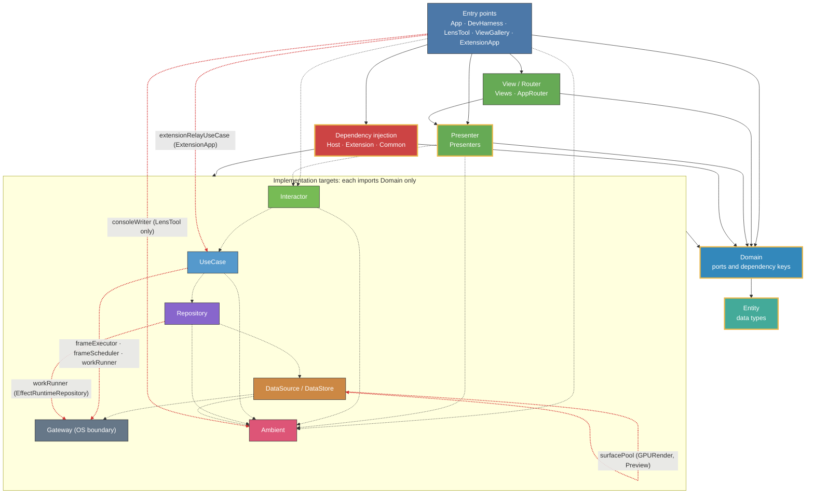

## Module Dependency Graph

Two levels, as in lyra: the **Layer Overview** draws each layer as one box and shows which way the dependencies run; the **Implementation Modules** diagrams below it draw every module, one area at a time, so each stays readable at page width. Solid edges are compile-time dependencies (`Package.swift`); dotted edges are `@Dependency` resolutions through `Domain`.

### Layer Overview

Implementation targets import `Domain` only, and the three DI targets are the only importers of implementation targets. Each lane resolves the layer right below it plus Ambient (`.claude/rules/architecture-boundaries.md` → Key-Path Allow-List), the cross-cutting ports every lane may use; a port enters Ambient only by a line of the lint's closed `AMBIENT` list (→ Ambient admission). The five red edges are the per-key exceptions of the key-path lint. Four leave their lane: the execution-context ports the frame path runs on, which a UseCase resolves; the `workRunner` of `EffectRuntimeRepository`; the `surfacePool` that `GPURenderDataSource` and `PreviewDataSource` lease surfaces through; and `extensionRelayUseCase`, which `ExtensionApp` resolves because the extension process has no Interactor lane. The fifth stays inside its lane but is narrower than it: `consoleWriter`, which the `AMBIENT` list gives to `LensTool` alone, since the command-line tool is the one process with a console to write to. The colours are lyra's, one per layer, and the diagrams below reuse them; a gold border marks the modules outside the implementation chain that other lanes compile against: `Presenters`, the DI targets, `Domain` and `Entity`.

### Implementation Modules

In each diagram but *Dependency injection*, columns are layers, and a label leaves out the layer suffix its column already names: `FrameTransport` under DataSource is `FrameTransportDataSource` (a DataStore keeps its suffix, since that column holds both, and is drawn a darker shade of the DataSource colour). A dotted edge runs from a module to the module whose live value its `@Dependency(\.key)` resolves (the key's `liveValue` registration names the type, and the type names the module); a red one is a per-key exception from the overview. A node with a dashed border is drawn in another diagram and appears only as a target. This section is generated: `scripts/architecture-diagrams/regenerate` redraws it from `Package.swift` and the resolutions under `Sources/`, and fails when a module is in no diagram or an edge is drawn twice or not at all; the text above the diagrams lives in `scripts/architecture-diagrams/section-head.md`, so edit it there. Every target also depends on `Domain`, and many modules resolve `UnifiedLog`; those edges, and swift-dependencies' `continuousClock`, are left out.
